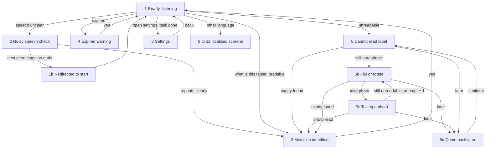

# VoAI design spec

Voice-first medicine label reader for blind and low-vision users. Web page, responsive to phone. Source of truth is the `project/` folder next to this file; every code block below is copied from it.

## 1. Package

```text
voai-export/
├── voai-spec.md        this document
├── tokens.css          colour, radius and type tokens as CSS variables
├── strings.json        interface strings per language (en, hi, te, kn, ta)
└── project/
    ├── canvas.json     board index: position and size of every screen on the canvas
    └── *.dc.html       one file per screen (HTML + inline CSS, no build step)
```

Open any `*.dc.html` in a browser to see it; screens link to each other by relative path. The `<script src="./support.js">` line and the `<x-dc>` / `<helmet>` wrappers belong to the design canvas runtime: a plain browser ignores them, and a developer can drop them. Fonts load from Google Fonts.

## 2. Pixel format and dimensions

| Item | Definition |
|---|---|
| Unit | CSS pixel (px), device independent. All sizes below are at 1×. |
| Raster export | Export at @2x (desktop) and @3x (phone). |
| Colour | sRGB, 8 bits per channel, written `#RRGGBB`. One value uses alpha: `#5B5BD666` (accent at 40%). |
| Origin | Top-left of each artboard; canvas coordinates in `canvas.json` are px from the canvas origin. |
| Layout | Flexbox. Frames are fluid: the width is the design width, the height is the height at that width. |
| Viewport tag | Every screen has `<meta name="viewport" content="width=device-width, initial-scale=1">`. Without it phones lay the page out at about 980 px. |
| Side padding | `clamp(16px, 4vw, 40px)` |
| Touch target | 56 px minimum height for buttons (landing mic 260 px); 48 px for the header Settings pill. |
| Breakpoint | Two-pane screens wrap to one column when the container is narrower than about 972 px (camera pane basis 560 px + 32 px gap + assistant basis 380 px). |
| Radius | 16 px buttons and small cards, 20 px cards, 24 px camera pane, full circle for the mic. |

### Frames

| Board | Screen | File | x | y | Width × Height |
|---|---|---|---|---|---|
| 1 · Ready, listening | desktop | `Main.dc.html` | 0 | 0 | 1280 × 970 |
| 2 · Noisy speech check | desktop | `Listening.dc.html` | 1360 | 0 | 1280 × 980 |
| 3 · Medicine identified | desktop | `Result.dc.html` | 2720 | 0 | 1280 × 1000 |
| 4 · Expired warning | desktop | `Expired.dc.html` | 0 | 1120 | 1280 × 970 |
| 5 · Can't read label | desktop | `Blur.dc.html` | 1360 | 1120 | 1280 × 970 |
| 6 · Settings | desktop | `Settings.dc.html` | 2720 | 1120 | 1280 × 970 |
| 1b · Redirected to start | desktop | `Redirect.dc.html` | 0 | 3300 | 1280 × 970 |
| 7 · How the voice layer routes | desktop | `Routing.dc.html` | 1360 | 3300 | 1280 × 1870 |
| 8a · Landing in Hindi | desktop | `Main-hi.dc.html` | 4080 | 0 | 1280 × 970 |
| 8b · Result in Hindi | desktop | `Result-hi.dc.html` | 5440 | 0 | 1280 × 980 |
| 8c · Result in Telugu | desktop | `Result-te.dc.html` | 4080 | 1100 | 1280 × 1020 |
| 8d · Result in Hindi, phone | phone | `Result-hi-m.dc.html` | 5440 | 1100 | 390 × 1150 |
| 9a · Landing in Telugu | desktop | `Main-te.dc.html` | 4080 | 2730 | 1280 × 970 |
| 10a · Landing in Kannada | desktop | `Main-kn.dc.html` | 5440 | 2730 | 1280 × 970 |
| 11a · Landing in Tamil | desktop | `Main-ta.dc.html` | 6800 | 2730 | 1280 × 970 |
| 10b · Result in Kannada | desktop | `Result-kn.dc.html` | 4080 | 3820 | 1280 × 1060 |
| 11b · Result in Tamil | desktop | `Result-ta.dc.html` | 5440 | 3820 | 1280 × 1330 |
| 9c · Result in Telugu, phone | phone | `Result-te-m.dc.html` | 6800 | 3820 | 390 × 1160 |
| 10c · Result in Kannada, phone | phone | `Result-kn-m.dc.html` | 7270 | 3820 | 390 × 1240 |
| 11c · Result in Tamil, phone | phone | `Result-ta-m.dc.html` | 7740 | 3820 | 390 × 1560 |
| Mobile 1 · Ready, listening | phone | `Main-m.dc.html` | 0 | 5650 | 390 × 1000 |
| Mobile 2 · Noisy speech check | phone | `Listening-m.dc.html` | 470 | 5650 | 390 × 1190 |
| Mobile 3 · Medicine identified | phone | `Result-m.dc.html` | 940 | 5650 | 390 × 1190 |
| Mobile 4 · Expired warning | phone | `Expired-m.dc.html` | 1410 | 5650 | 390 × 1120 |
| Mobile 5 · Can't read label | phone | `Blur-m.dc.html` | 1880 | 5650 | 390 × 1210 |
| Mobile 6 · Settings | phone | `Settings-m.dc.html` | 2350 | 5650 | 390 × 1150 |
| Mobile 1b · Redirected to start | phone | `Redirect-m.dc.html` | 2820 | 5650 | 390 × 1110 |
| Mobile 2b · Camera | phone | `Listening-cam-m.dc.html` | 470 | 7340 | 390 × 1090 |
| Mobile 3b · Camera | phone | `Result-cam-m.dc.html` | 940 | 7340 | 390 × 1070 |
| Mobile 4b · Camera | phone | `Expired-cam-m.dc.html` | 1410 | 7340 | 390 × 1080 |
| Mobile 5b · Camera | phone | `Blur-cam-m.dc.html` | 1880 | 7340 | 390 × 1070 |
| 5b · Flip or rotate | desktop | `Flip.dc.html` | 0 | 2210 | 1280 × 970 |
| 5c · Taking a photo | desktop | `Photo.dc.html` | 1360 | 2210 | 1280 × 970 |
| 5d · Come back later | desktop | `Paused.dc.html` | 2720 | 2210 | 1280 × 970 |
| Mobile 5b · Flip or rotate | phone | `Flip-m.dc.html` | 3290 | 5650 | 390 × 1210 |
| Mobile 5b · Flip or rotate, camera | phone | `Flip-cam-m.dc.html` | 2350 | 7340 | 390 × 1070 |
| Mobile 5c · Taking a photo | phone | `Photo-m.dc.html` | 2820 | 7340 | 390 × 1500 |
| Mobile 5d · Come back later | phone | `Paused-m.dc.html` | 3290 | 7340 | 390 × 1030 |

Desktop screens are 1280 wide. Phone screens are 390 wide (iPhone 14 class). Phone heights are the page height at 390 px and scroll in a real device.

## 3. Colour palette

| Token | Hex | Use |
|---|---|---|
| `--bg` | `#F4F5F9` | Page background |
| `--surface` | `#FFFFFF` | Cards, header buttons, nav bar, toggles |
| `--camera` | `#E9EAF3` | Camera pane background |
| `--ink` | `#1D1B2E` | Primary text, focus ring |
| `--muted` | `#52566B` | Secondary text, captions, labels |
| `--accent` | `#5B5BD6` | Primary actions, mic, icons, highlights |
| `--accent-soft` | `#ECECFB` | Soft highlight cards, mic halo |
| `--accent-ring` | `#D9D9F5` | Outer ring of the landing mic |
| `--accent-link` | `#3E3EA8` | Links on the routing page |
| `--border` | `#9AA0BA` | Component borders (cards, buttons) |
| `--hairline` | `#D5D8E6` | Dividers, header/nav rules, progress track |
| `--border-soft` | `#C4C8D8` | Routing-table borders |
| `--warn` | `#B45309` | Expired state: border, icon, text |
| `--warn-bg` | `#FFF4E0` | Expired state card |
| `--foil` | `#AEB3CC` | Tablet strip foil (illustration) |
| `--blister` | `#E4E6F2` | Filled blister (illustration) |
| `--toggle-border` | `#8E8E93` | Off-state toggle border |

```css
:root {
  --bg: #F4F5F9; /* Page background */
  --surface: #FFFFFF; /* Cards, header buttons, nav bar, toggles */
  --camera: #E9EAF3; /* Camera pane background */
  --ink: #1D1B2E; /* Primary text, focus ring */
  --muted: #52566B; /* Secondary text, captions, labels */
  --accent: #5B5BD6; /* Primary actions, mic, icons, highlights */
  --accent-soft: #ECECFB; /* Soft highlight cards, mic halo */
  --accent-ring: #D9D9F5; /* Outer ring of the landing mic */
  --accent-link: #3E3EA8; /* Links on the routing page */
  --border: #9AA0BA; /* Component borders (cards, buttons) */
  --hairline: #D5D8E6; /* Dividers, header/nav rules, progress track */
  --border-soft: #C4C8D8; /* Routing-table borders */
  --warn: #B45309; /* Expired state: border, icon, text */
  --warn-bg: #FFF4E0; /* Expired state card */
  --foil: #AEB3CC; /* Tablet strip foil (illustration) */
  --blister: #E4E6F2; /* Filled blister (illustration) */
  --toggle-border: #8E8E93; /* Off-state toggle border */
}
```

### Contrast (WCAG 2.x, computed)

| Text on background | Ratio | Passes AA (4.5:1) |
|---|---|---|
| `--ink` on `--bg` | 15.44:1 | yes |
| `--ink` on `--surface` | 16.82:1 | yes |
| `--muted` on `--bg` | 6.64:1 | yes |
| `--muted` on `--surface` | 7.24:1 | yes |
| `--accent` on `--surface` | 5.37:1 | yes |
| `--surface` on `--accent` | 5.37:1 | yes |
| `--accent` on `--accent-soft` | 4.59:1 | yes |
| `--accent` on `--bg` | 4.93:1 | yes |
| `--warn` on `--warn-bg` | 4.61:1 | yes |
| `--ink` on `--warn-bg` | 15.43:1 | yes |
| `--accent-link` on `--bg` | 7.84:1 | yes |
| `--ink` on `--accent-soft` | 14.38:1 | yes |

## 4. Typography

| Language | Font family stack | Google Fonts weights |
|---|---|---|
| English | `'Atkinson Hyperlegible', system-ui, sans-serif` | 400, 700 |
| Hindi | `'Noto Sans Devanagari', 'Atkinson Hyperlegible', system-ui, sans-serif` | 400, 700 |
| Telugu | `'Noto Sans Telugu', 'Atkinson Hyperlegible', system-ui, sans-serif` | 400, 700 |
| Kannada | `'Noto Sans Kannada', 'Atkinson Hyperlegible', system-ui, sans-serif` | 400, 700 |
| Tamil | `'Noto Sans Tamil', 'Atkinson Hyperlegible', system-ui, sans-serif` | 400, 700 |

Atkinson Hyperlegible is designed for low vision. Only weights 400 and 700 are used. Sizes used across all screens: 14px, 16px, 18px, 19px, 20px, 22px, 24px, 26px, 28px, 30px, 32px, 36px, 64px.

| Style | Size / line height | Weight | Notes |
|---|---|---|---|
| Wordmark | 28px | 700 | letter-spacing 0.02em; sub-label 18px / 400 / muted |
| Page title (h1) | 36px / 1.1 to 1.15 | 700 | phone Settings title 32px |
| Spoken answer | 30px / 1.3 | 700 | the main card text; expired warning 36px / 1.2 |
| Answer detail | 24px to 26px / 1.4 | 400 | supporting sentence, detail values |
| Prompt (risk question) | 28px | 700 |  |
| Body | 20px to 22px / 1.4 | 400 or 700 | buttons 20px to 26px / 700 |
| Caption | 18px | 400 | nav hint, header pills, helper text; colour `--muted` |
| Label caps | 16px (14px on the routing page) | 700 | uppercase, letter-spacing 0.04em, colour `--muted` or `--accent` |
| Landing status | 24px | 400 | `--muted` |

Indic scripts use the same sizes; allow a taller line height (about 1.4) if glyphs clip.

## 5. Icons

All icons are inline SVG, `viewBox="0 0 24 24"`, `fill="none"`, round caps and joins, stroke width 1.8 to 2.4, colour from `currentColor` or the token noted. Decorative icons carry `aria-hidden="true"`.

**mic**: Landing mic (110 px, white on `--accent`); Listening mic

```html
<svg width="110" height="110" viewBox="0 0 24 24" fill="none" stroke="#FFFFFF" stroke-width="1.8" stroke-linecap="round" stroke-linejoin="round" aria-hidden="true"><rect x="9" y="3" width="6" height="11" rx="3"/><path d="M5 11a7 7 0 0 0 14 0M12 18v3"/></svg>
```

**torch (bolt)**: Torch button, 24 px

```html
<svg width="24" height="24" viewBox="0 0 24 24" fill="none" stroke="currentColor" stroke-width="2" stroke-linecap="round" stroke-linejoin="round" aria-hidden="true"><path d="M13 2L4 14h7l-1 8 9-12h-7l1-8z"/></svg>
```

**mic-off**: Mute mic button, 24 px

```html
<svg width="24" height="24" viewBox="0 0 24 24" fill="none" stroke="currentColor" stroke-width="2" stroke-linecap="round" stroke-linejoin="round" aria-hidden="true"><rect x="9" y="3" width="6" height="11" rx="3"/><path d="M5 11a7 7 0 0 0 11.5 5.3M19 11a7 7 0 0 1-.6 2.8M12 18v3M3 3l18 18"/></svg>
```

**chevron-left**: Settings back button, 28 px

```html
<svg width="28" height="28" viewBox="0 0 24 24" fill="none" stroke="#1D1B2E" stroke-width="2.2" stroke-linecap="round" stroke-linejoin="round" aria-hidden="true"><path d="M15 5l-7 7 7 7"/></svg>
```

**warning**: Expired warning, 32 px, `--warn`

```html
<svg width="32" height="32" viewBox="0 0 24 24" fill="none" stroke="#B45309" stroke-width="2.2" stroke-linecap="round" stroke-linejoin="round" aria-hidden="true"><path d="M12 3l10 18H2L12 3z"/><path d="M12 10v5M12 18v.5"/></svg>
```

**arrow-up/down/left/right**: Can’t-read-label move guides, 56 px, `--accent`

```html
<svg width="56" height="56" viewBox="0 0 24 24" fill="none" stroke="#5B5BD6" stroke-width="2.4" stroke-linecap="round" stroke-linejoin="round" aria-hidden="true"><path d="M12 19V5M5 12l7-7 7 7"/></svg>  <!-- up; down: M12 5v14M5 12l7 7 7-7; left: M19 12H5M12 5l-7 7 7 7; right: M5 12h14M12 5l7 7-7 7 -->
```

**flip**: Flip or rotate screen, 72 px, `--accent`

```html
<svg width="72" height="72" viewBox="0 0 24 24" fill="none" stroke="#5B5BD6" stroke-width="2.2" stroke-linecap="round" stroke-linejoin="round" role="img" aria-label="Flip the strip over"><path d="M12 3v18M16 7l5 5-5 5V7zM8 7l-5 5 5 5V7z"/></svg>
```

**rotate**: Flip or rotate screen, 72 px, `--accent`

```html
<svg width="72" height="72" viewBox="0 0 24 24" fill="none" stroke="#5B5BD6" stroke-width="2.2" stroke-linecap="round" stroke-linejoin="round" role="img" aria-label="Turn the strip sideways"><path d="M21 12a9 9 0 1 1-3-6.7L21 8M21 3v5h-5"/></svg>
```

**pause**: Come back later, inside the 260 px circle, white

```html
<svg width="110" height="110" viewBox="0 0 24 24" fill="none" stroke="#FFFFFF" stroke-width="1.8" stroke-linecap="round" stroke-linejoin="round" aria-hidden="true"><rect x="6" y="5" width="4" height="14" rx="1"/><rect x="14" y="5" width="4" height="14" rx="1"/></svg>
```

Illustration (not an icon): the tablet strip is an SVG `viewBox="0 0 400 220"`, strip `rect` 340 × 160 radius 16 filled `--foil`, eight blister circles r = 22, filled `--blister` or `--border` when empty. See `Main.dc.html` family or `Result.dc.html`.

## 6. Components

| Component | Definition |
|---|---|
| Header | Row, space-between, padding `20px clamp(16px,4vw,40px)`. Wordmark left, Settings pill right (48 px tall, radius 24, 2 px `--accent` border, white fill, `--accent` text 18/700). Present on every screen. |
| Camera pane | `flex: 999 1 560px`, min height 480 (620 on phone slide 2), radius 24, 2 px `--hairline` border, `--camera` fill, strip illustration centred, chip top-left (`--surface`, radius 20, 18/700), Torch and Mute mic buttons bottom-centre. Expired state: 4 px `--warn` border. |
| Assistant card | White, 2 px `--border`, radius 20, padding 24. Caption label 16 caps, answer 28 to 30 / 700. |
| Risk card | White, 2 px `--accent` border, radius 20, padding 20 24. Question 28/700, two buttons 64 px tall. |
| Primary button | `--accent` fill, white text, 2 px `--accent` border, radius 16, 56 to 80 px tall. |
| Secondary button | White fill, `--accent` or `--ink` text, 2 px `--border` or `--accent` border. |
| Voice navigation bar | Bottom of every screen. White, 2 px `--hairline` top rule, padding 16 `clamp(16px,4vw,40px)`. Up to two 56 px buttons (`flex: 1 1 140px`) plus a centred 18 px caption naming the voice commands. |
| Countdown ring | 120 px circle, white fill, 6 px `--accent` border, numeral 64/700 `--accent`, centred over the camera pane (5c). |
| Attempt dots | 16 px circles, 8 px gap, filled `--accent` for attempts made, `--hairline` for the rest (5b). |
| Toggle | 72 × 40 pill. On: `--accent`, white knob right. Off: `--hairline` track, `--toggle-border` 2 px, white knob left. `role="img"` with label On or Off. |
| Focus ring | 4 px solid `--ink`, offset 3 px (6 px on the landing mic). |

## 7. Screens

### 1 · Ready, listening

Landing. A single round voice icon waits for audio.

| Property | Value |
|---|---|
| File | `Main.dc.html` |
| Size | 1280 × 970 px (desktop) |
| Phone file | `Main-m.dc.html` |

Layout and content:
- Header (wordmark, Settings)
- Centre: mic button 260 × 260 circle, `--accent`, ring `0 0 0 18px --accent-soft, 0 0 0 36px --bg, 0 0 0 38px --accent-ring`
- Status line 24px `--muted`: “Waiting for you to speak” (`aria-live=polite`)
- Nav bar: caption only

<details><summary>Source: Main.dc.html</summary>

```html
<!doctype html>
<html lang="en">
<head>
<meta charset="utf-8">
<meta name="viewport" content="width=device-width, initial-scale=1">
<title>VoAI landing</title>
<script src="./support.js"></script>
</head>
<body>
<x-dc>
<helmet>
<link rel="preconnect" href="https://fonts.googleapis.com">
<link href="https://fonts.googleapis.com/css2?family=Atkinson+Hyperlegible:wght@400;700&display=swap" rel="stylesheet">
<style>
body{margin:0;overflow-wrap:anywhere}
a:focus-visible{outline:4px solid #1D1B2E;outline-offset:6px}
</style>
</helmet>
<div style="min-height:960px;box-sizing:border-box;background:#F4F5F9;color:#1D1B2E;font-family:'Atkinson Hyperlegible',system-ui,sans-serif;display:flex;flex-direction:column">
  <header style="display:flex;justify-content:space-between;align-items:center;padding:20px clamp(16px,4vw,40px)">
    <div style="font-size:28px;font-weight:700;letter-spacing:0.02em">VoAI</div>
    <a href="Settings.dc.html" style="height:48px;padding:0 20px;border-radius:24px;border:2px solid #5B5BD6;color:#5B5BD6;font-size:18px;font-weight:700;display:flex;align-items:center;text-decoration:none;background:#FFFFFF">Settings</a>
  </header>

  <main style="flex:1;display:flex;flex-direction:column;align-items:center;justify-content:center;gap:40px;padding:24px">
    <a href="Listening.dc.html" aria-label="Voice assistant is waiting for you to speak" style="width:260px;height:260px;border-radius:130px;background:#5B5BD6;display:flex;align-items:center;justify-content:center;box-shadow:0 0 0 18px #ECECFB,0 0 0 36px #F4F5F9,0 0 0 38px #D9D9F5">
      <svg width="110" height="110" viewBox="0 0 24 24" fill="none" stroke="#FFFFFF" stroke-width="1.8" stroke-linecap="round" stroke-linejoin="round" aria-hidden="true"><rect x="9" y="3" width="6" height="11" rx="3"/><path d="M5 11a7 7 0 0 0 14 0M12 18v3"/></svg>
    </a>
    <div style="font-size:24px;color:#52566B" aria-live="polite">Waiting for you to speak</div>
  </main>
  <nav aria-label="Voice navigation" style="display:flex;flex-wrap:wrap;gap:12px;align-items:center;padding:16px clamp(16px,4vw,40px);border-top:2px solid #D5D8E6;background:#FFFFFF">
    <div style="flex:1 1 100%;text-align:center;font-size:18px;color:#52566B">Say what you need, for example “What is this tablet?” or “Open settings”</div>
  </nav>
</div>
</x-dc>
<script type="text/x-dc" data-dc-script data-props='{"$preview":{"width":1280,"height":970}}'>
class Component extends DCLogic {
renderVals() {
return {};
}
}
</script>
</body>
</html>

```

</details>

### 2 · Noisy speech check

Speech was unclear. VoAI checks the label, then asks the user to repeat.

| Property | Value |
|---|---|
| File | `Listening.dc.html` |
| Size | 1280 × 980 px (desktop) |
| Phone file | `Listening-m.dc.html` |

Layout and content:
- Camera pane (left) and assistant column (right)
- Heading “Not sure I heard you” 36/700
- Waveform: 9 bars 10 px wide, 28 to 84 px tall, `--accent`
- Card: “Did I hear “what is this tablet”? Say again?”
- Ordered steps 1 to 3 (check label, ask again, read label)
- Nav bar: Back, Next (to 1b), caption

<details><summary>Source: Listening.dc.html</summary>

```html
<!doctype html>
<html lang="en">
<head>
<meta charset="utf-8">
<meta name="viewport" content="width=device-width, initial-scale=1">
<title>VoAI noisy speech check</title>
<script src="./support.js"></script>
</head>
<body>
<x-dc>
<helmet>
<link rel="preconnect" href="https://fonts.googleapis.com">
<link href="https://fonts.googleapis.com/css2?family=Atkinson+Hyperlegible:wght@400;700&display=swap" rel="stylesheet">
<style>
body{margin:0;overflow-wrap:anywhere}
button{font-family:inherit;cursor:pointer}
a:focus-visible,button:focus-visible{outline:4px solid #1D1B2E;outline-offset:3px}
</style>
</helmet>
<div style="min-height:960px;box-sizing:border-box;background:#F4F5F9;color:#1D1B2E;font-family:'Atkinson Hyperlegible',system-ui,sans-serif;display:flex;flex-direction:column">
  <header style="display:flex;flex-wrap:wrap;gap:16px;align-items:center;justify-content:space-between;padding:20px clamp(16px,4vw,40px);border-bottom:2px solid #D5D8E6">
    <div style="font-size:28px;font-weight:700;letter-spacing:0.02em">VoAI <span style="font-size:18px;font-weight:400;color:#52566B">medicine label reader</span></div>
    <div style="display:flex;flex-wrap:wrap;gap:12px;align-items:center">
      <a href="Settings.dc.html" style="height:48px;padding:0 20px;border-radius:24px;border:2px solid #5B5BD6;color:#5B5BD6;font-size:18px;font-weight:700;display:flex;align-items:center;text-decoration:none;background:#FFFFFF">Settings</a>
    </div>
  </header>

  <main style="flex:1;display:flex;flex-wrap:wrap;gap:32px;padding:32px clamp(16px,4vw,40px);box-sizing:border-box;width:100%;max-width:1440px;margin:0 auto">
    <section aria-label="Camera" style="position:relative;flex:999 1 560px;min-width:0;min-height:480px;background:#E9EAF3;border:2px solid #D5D8E6;border-radius:24px;display:flex;align-items:center;justify-content:center;overflow:hidden">
      <svg viewBox="0 0 400 220" style="width:70%;max-width:520px" role="img" aria-label="Camera view of a tablet strip">
        <rect x="30" y="30" width="340" height="160" rx="16" fill="#AEB3CC"/>
        <circle cx="90" cy="80" r="22" fill="#E4E6F2"/><circle cx="160" cy="80" r="22" fill="#E4E6F2"/><circle cx="230" cy="80" r="22" fill="#E4E6F2"/><circle cx="300" cy="80" r="22" fill="#9AA0BA"/>
        <circle cx="90" cy="140" r="22" fill="#E4E6F2"/><circle cx="160" cy="140" r="22" fill="#E4E6F2"/><circle cx="230" cy="140" r="22" fill="#9AA0BA"/><circle cx="300" cy="140" r="22" fill="#9AA0BA"/>
      </svg>
      <div style="position:absolute;left:16px;top:16px;background:#FFFFFF;border-radius:20px;padding:8px 16px;font-size:18px;font-weight:700;color:#5B5BD6">Camera on</div>
      <div style="position:absolute;left:16px;right:16px;bottom:16px;display:flex;flex-wrap:wrap;gap:12px;justify-content:center">
        <button type="button" style="height:56px;padding:0 16px;border-radius:16px;border:2px solid #9AA0BA;background:#FFFFFF;color:#1D1B2E;font-size:20px;font-weight:700;display:inline-flex;align-items:center;gap:10px"><svg width="24" height="24" viewBox="0 0 24 24" fill="none" stroke="currentColor" stroke-width="2" stroke-linecap="round" stroke-linejoin="round" aria-hidden="true"><path d="M13 2L4 14h7l-1 8 9-12h-7l1-8z"/></svg>Torch</button>
        <button type="button" style="height:56px;padding:0 16px;border-radius:16px;border:2px solid #9AA0BA;background:#FFFFFF;color:#1D1B2E;font-size:20px;font-weight:700;display:inline-flex;align-items:center;gap:10px"><svg width="24" height="24" viewBox="0 0 24 24" fill="none" stroke="currentColor" stroke-width="2" stroke-linecap="round" stroke-linejoin="round" aria-hidden="true"><rect x="9" y="3" width="6" height="11" rx="3"/><path d="M5 11a7 7 0 0 0 11.5 5.3M19 11a7 7 0 0 1-.6 2.8M12 18v3M3 3l18 18"/></svg>Mute mic</button>
      </div>
    </section>

    <section aria-label="Assistant" style="flex:1 1 380px;min-width:0;display:flex;flex-direction:column;gap:20px">
      <h1 style="margin:0;font-size:36px;line-height:1.1">Not sure I heard you</h1>

      <div style="display:flex;align-items:center;justify-content:center;gap:8px;height:96px;background:#FFFFFF;border:2px solid #9AA0BA;border-radius:20px" aria-hidden="true">
        <div style="width:10px;height:30px;border-radius:5px;background:#5B5BD6"></div><div style="width:10px;height:70px;border-radius:5px;background:#5B5BD6"></div><div style="width:10px;height:46px;border-radius:5px;background:#5B5BD6"></div><div style="width:10px;height:84px;border-radius:5px;background:#5B5BD6"></div><div style="width:10px;height:54px;border-radius:5px;background:#5B5BD6"></div><div style="width:10px;height:78px;border-radius:5px;background:#5B5BD6"></div><div style="width:10px;height:36px;border-radius:5px;background:#5B5BD6"></div><div style="width:10px;height:64px;border-radius:5px;background:#5B5BD6"></div><div style="width:10px;height:28px;border-radius:5px;background:#5B5BD6"></div>
      </div>

      <div style="background:#FFFFFF;border:2px solid #9AA0BA;border-radius:20px;padding:24px;display:flex;flex-direction:column;gap:12px" aria-live="polite">
        <div style="font-size:16px;color:#52566B;letter-spacing:0.04em;text-transform:uppercase;font-weight:700">VoAI says</div>
        <div style="font-size:30px;line-height:1.3;font-weight:700">Did I hear “what is this tablet”? Say again?</div>
        <div style="font-size:20px;color:#52566B;line-height:1.4">Background noise was high. If I still can’t tell, I’ll read the label to you.</div>
      </div>

      <ol style="margin:0;padding:0;list-style:none;display:flex;flex-direction:column;gap:10px;font-size:20px">
        <li style="display:flex;gap:12px;align-items:center"><span style="width:36px;height:36px;border-radius:18px;background:#5B5BD6;color:#FFFFFF;font-weight:700;display:flex;align-items:center;justify-content:center;flex:none">1</span>Checked against text on the label</li>
        <li style="display:flex;gap:12px;align-items:center"><span style="width:36px;height:36px;border-radius:18px;background:#5B5BD6;color:#FFFFFF;font-weight:700;display:flex;align-items:center;justify-content:center;flex:none">2</span>Asking you to say it again</li>
        <li style="display:flex;gap:12px;align-items:center;color:#52566B"><span style="width:36px;height:36px;border-radius:18px;border:2px solid #9AA0BA;display:flex;align-items:center;justify-content:center;flex:none">3</span>Then read the label out loud</li>
      </ol>

      <a href="Result.dc.html" style="margin-top:auto;height:64px;border-radius:16px;border:2px solid #9AA0BA;background:#FFFFFF;color:#1D1B2E;font-size:22px;display:flex;align-items:center;justify-content:center;text-decoration:none">User says it again: continue</a>
    </section>
  </main>
  <nav aria-label="Voice navigation" style="display:flex;flex-wrap:wrap;gap:12px;align-items:center;padding:16px clamp(16px,4vw,40px);border-top:2px solid #D5D8E6;background:#FFFFFF">
    <a href="Main.dc.html" style="flex:1 1 140px;height:56px;border-radius:16px;font-size:20px;font-weight:700;display:flex;align-items:center;justify-content:center;text-decoration:none;box-sizing:border-box;border:2px solid #5B5BD6;background:#FFFFFF;color:#5B5BD6">‹ Back</a>
    <a href="Redirect.dc.html" style="flex:1 1 140px;height:56px;border-radius:16px;font-size:20px;font-weight:700;display:flex;align-items:center;justify-content:center;text-decoration:none;box-sizing:border-box;border:2px solid #5B5BD6;background:#5B5BD6;color:#FFFFFF">Next ›</a>
    <div style="flex:1 1 100%;text-align:center;font-size:18px;color:#52566B">Say “back”, or answer me. Skipping ahead brings you back to the start.</div>
  </nav>
</div>
</x-dc>
<script type="text/x-dc" data-dc-script data-props='{"$preview":{"width":1280,"height":980}}'>
class Component extends DCLogic {
renderVals() {
return {};
}
}
</script>
</body>
</html>

```

</details>

### 3 · Medicine identified

Answer to “What is this tablet?” and the risk question.

| Property | Value |
|---|---|
| File | `Result.dc.html` |
| Size | 1280 × 1000 px (desktop) |
| Phone file | `Result-m.dc.html` |

Layout and content:
- Camera pane with chip “Read from label: Dolo 650”
- Card: “Dolo 650, a fever tablet. Expires in three months. Three tablets.”
- Two detail tiles: Expiry (EXP) in `--accent-soft`, Tablets left
- Note: printed on the label, never suggests a dose
- Risk card: “Do you understand the risk?” Yes / No, repeat
- Nav bar: Back, Start over

<details><summary>Source: Result.dc.html</summary>

```html
<!doctype html>
<html lang="en">
<head>
<meta charset="utf-8">
<meta name="viewport" content="width=device-width, initial-scale=1">
<title>VoAI medicine identified</title>
<script src="./support.js"></script>
</head>
<body>
<x-dc>
<helmet>
<link rel="preconnect" href="https://fonts.googleapis.com">
<link href="https://fonts.googleapis.com/css2?family=Atkinson+Hyperlegible:wght@400;700&display=swap" rel="stylesheet">
<style>
body{margin:0;overflow-wrap:anywhere}
button{font-family:inherit;cursor:pointer}
a:focus-visible,button:focus-visible{outline:4px solid #1D1B2E;outline-offset:3px}
</style>
</helmet>
<div style="min-height:960px;box-sizing:border-box;background:#F4F5F9;color:#1D1B2E;font-family:'Atkinson Hyperlegible',system-ui,sans-serif;display:flex;flex-direction:column">
  <header style="display:flex;flex-wrap:wrap;gap:16px;align-items:center;justify-content:space-between;padding:20px clamp(16px,4vw,40px);border-bottom:2px solid #D5D8E6">
    <div style="font-size:28px;font-weight:700;letter-spacing:0.02em">VoAI <span style="font-size:18px;font-weight:400;color:#52566B">medicine label reader</span></div>
    <div style="display:flex;flex-wrap:wrap;gap:12px;align-items:center">
      <a href="Settings.dc.html" style="height:48px;padding:0 20px;border-radius:24px;border:2px solid #5B5BD6;color:#5B5BD6;font-size:18px;font-weight:700;display:flex;align-items:center;text-decoration:none;background:#FFFFFF">Settings</a>
    </div>
  </header>

  <main style="flex:1;display:flex;flex-wrap:wrap;gap:32px;padding:32px clamp(16px,4vw,40px);box-sizing:border-box;width:100%;max-width:1440px;margin:0 auto">
    <section aria-label="Camera" style="position:relative;flex:999 1 560px;min-width:0;min-height:480px;background:#E9EAF3;border:2px solid #D5D8E6;border-radius:24px;display:flex;align-items:center;justify-content:center;overflow:hidden">
      <svg viewBox="0 0 400 220" style="width:70%;max-width:520px" role="img" aria-label="Camera view of a tablet strip">
        <rect x="30" y="30" width="340" height="160" rx="16" fill="#AEB3CC"/>
        <circle cx="90" cy="80" r="22" fill="#E4E6F2"/><circle cx="160" cy="80" r="22" fill="#E4E6F2"/><circle cx="230" cy="80" r="22" fill="#E4E6F2"/><circle cx="300" cy="80" r="22" fill="#9AA0BA"/>
        <circle cx="90" cy="140" r="22" fill="#E4E6F2"/><circle cx="160" cy="140" r="22" fill="#E4E6F2"/><circle cx="230" cy="140" r="22" fill="#9AA0BA"/><circle cx="300" cy="140" r="22" fill="#9AA0BA"/>
      </svg>
      <div style="position:absolute;left:16px;top:16px;background:#FFFFFF;border-radius:20px;padding:8px 16px;font-size:18px;font-weight:700;color:#5B5BD6">Read from label: Dolo 650</div>
      <div style="position:absolute;left:16px;right:16px;bottom:16px;display:flex;flex-wrap:wrap;gap:12px;justify-content:center">
        <button type="button" style="height:56px;padding:0 16px;border-radius:16px;border:2px solid #9AA0BA;background:#FFFFFF;color:#1D1B2E;font-size:20px;font-weight:700;display:inline-flex;align-items:center;gap:10px"><svg width="24" height="24" viewBox="0 0 24 24" fill="none" stroke="currentColor" stroke-width="2" stroke-linecap="round" stroke-linejoin="round" aria-hidden="true"><path d="M13 2L4 14h7l-1 8 9-12h-7l1-8z"/></svg>Torch</button>
        <button type="button" style="height:56px;padding:0 16px;border-radius:16px;border:2px solid #9AA0BA;background:#FFFFFF;color:#1D1B2E;font-size:20px;font-weight:700;display:inline-flex;align-items:center;gap:10px"><svg width="24" height="24" viewBox="0 0 24 24" fill="none" stroke="currentColor" stroke-width="2" stroke-linecap="round" stroke-linejoin="round" aria-hidden="true"><rect x="9" y="3" width="6" height="11" rx="3"/><path d="M5 11a7 7 0 0 0 11.5 5.3M19 11a7 7 0 0 1-.6 2.8M12 18v3M3 3l18 18"/></svg>Mute mic</button>
      </div>
    </section>

    <section aria-label="Assistant" style="flex:1 1 380px;min-width:0;display:flex;flex-direction:column;gap:20px">
      <div style="font-size:20px;color:#52566B">You asked: “What is this tablet?”</div>

      <div style="background:#FFFFFF;border:2px solid #9AA0BA;border-radius:20px;padding:24px" aria-live="polite">
        <div style="font-size:30px;line-height:1.3;font-weight:700">Dolo 650, a fever tablet. Expires in three months. Three tablets.</div>
      </div>

      <dl style="margin:0;display:grid;grid-template-columns:repeat(2,minmax(0,1fr));gap:12px">
        <div style="background:#ECECFB;border:2px solid #5B5BD6;border-radius:16px;padding:14px 16px"><dt style="font-size:16px;color:#5B5BD6;font-weight:700">Expiry (EXP)</dt><dd style="margin:2px 0 0;font-size:24px">In 3 months</dd></div>
        <div style="background:#FFFFFF;border:2px solid #9AA0BA;border-radius:16px;padding:14px 16px"><dt style="font-size:16px;color:#52566B;font-weight:700">Tablets left</dt><dd style="margin:2px 0 0;font-size:24px">3</dd></div>
      </dl>
      <div style="font-size:18px;color:#52566B;line-height:1.4">Everything above is printed on the label. I never suggest a dose.</div>

      <div style="background:#FFFFFF;border:2px solid #5B5BD6;border-radius:20px;padding:20px 24px;margin-top:auto" aria-live="polite">
        <div style="font-size:28px;font-weight:700;margin-bottom:14px">Do you understand the risk?</div>
        <div style="display:flex;flex-wrap:wrap;gap:12px">
          <a href="Main.dc.html" style="flex:1 1 160px;height:64px;border-radius:16px;background:#5B5BD6;color:#FFFFFF;font-size:24px;font-weight:700;display:flex;align-items:center;justify-content:center;text-decoration:none">Yes · हाँ · ಹೌದು</a>
          <button type="button" style="flex:1 1 160px;height:64px;border-radius:16px;border:2px solid #9AA0BA;background:#FFFFFF;color:#1D1B2E;font-size:22px;font-weight:700">No, repeat</button>
        </div>
        <div style="font-size:16px;color:#52566B;margin-top:12px">Asked again once unless you say yes.</div>
      </div>
    </section>
  </main>
  <nav aria-label="Voice navigation" style="display:flex;flex-wrap:wrap;gap:12px;align-items:center;padding:16px clamp(16px,4vw,40px);border-top:2px solid #D5D8E6;background:#FFFFFF">
    <a href="Listening.dc.html" style="flex:1 1 140px;height:56px;border-radius:16px;font-size:20px;font-weight:700;display:flex;align-items:center;justify-content:center;text-decoration:none;box-sizing:border-box;border:2px solid #5B5BD6;background:#FFFFFF;color:#5B5BD6">‹ Back</a>
    <a href="Main.dc.html" style="flex:1 1 140px;height:56px;border-radius:16px;font-size:20px;font-weight:700;display:flex;align-items:center;justify-content:center;text-decoration:none;box-sizing:border-box;border:2px solid #5B5BD6;background:#5B5BD6;color:#FFFFFF">Start over</a>
    <div style="flex:1 1 100%;text-align:center;font-size:18px;color:#52566B">Say “back” or “start over”</div>
  </nav>
</div>
</x-dc>
<script type="text/x-dc" data-dc-script data-props='{"$preview":{"width":1280,"height":1000}}'>
class Component extends DCLogic {
renderVals() {
return {};
}
}
</script>
</body>
</html>

```

</details>

### 4 · Expired warning

Date next to EXP is in the past. No dose given.

| Property | Value |
|---|---|
| File | `Expired.dc.html` |
| Size | 1280 × 970 px (desktop) |
| Phone file | `Expired-m.dc.html` |

Layout and content:
- Camera pane with 4 px `--warn` border, chip “EXP 08/2026 read from label”
- Alert card `--warn-bg`, 4 px `--warn` border, warning icon, “Warning: this has expired. Please do not take it.” 36/700
- Explanation 20px `--muted`
- Risk card with Yes / No, repeat
- Nav bar: Back, Start over

<details><summary>Source: Expired.dc.html</summary>

```html
<!doctype html>
<html lang="en">
<head>
<meta charset="utf-8">
<meta name="viewport" content="width=device-width, initial-scale=1">
<title>VoAI expired warning</title>
<script src="./support.js"></script>
</head>
<body>
<x-dc>
<helmet>
<link rel="preconnect" href="https://fonts.googleapis.com">
<link href="https://fonts.googleapis.com/css2?family=Atkinson+Hyperlegible:wght@400;700&display=swap" rel="stylesheet">
<style>
body{margin:0;overflow-wrap:anywhere}
button{font-family:inherit;cursor:pointer}
a:focus-visible,button:focus-visible{outline:4px solid #1D1B2E;outline-offset:3px}
</style>
</helmet>
<div style="min-height:960px;box-sizing:border-box;background:#F4F5F9;color:#1D1B2E;font-family:'Atkinson Hyperlegible',system-ui,sans-serif;display:flex;flex-direction:column">
  <header style="display:flex;flex-wrap:wrap;gap:16px;align-items:center;justify-content:space-between;padding:20px clamp(16px,4vw,40px);border-bottom:2px solid #D5D8E6">
    <div style="font-size:28px;font-weight:700;letter-spacing:0.02em">VoAI <span style="font-size:18px;font-weight:400;color:#52566B">medicine label reader</span></div>
    <div style="display:flex;flex-wrap:wrap;gap:12px;align-items:center">
      <a href="Settings.dc.html" style="height:48px;padding:0 20px;border-radius:24px;border:2px solid #5B5BD6;color:#5B5BD6;font-size:18px;font-weight:700;display:flex;align-items:center;text-decoration:none;background:#FFFFFF">Settings</a>
    </div>
  </header>

  <main style="flex:1;display:flex;flex-wrap:wrap;gap:32px;padding:32px clamp(16px,4vw,40px);box-sizing:border-box;width:100%;max-width:1440px;margin:0 auto">
    <section aria-label="Camera" style="position:relative;flex:999 1 560px;min-width:0;min-height:480px;background:#E9EAF3;border:4px solid #B45309;border-radius:24px;display:flex;align-items:center;justify-content:center;overflow:hidden">
      <svg viewBox="0 0 400 220" style="width:70%;max-width:520px" role="img" aria-label="Camera view of a tablet strip">
        <rect x="30" y="30" width="340" height="160" rx="16" fill="#AEB3CC"/>
        <circle cx="90" cy="80" r="22" fill="#E4E6F2"/><circle cx="160" cy="80" r="22" fill="#E4E6F2"/><circle cx="230" cy="80" r="22" fill="#E4E6F2"/><circle cx="300" cy="80" r="22" fill="#9AA0BA"/>
        <circle cx="90" cy="140" r="22" fill="#E4E6F2"/><circle cx="160" cy="140" r="22" fill="#E4E6F2"/><circle cx="230" cy="140" r="22" fill="#9AA0BA"/><circle cx="300" cy="140" r="22" fill="#9AA0BA"/>
      </svg>
      <div style="position:absolute;left:16px;top:16px;background:#FFFFFF;border-radius:20px;padding:8px 16px;font-size:18px;font-weight:700;color:#B45309">EXP 08/2026 read from label</div>
      <div style="position:absolute;left:16px;right:16px;bottom:16px;display:flex;flex-wrap:wrap;gap:12px;justify-content:center">
        <button type="button" style="height:56px;padding:0 16px;border-radius:16px;border:2px solid #9AA0BA;background:#FFFFFF;color:#1D1B2E;font-size:20px;font-weight:700;display:inline-flex;align-items:center;gap:10px"><svg width="24" height="24" viewBox="0 0 24 24" fill="none" stroke="currentColor" stroke-width="2" stroke-linecap="round" stroke-linejoin="round" aria-hidden="true"><path d="M13 2L4 14h7l-1 8 9-12h-7l1-8z"/></svg>Torch</button>
        <button type="button" style="height:56px;padding:0 16px;border-radius:16px;border:2px solid #9AA0BA;background:#FFFFFF;color:#1D1B2E;font-size:20px;font-weight:700;display:inline-flex;align-items:center;gap:10px"><svg width="24" height="24" viewBox="0 0 24 24" fill="none" stroke="currentColor" stroke-width="2" stroke-linecap="round" stroke-linejoin="round" aria-hidden="true"><rect x="9" y="3" width="6" height="11" rx="3"/><path d="M5 11a7 7 0 0 0 11.5 5.3M19 11a7 7 0 0 1-.6 2.8M12 18v3M3 3l18 18"/></svg>Mute mic</button>
      </div>
    </section>

    <section aria-label="Assistant" style="flex:1 1 380px;min-width:0;display:flex;flex-direction:column;gap:20px">
      <div style="background:#FFF4E0;border:4px solid #B45309;border-radius:20px;padding:24px;display:flex;flex-direction:column;gap:14px" role="alert">
        <div style="display:flex;align-items:center;gap:12px;color:#B45309;font-size:20px;font-weight:700;letter-spacing:0.04em;text-transform:uppercase">
          <svg width="32" height="32" viewBox="0 0 24 24" fill="none" stroke="#B45309" stroke-width="2.2" stroke-linecap="round" stroke-linejoin="round" aria-hidden="true"><path d="M12 3l10 18H2L12 3z"/><path d="M12 10v5M12 18v.5"/></svg>
          Expired
        </div>
        <div style="font-size:36px;line-height:1.2;font-weight:700">Warning: this has expired. Please do not take it.</div>
      </div>

      <div style="font-size:20px;color:#52566B;line-height:1.4">No dose is given for an expired medicine. I only read the date printed next to EXP and never guess one.</div>

      <div style="background:#FFFFFF;border:2px solid #5B5BD6;border-radius:20px;padding:20px 24px;margin-top:auto" aria-live="polite">
        <div style="font-size:28px;font-weight:700;margin-bottom:14px">Do you understand the risk?</div>
        <div style="display:flex;flex-wrap:wrap;gap:12px">
          <a href="Main.dc.html" style="flex:1 1 160px;height:64px;border-radius:16px;background:#5B5BD6;color:#FFFFFF;font-size:24px;font-weight:700;display:flex;align-items:center;justify-content:center;text-decoration:none">Yes · हाँ · అవును</a>
          <button type="button" style="flex:1 1 160px;height:64px;border-radius:16px;border:2px solid #9AA0BA;background:#FFFFFF;color:#1D1B2E;font-size:22px;font-weight:700">No, repeat</button>
        </div>
        <div style="font-size:16px;color:#52566B;margin-top:12px">Repeated once unless you say yes: Yes, Haan, Howdu, Avunu, Aama.</div>
      </div>
    </section>
  </main>
  <nav aria-label="Voice navigation" style="display:flex;flex-wrap:wrap;gap:12px;align-items:center;padding:16px clamp(16px,4vw,40px);border-top:2px solid #D5D8E6;background:#FFFFFF">
    <a href="Listening.dc.html" style="flex:1 1 140px;height:56px;border-radius:16px;font-size:20px;font-weight:700;display:flex;align-items:center;justify-content:center;text-decoration:none;box-sizing:border-box;border:2px solid #5B5BD6;background:#FFFFFF;color:#5B5BD6">‹ Back</a>
    <a href="Main.dc.html" style="flex:1 1 140px;height:56px;border-radius:16px;font-size:20px;font-weight:700;display:flex;align-items:center;justify-content:center;text-decoration:none;box-sizing:border-box;border:2px solid #5B5BD6;background:#5B5BD6;color:#FFFFFF">Start over</a>
    <div style="flex:1 1 100%;text-align:center;font-size:18px;color:#52566B">Say “back” or “start over”</div>
  </nav>
</div>
</x-dc>
<script type="text/x-dc" data-dc-script data-props='{"$preview":{"width":1280,"height":970}}'>
class Component extends DCLogic {
renderVals() {
return {};
}
}
</script>
</body>
</html>

```

</details>

### 5 · Can’t read label

Name or expiry unreadable. Silent clean-up first, then guidance.

| Property | Value |
|---|---|
| File | `Blur.dc.html` |
| Size | 1280 × 970 px (desktop) |
| Phone file | `Blur-m.dc.html` |

Layout and content:
- Camera pane, strip blurred 5 px, four 56 px arrows at the edges, chip “Cleaning up frames · 5 s”
- Heading “I can’t read this yet”
- Card: what VoAI can read, then “Move the medicine up, down, left or right so I can see the expiry date.”
- Progress: sharpest 5 frames merged, enlarged 2×
- Buttons: Expiry found, continue (to 3) and Still can’t read: next try (to 5b)
- Nav bar: Back, Start over

<details><summary>Source: Blur.dc.html</summary>

```html
<!doctype html>
<html lang="en">
<head>
<meta charset="utf-8">
<meta name="viewport" content="width=device-width, initial-scale=1">
<title>VoAI can't read label</title>
<script src="./support.js"></script>
</head>
<body>
<x-dc>
<helmet>
<link rel="preconnect" href="https://fonts.googleapis.com">
<link href="https://fonts.googleapis.com/css2?family=Atkinson+Hyperlegible:wght@400;700&display=swap" rel="stylesheet">
<style>
body{margin:0;overflow-wrap:anywhere}
button{font-family:inherit;cursor:pointer}
a:focus-visible,button:focus-visible{outline:4px solid #1D1B2E;outline-offset:3px}
</style>
</helmet>
<div style="min-height:960px;box-sizing:border-box;background:#F4F5F9;color:#1D1B2E;font-family:'Atkinson Hyperlegible',system-ui,sans-serif;display:flex;flex-direction:column">
  <header style="display:flex;flex-wrap:wrap;gap:16px;align-items:center;justify-content:space-between;padding:20px clamp(16px,4vw,40px);border-bottom:2px solid #D5D8E6">
    <div style="font-size:28px;font-weight:700;letter-spacing:0.02em">VoAI <span style="font-size:18px;font-weight:400;color:#52566B">medicine label reader</span></div>
    <div style="display:flex;flex-wrap:wrap;gap:12px;align-items:center">
      <a href="Settings.dc.html" style="height:48px;padding:0 20px;border-radius:24px;border:2px solid #5B5BD6;color:#5B5BD6;font-size:18px;font-weight:700;display:flex;align-items:center;text-decoration:none;background:#FFFFFF">Settings</a>
    </div>
  </header>

  <main style="flex:1;display:flex;flex-wrap:wrap;gap:32px;padding:32px clamp(16px,4vw,40px);box-sizing:border-box;width:100%;max-width:1440px;margin:0 auto">
    <section aria-label="Camera" style="position:relative;flex:999 1 560px;min-width:0;min-height:480px;background:#E9EAF3;border:2px solid #D5D8E6;border-radius:24px;display:flex;align-items:center;justify-content:center;overflow:hidden">
      <svg viewBox="0 0 400 220" style="width:70%;max-width:520px;filter:blur(5px)" role="img" aria-label="Blurry camera view of a tablet strip">
        <rect x="30" y="30" width="340" height="160" rx="16" fill="#AEB3CC"/>
        <circle cx="90" cy="80" r="22" fill="#E4E6F2"/><circle cx="160" cy="80" r="22" fill="#E4E6F2"/><circle cx="230" cy="80" r="22" fill="#E4E6F2"/><circle cx="300" cy="80" r="22" fill="#9AA0BA"/>
        <circle cx="90" cy="140" r="22" fill="#E4E6F2"/><circle cx="160" cy="140" r="22" fill="#E4E6F2"/><circle cx="230" cy="140" r="22" fill="#9AA0BA"/><circle cx="300" cy="140" r="22" fill="#9AA0BA"/>
      </svg>
      <svg width="56" height="56" viewBox="0 0 24 24" fill="none" stroke="#5B5BD6" stroke-width="2.4" stroke-linecap="round" stroke-linejoin="round" aria-hidden="true" style="position:absolute;top:56px;left:50%;margin-left:-28px"><path d="M12 19V5M5 12l7-7 7 7"/></svg>
      <svg width="56" height="56" viewBox="0 0 24 24" fill="none" stroke="#5B5BD6" stroke-width="2.4" stroke-linecap="round" stroke-linejoin="round" aria-hidden="true" style="position:absolute;bottom:120px;left:50%;margin-left:-28px"><path d="M12 5v14M5 12l7 7 7-7"/></svg>
      <svg width="56" height="56" viewBox="0 0 24 24" fill="none" stroke="#5B5BD6" stroke-width="2.4" stroke-linecap="round" stroke-linejoin="round" aria-hidden="true" style="position:absolute;left:16px;top:50%;margin-top:-28px"><path d="M19 12H5M12 5l-7 7 7 7"/></svg>
      <svg width="56" height="56" viewBox="0 0 24 24" fill="none" stroke="#5B5BD6" stroke-width="2.4" stroke-linecap="round" stroke-linejoin="round" aria-hidden="true" style="position:absolute;right:16px;top:50%;margin-top:-28px"><path d="M5 12h14M12 5l7 7-7 7"/></svg>
      <div style="position:absolute;left:16px;top:16px;background:#FFFFFF;border-radius:20px;padding:8px 16px;font-size:18px;font-weight:700;color:#5B5BD6">Cleaning up frames · 5 s</div>
      <div style="position:absolute;left:16px;right:16px;bottom:16px;display:flex;flex-wrap:wrap;gap:12px;justify-content:center">
        <button type="button" style="height:56px;padding:0 16px;border-radius:16px;border:2px solid #9AA0BA;background:#FFFFFF;color:#1D1B2E;font-size:20px;font-weight:700;display:inline-flex;align-items:center;gap:10px"><svg width="24" height="24" viewBox="0 0 24 24" fill="none" stroke="currentColor" stroke-width="2" stroke-linecap="round" stroke-linejoin="round" aria-hidden="true"><path d="M13 2L4 14h7l-1 8 9-12h-7l1-8z"/></svg>Torch</button>
        <button type="button" style="height:56px;padding:0 16px;border-radius:16px;border:2px solid #9AA0BA;background:#FFFFFF;color:#1D1B2E;font-size:20px;font-weight:700;display:inline-flex;align-items:center;gap:10px"><svg width="24" height="24" viewBox="0 0 24 24" fill="none" stroke="currentColor" stroke-width="2" stroke-linecap="round" stroke-linejoin="round" aria-hidden="true"><rect x="9" y="3" width="6" height="11" rx="3"/><path d="M5 11a7 7 0 0 0 11.5 5.3M19 11a7 7 0 0 1-.6 2.8M12 18v3M3 3l18 18"/></svg>Mute mic</button>
      </div>
    </section>

    <section aria-label="Assistant" style="flex:1 1 380px;min-width:0;display:flex;flex-direction:column;gap:20px">
      <h1 style="margin:0;font-size:36px;line-height:1.1">I can’t read this yet</h1>

      <div style="background:#FFFFFF;border:2px solid #9AA0BA;border-radius:20px;padding:24px;display:flex;flex-direction:column;gap:16px" aria-live="polite">
        <div style="font-size:16px;color:#52566B;letter-spacing:0.04em;text-transform:uppercase;font-weight:700">I can read</div>
        <div style="font-size:26px;line-height:1.3">“Dolo” and part of a number. The expiry date is not readable.</div>
        <div style="font-size:30px;line-height:1.3;font-weight:700">I can’t read this. Move the medicine up, down, left or right so I can see the expiry date.</div>
      </div>

      <div style="background:#FFFFFF;border:2px solid #9AA0BA;border-radius:16px;padding:16px 20px">
        <div style="font-size:16px;color:#52566B;font-weight:700;margin-bottom:8px">Silent clean-up, no questions asked first</div>
        <div style="height:12px;border-radius:6px;background:#D5D8E6" aria-hidden="true"><div style="width:60%;height:12px;border-radius:6px;background:#5B5BD6"></div></div>
        <div style="font-size:18px;color:#52566B;margin-top:8px">Sharpest 5 frames merged, sharpened, enlarged 2×.</div>
      </div>

      <div style="margin-top:auto;display:flex;flex-wrap:wrap;gap:12px"><a href="Result.dc.html" style="flex:1 1 180px;height:64px;border-radius:16px;font-size:22px;display:flex;align-items:center;justify-content:center;text-decoration:none;box-sizing:border-box;border:2px solid #9AA0BA;background:#FFFFFF;color:#1D1B2E">Expiry found: continue</a><a href="Flip.dc.html" style="flex:1 1 180px;height:64px;border-radius:16px;font-size:22px;display:flex;align-items:center;justify-content:center;text-decoration:none;box-sizing:border-box;border:2px solid #5B5BD6;background:#5B5BD6;color:#FFFFFF;font-weight:700">Still can’t read: next try</a></div>
    </section>
  </main>
  <nav aria-label="Voice navigation" style="display:flex;flex-wrap:wrap;gap:12px;align-items:center;padding:16px clamp(16px,4vw,40px);border-top:2px solid #D5D8E6;background:#FFFFFF">
    <a href="Listening.dc.html" style="flex:1 1 140px;height:56px;border-radius:16px;font-size:20px;font-weight:700;display:flex;align-items:center;justify-content:center;text-decoration:none;box-sizing:border-box;border:2px solid #5B5BD6;background:#FFFFFF;color:#5B5BD6">‹ Back</a>
    <a href="Main.dc.html" style="flex:1 1 140px;height:56px;border-radius:16px;font-size:20px;font-weight:700;display:flex;align-items:center;justify-content:center;text-decoration:none;box-sizing:border-box;border:2px solid #5B5BD6;background:#5B5BD6;color:#FFFFFF">Start over</a>
    <div style="flex:1 1 100%;text-align:center;font-size:18px;color:#52566B">Say “back” or “start over”</div>
  </nav>
</div>
</x-dc>
<script type="text/x-dc" data-dc-script data-props='{"$preview":{"width":1280,"height":970}}'>
class Component extends DCLogic {
renderVals() {
return {};
}
}
</script>
</body>
</html>

```

</details>

### 6 · Settings

Speed, privacy, torch. No language setting: language follows speech.

| Property | Value |
|---|---|
| File | `Settings.dc.html` |
| Size | 1280 × 970 px (desktop) |
| Phone file | `Settings-m.dc.html` |

Layout and content:
- Header with back chevron button 56 × 56 and title “Settings” 32/700
- Card: speaking speed with − / + 64 px buttons and track
- Card: Hear a sample
- Card: Cloud help (off), Always listening (on), Torch on at start (off)
- Nav bar: Back

<details><summary>Source: Settings.dc.html</summary>

```html
<!doctype html>
<html lang="en">
<head>
<meta charset="utf-8">
<meta name="viewport" content="width=device-width, initial-scale=1">
<title>VoAI settings</title>
<script src="./support.js"></script>
</head>
<body>
<x-dc>
<helmet>
<link rel="preconnect" href="https://fonts.googleapis.com">
<link href="https://fonts.googleapis.com/css2?family=Atkinson+Hyperlegible:wght@400;700&display=swap" rel="stylesheet">
<style>
body{margin:0;overflow-wrap:anywhere}
button{font-family:inherit;cursor:pointer}
a:focus-visible,button:focus-visible{outline:4px solid #1D1B2E;outline-offset:3px}
</style>
</helmet>
<div style="min-height:960px;box-sizing:border-box;background:#F4F5F9;color:#1D1B2E;font-family:'Atkinson Hyperlegible',system-ui,sans-serif;display:flex;flex-direction:column">
  <header style="display:flex;flex-wrap:wrap;gap:16px;align-items:center;justify-content:space-between;padding:20px clamp(16px,4vw,40px);border-bottom:2px solid #D5D8E6">
    <div style="display:flex;align-items:center;gap:16px">
      <a href="Main.dc.html" aria-label="Back to the camera" style="width:56px;height:56px;border-radius:28px;border:2px solid #9AA0BA;background:#FFFFFF;display:flex;align-items:center;justify-content:center">
        <svg width="28" height="28" viewBox="0 0 24 24" fill="none" stroke="#1D1B2E" stroke-width="2.2" stroke-linecap="round" stroke-linejoin="round" aria-hidden="true"><path d="M15 5l-7 7 7 7"/></svg>
      </a>
      <h1 style="margin:0;font-size:32px">Settings</h1>
    </div>
  </header>

  <main style="flex:1;display:flex;flex-wrap:wrap;gap:32px;padding:32px clamp(16px,4vw,40px);box-sizing:border-box;width:100%;max-width:1200px;margin:0 auto;align-content:flex-start">

    <section aria-label="Voice" style="flex:1 1 440px;min-width:0;background:#FFFFFF;border:2px solid #9AA0BA;border-radius:20px;padding:24px;display:flex;flex-direction:column;gap:16px">
      <div style="display:flex;justify-content:space-between;align-items:baseline"><div style="font-size:26px;font-weight:700">Speaking speed</div><div style="font-size:24px;color:#5B5BD6;font-weight:700">1.0×</div></div>
      <div style="display:flex;align-items:center;gap:12px">
        <button type="button" aria-label="Slower" style="width:64px;height:64px;border-radius:16px;border:2px solid #9AA0BA;background:#FFFFFF;color:#1D1B2E;font-size:32px">−</button>
        <div style="flex:1;height:12px;border-radius:6px;background:#D5D8E6" aria-hidden="true"><div style="width:50%;height:12px;border-radius:6px;background:#5B5BD6"></div></div>
        <button type="button" aria-label="Faster" style="width:64px;height:64px;border-radius:16px;border:2px solid #9AA0BA;background:#FFFFFF;color:#1D1B2E;font-size:32px">+</button>
      </div>
      <button type="button" style="height:64px;border-radius:16px;border:2px solid #5B5BD6;background:#FFFFFF;color:#5B5BD6;font-size:22px;font-weight:700">Hear a sample</button>
    </section>

    <section aria-label="Privacy" style="flex:1 1 100%;background:#FFFFFF;border:2px solid #9AA0BA;border-radius:20px;padding:8px 24px;display:flex;flex-direction:column">
      <div style="display:flex;justify-content:space-between;align-items:center;gap:16px;min-height:96px;border-bottom:1px solid #D5D8E6">
        <div><div style="font-size:24px;font-weight:700">Cloud help</div><div style="font-size:18px;color:#52566B;line-height:1.4">Off by default. When on, only used if on-device speech recognition fails and to describe your surroundings. Everything else stays on this device.</div></div>
        <div style="width:72px;height:40px;border-radius:20px;background:#D5D8E6;border:2px solid #8E8E93;box-sizing:border-box;position:relative;flex:none" role="img" aria-label="Off"><div style="position:absolute;left:2px;top:2px;width:32px;height:32px;border-radius:16px;background:#FFFFFF"></div></div>
      </div>
      <div style="display:flex;justify-content:space-between;align-items:center;gap:16px;min-height:80px;border-bottom:1px solid #D5D8E6">
        <div><div style="font-size:24px;font-weight:700">Always listening</div><div style="font-size:18px;color:#52566B">Mic stays on while this page is open. Use Mute mic on the camera screen to pause.</div></div>
        <div style="width:72px;height:40px;border-radius:20px;background:#5B5BD6;position:relative;flex:none" role="img" aria-label="On"><div style="position:absolute;right:4px;top:4px;width:32px;height:32px;border-radius:16px;background:#FFFFFF"></div></div>
      </div>
      <div style="display:flex;justify-content:space-between;align-items:center;gap:16px;min-height:80px">
        <div><div style="font-size:24px;font-weight:700">Torch on at start</div><div style="font-size:18px;color:#52566B">Helps with glare and dim rooms.</div></div>
        <div style="width:72px;height:40px;border-radius:20px;background:#D5D8E6;border:2px solid #8E8E93;box-sizing:border-box;position:relative;flex:none" role="img" aria-label="Off"><div style="position:absolute;left:2px;top:2px;width:32px;height:32px;border-radius:16px;background:#FFFFFF"></div></div>
      </div>
    </section>
  </main>
  <nav aria-label="Voice navigation" style="display:flex;flex-wrap:wrap;gap:12px;align-items:center;padding:16px clamp(16px,4vw,40px);border-top:2px solid #D5D8E6;background:#FFFFFF">
    <a href="Main.dc.html" style="flex:1 1 140px;height:56px;border-radius:16px;font-size:20px;font-weight:700;display:flex;align-items:center;justify-content:center;text-decoration:none;box-sizing:border-box;border:2px solid #5B5BD6;background:#FFFFFF;color:#5B5BD6">‹ Back</a>
    <div style="flex:1 1 100%;text-align:center;font-size:18px;color:#52566B">Say “back” to return</div>
  </nav>
</div>
</x-dc>
<script type="text/x-dc" data-dc-script data-props='{"$preview":{"width":1280,"height":970}}'>
class Component extends DCLogic {
renderVals() {
return {};
}
}
</script>
</body>
</html>

```

</details>

### 1b · Redirected to start

Shown when the user skips ahead before finishing a task.

| Property | Value |
|---|---|
| File | `Redirect.dc.html` |
| Size | 1280 × 970 px (desktop) |
| Phone file | `Redirect-m.dc.html` |

Layout and content:
- Landing layout plus card `--accent-soft`, 2 px `--accent`: “Let’s finish this first.” / “Ask about your medicine, for example “What is this tablet?””

<details><summary>Source: Redirect.dc.html</summary>

```html
<!doctype html>
<html lang="en">
<head>
<meta charset="utf-8">
<meta name="viewport" content="width=device-width, initial-scale=1">
<title>VoAI redirected to start</title>
<script src="./support.js"></script>
</head>
<body>
<x-dc>
<helmet>
<link rel="preconnect" href="https://fonts.googleapis.com">
<link href="https://fonts.googleapis.com/css2?family=Atkinson+Hyperlegible:wght@400;700&display=swap" rel="stylesheet">
<style>
body{margin:0;overflow-wrap:anywhere}
a:focus-visible{outline:4px solid #1D1B2E;outline-offset:6px}
</style>
</helmet>
<div style="min-height:960px;box-sizing:border-box;background:#F4F5F9;color:#1D1B2E;font-family:'Atkinson Hyperlegible',system-ui,sans-serif;display:flex;flex-direction:column">
  <header style="display:flex;justify-content:space-between;align-items:center;padding:20px clamp(16px,4vw,40px)">
    <div style="font-size:28px;font-weight:700;letter-spacing:0.02em">VoAI</div>
    <a href="Settings.dc.html" style="height:48px;padding:0 20px;border-radius:24px;border:2px solid #5B5BD6;color:#5B5BD6;font-size:18px;font-weight:700;display:flex;align-items:center;text-decoration:none;background:#FFFFFF">Settings</a>
  </header>

  <main style="flex:1;display:flex;flex-direction:column;align-items:center;justify-content:center;gap:40px;padding:24px">
    <div role="status" style="max-width:560px;background:#ECECFB;border:2px solid #5B5BD6;border-radius:20px;padding:20px 24px;text-align:center"><div style="font-size:26px;font-weight:700;line-height:1.3">Let’s finish this first.</div><div style="font-size:22px;margin-top:8px;color:#52566B;line-height:1.4">Ask about your medicine, for example “What is this tablet?”</div></div>
    <a href="Listening.dc.html" aria-label="Voice assistant is waiting for you to speak" style="width:260px;height:260px;border-radius:130px;background:#5B5BD6;display:flex;align-items:center;justify-content:center;box-shadow:0 0 0 18px #ECECFB,0 0 0 36px #F4F5F9,0 0 0 38px #D9D9F5">
      <svg width="110" height="110" viewBox="0 0 24 24" fill="none" stroke="#FFFFFF" stroke-width="1.8" stroke-linecap="round" stroke-linejoin="round" aria-hidden="true"><rect x="9" y="3" width="6" height="11" rx="3"/><path d="M5 11a7 7 0 0 0 14 0M12 18v3"/></svg>
    </a>
    <div style="font-size:24px;color:#52566B" aria-live="polite">Waiting for you to speak</div>
  </main>
  <nav aria-label="Voice navigation" style="display:flex;flex-wrap:wrap;gap:12px;align-items:center;padding:16px clamp(16px,4vw,40px);border-top:2px solid #D5D8E6;background:#FFFFFF">
    <div style="flex:1 1 100%;text-align:center;font-size:18px;color:#52566B">Say what you need, for example “What is this tablet?” or “Open settings”</div>
  </nav>
</div>
</x-dc>
<script type="text/x-dc" data-dc-script data-props='{"$preview":{"width":1280,"height":970}}'>
class Component extends DCLogic {
renderVals() {
return {};
}
}
</script>
</body>
</html>

```

</details>

### 7 · How the voice layer routes

Rules page: what the user says or shows, what VoAI does, which screen opens.

| Property | Value |
|---|---|
| File | `Routing.dc.html` |
| Size | 1280 × 1870 px (desktop) |
| Phone file | none |

Layout and content:
- Title 36/700, gate card, 3-column rows, one per rule

<details><summary>Source: Routing.dc.html</summary>

```html
<!doctype html>
<html lang="en">
<head>
<meta charset="utf-8">
<meta name="viewport" content="width=device-width, initial-scale=1">
<title>VoAI voice routing</title>
<script src="./support.js"></script>
</head>
<body>
<x-dc>
<helmet>
<link rel="preconnect" href="https://fonts.googleapis.com">
<link href="https://fonts.googleapis.com/css2?family=Atkinson+Hyperlegible:wght@400;700&display=swap" rel="stylesheet">
<style>
body{margin:0;overflow-wrap:anywhere}
a{color:#3E3EA8}
a:focus-visible{outline:4px solid #1D1B2E;outline-offset:3px}
</style>
</helmet>
<div style="min-height:1100px;box-sizing:border-box;background:#F4F5F9;color:#1D1B2E;font-family:'Atkinson Hyperlegible',system-ui,sans-serif;padding:40px clamp(16px,4vw,48px);display:flex;flex-direction:column;gap:24px">
  <div style="max-width:1100px;width:100%;margin:0 auto;display:flex;flex-direction:column;gap:24px">
    <div>
      <h1 style="margin:0;font-size:36px;line-height:1.15">How VoAI picks the next screen</h1>
      <p style="margin:10px 0 0;font-size:20px;line-height:1.45;color:#52566B">The voice layer, not a button, decides where the user goes. The screen only follows what was said and what the camera could read.</p>
    </div>

    <div style="background:#ECECFB;border:2px solid #5B5BD6;border-radius:20px;padding:20px 24px;font-size:20px;line-height:1.45">
      <b>Gate:</b> “back”, “next” and “settings” are accepted only when the current task is finished. If it isn’t, VoAI says why and returns to the start, then waits for the user’s question.
    </div>

    <div style="display:flex;flex-direction:column;gap:12px">
      <div style="display:grid;grid-template-columns:repeat(auto-fit,minmax(220px,1fr));gap:12px;background:#FFFFFF;border:2px solid #C4C8D8;border-radius:16px;padding:16px 20px;font-size:19px;line-height:1.4">
        <div><span style="display:block;font-size:14px;font-weight:700;letter-spacing:0.04em;text-transform:uppercase;color:#52566B;margin-bottom:4px">User says or shows</span>Nothing yet</div><div><span style="display:block;font-size:14px;font-weight:700;letter-spacing:0.04em;text-transform:uppercase;color:#52566B;margin-bottom:4px">VoAI does</span>Keeps listening, camera on</div><div><span style="display:block;font-size:14px;font-weight:700;letter-spacing:0.04em;text-transform:uppercase;color:#52566B;margin-bottom:4px">Screen</span><a href="Main.dc.html">1 · Ready, listening</a></div>
      </div>
      <div style="display:grid;grid-template-columns:repeat(auto-fit,minmax(220px,1fr));gap:12px;background:#FFFFFF;border:2px solid #C4C8D8;border-radius:16px;padding:16px 20px;font-size:19px;line-height:1.4">
        <div><span style="display:block;font-size:14px;font-weight:700;letter-spacing:0.04em;text-transform:uppercase;color:#52566B;margin-bottom:4px">User says or shows</span>Speech is noisy or unclear</div><div><span style="display:block;font-size:14px;font-weight:700;letter-spacing:0.04em;text-transform:uppercase;color:#52566B;margin-bottom:4px">VoAI does</span>Checks against the label, asks “Did I hear X? Say again?”</div><div><span style="display:block;font-size:14px;font-weight:700;letter-spacing:0.04em;text-transform:uppercase;color:#52566B;margin-bottom:4px">Screen</span><a href="Listening.dc.html">2 · Noisy speech check</a></div>
      </div>
      <div style="display:grid;grid-template-columns:repeat(auto-fit,minmax(220px,1fr));gap:12px;background:#FFFFFF;border:2px solid #C4C8D8;border-radius:16px;padding:16px 20px;font-size:19px;line-height:1.4">
        <div><span style="display:block;font-size:14px;font-weight:700;letter-spacing:0.04em;text-transform:uppercase;color:#52566B;margin-bottom:4px">User says or shows</span>“What is this tablet?” and the label is readable</div><div><span style="display:block;font-size:14px;font-weight:700;letter-spacing:0.04em;text-transform:uppercase;color:#52566B;margin-bottom:4px">VoAI does</span>Answers danger first, then asks “Do you understand the risk?”</div><div><span style="display:block;font-size:14px;font-weight:700;letter-spacing:0.04em;text-transform:uppercase;color:#52566B;margin-bottom:4px">Screen</span><a href="Result.dc.html">3 · Medicine identified</a></div>
      </div>
      <div style="display:grid;grid-template-columns:repeat(auto-fit,minmax(220px,1fr));gap:12px;background:#FFFFFF;border:2px solid #C4C8D8;border-radius:16px;padding:16px 20px;font-size:19px;line-height:1.4">
        <div><span style="display:block;font-size:14px;font-weight:700;letter-spacing:0.04em;text-transform:uppercase;color:#52566B;margin-bottom:4px">User says or shows</span>Same question, date next to EXP is in the past</div><div><span style="display:block;font-size:14px;font-weight:700;letter-spacing:0.04em;text-transform:uppercase;color:#52566B;margin-bottom:4px">VoAI does</span>Warns “do not take it”, gives no dose</div><div><span style="display:block;font-size:14px;font-weight:700;letter-spacing:0.04em;text-transform:uppercase;color:#52566B;margin-bottom:4px">Screen</span><a href="Expired.dc.html">4 · Expired warning</a></div>
      </div>
      <div style="display:grid;grid-template-columns:repeat(auto-fit,minmax(220px,1fr));gap:12px;background:#FFFFFF;border:2px solid #C4C8D8;border-radius:16px;padding:16px 20px;font-size:19px;line-height:1.4">
        <div><span style="display:block;font-size:14px;font-weight:700;letter-spacing:0.04em;text-transform:uppercase;color:#52566B;margin-bottom:4px">User says or shows</span>Same question, name or expiry unreadable</div><div><span style="display:block;font-size:14px;font-weight:700;letter-spacing:0.04em;text-transform:uppercase;color:#52566B;margin-bottom:4px">VoAI does</span>Cleans frames silently, then says what it can read and how to move the pack</div><div><span style="display:block;font-size:14px;font-weight:700;letter-spacing:0.04em;text-transform:uppercase;color:#52566B;margin-bottom:4px">Screen</span><a href="Blur.dc.html">5 · Can’t read label</a></div>
      </div>
      <div style="display:grid;grid-template-columns:repeat(auto-fit,minmax(220px,1fr));gap:12px;background:#FFFFFF;border:2px solid #C4C8D8;border-radius:16px;padding:16px 20px;font-size:19px;line-height:1.4">
        <div><span style="display:block;font-size:14px;font-weight:700;letter-spacing:0.04em;text-transform:uppercase;color:#52566B;margin-bottom:4px">User says or shows</span>“Open settings” after finishing a task</div><div><span style="display:block;font-size:14px;font-weight:700;letter-spacing:0.04em;text-transform:uppercase;color:#52566B;margin-bottom:4px">VoAI does</span>Opens settings</div><div><span style="display:block;font-size:14px;font-weight:700;letter-spacing:0.04em;text-transform:uppercase;color:#52566B;margin-bottom:4px">Screen</span><a href="Settings.dc.html">6 · Settings</a></div>
      </div>
      <div style="display:grid;grid-template-columns:repeat(auto-fit,minmax(220px,1fr));gap:12px;background:#FFFFFF;border:2px solid #C4C8D8;border-radius:16px;padding:16px 20px;font-size:19px;line-height:1.4">
        <div><span style="display:block;font-size:14px;font-weight:700;letter-spacing:0.04em;text-transform:uppercase;color:#52566B;margin-bottom:4px">User says or shows</span>User speaks another language, or says a language name</div><div><span style="display:block;font-size:14px;font-weight:700;letter-spacing:0.04em;text-transform:uppercase;color:#52566B;margin-bottom:4px">VoAI does</span>Switches the screen text and VoAI’s voice to that language, only when sure</div><div><span style="display:block;font-size:14px;font-weight:700;letter-spacing:0.04em;text-transform:uppercase;color:#52566B;margin-bottom:4px">Screen</span><a href="Result-hi.dc.html">8 · Same screens in Hindi</a></div>
      </div>
      <div style="display:grid;grid-template-columns:repeat(auto-fit,minmax(220px,1fr));gap:12px;background:#FFFFFF;border:2px solid #C4C8D8;border-radius:16px;padding:16px 20px;font-size:19px;line-height:1.4">
        <div><span style="display:block;font-size:14px;font-weight:700;letter-spacing:0.04em;text-transform:uppercase;color:#52566B;margin-bottom:4px">User says or shows</span>Still unreadable after moving the pack</div><div><span style="display:block;font-size:14px;font-weight:700;letter-spacing:0.04em;text-transform:uppercase;color:#52566B;margin-bottom:4px">VoAI does</span>Asks to flip the strip or turn it sideways. Repeats as many times as needed, counting attempts</div><div><span style="display:block;font-size:14px;font-weight:700;letter-spacing:0.04em;text-transform:uppercase;color:#52566B;margin-bottom:4px">Screen</span><a href="Flip.dc.html">5b · Flip or rotate</a></div>
      </div>
      <div style="display:grid;grid-template-columns:repeat(auto-fit,minmax(220px,1fr));gap:12px;background:#FFFFFF;border:2px solid #C4C8D8;border-radius:16px;padding:16px 20px;font-size:19px;line-height:1.4">
        <div><span style="display:block;font-size:14px;font-weight:700;letter-spacing:0.04em;text-transform:uppercase;color:#52566B;margin-bottom:4px">User says or shows</span>“Take photo”, or the user holds still</div><div><span style="display:block;font-size:14px;font-weight:700;letter-spacing:0.04em;text-transform:uppercase;color:#52566B;margin-bottom:4px">VoAI does</span>Counts down 3, 2, 1, takes a photo, reads it. If still unreadable, goes back to flip or rotate</div><div><span style="display:block;font-size:14px;font-weight:700;letter-spacing:0.04em;text-transform:uppercase;color:#52566B;margin-bottom:4px">Screen</span><a href="Photo.dc.html">5c · Taking a photo</a></div>
      </div>
      <div style="display:grid;grid-template-columns:repeat(auto-fit,minmax(220px,1fr));gap:12px;background:#FFFFFF;border:2px solid #C4C8D8;border-radius:16px;padding:16px 20px;font-size:19px;line-height:1.4">
        <div><span style="display:block;font-size:14px;font-weight:700;letter-spacing:0.04em;text-transform:uppercase;color:#52566B;margin-bottom:4px">User says or shows</span>“Later”, “I’ll come back”, or silence after a request</div><div><span style="display:block;font-size:14px;font-weight:700;letter-spacing:0.04em;text-transform:uppercase;color:#52566B;margin-bottom:4px">VoAI does</span>Pauses, keeps listening for “continue”, remembers the medicine while the page is open</div><div><span style="display:block;font-size:14px;font-weight:700;letter-spacing:0.04em;text-transform:uppercase;color:#52566B;margin-bottom:4px">Screen</span><a href="Paused.dc.html">5d · Come back later</a></div>
      </div>
      <div style="display:grid;grid-template-columns:repeat(auto-fit,minmax(220px,1fr));gap:12px;background:#ECECFB;border:2px solid #5B5BD6;border-radius:16px;padding:16px 20px;font-size:19px;line-height:1.4">
        <div><span style="display:block;font-size:14px;font-weight:700;letter-spacing:0.04em;text-transform:uppercase;color:#52566B;margin-bottom:4px">User says or shows</span>“Next” or “settings” before the task is finished</div><div><span style="display:block;font-size:14px;font-weight:700;letter-spacing:0.04em;text-transform:uppercase;color:#52566B;margin-bottom:4px">VoAI does</span>Says “Let’s finish this first” and returns to the start</div><div><span style="display:block;font-size:14px;font-weight:700;letter-spacing:0.04em;text-transform:uppercase;color:#52566B;margin-bottom:4px">Screen</span><a href="Redirect.dc.html">1b · Redirected to start</a></div>
      </div>
      <div style="display:grid;grid-template-columns:repeat(auto-fit,minmax(220px,1fr));gap:12px;background:#FFFFFF;border:2px solid #C4C8D8;border-radius:16px;padding:16px 20px;font-size:19px;line-height:1.4">
        <div><span style="display:block;font-size:14px;font-weight:700;letter-spacing:0.04em;text-transform:uppercase;color:#52566B;margin-bottom:4px">User says or shows</span>“Back” or “Start over”</div><div><span style="display:block;font-size:14px;font-weight:700;letter-spacing:0.04em;text-transform:uppercase;color:#52566B;margin-bottom:4px">VoAI does</span>Goes to the previous step, or to the start for a new question</div><div><span style="display:block;font-size:14px;font-weight:700;letter-spacing:0.04em;text-transform:uppercase;color:#52566B;margin-bottom:4px">Screen</span><a href="Main.dc.html">1 · Ready, listening</a></div>
      </div>
    </div>
  </div>
</div>
</x-dc>
<script type="text/x-dc" data-dc-script data-props='{"$preview":{"width":1280,"height":1870}}'>
class Component extends DCLogic {
renderVals() {
return {};
}
}
</script>
</body>
</html>

```

</details>

### 5b · Flip or rotate

Shown when the label is still unreadable after moving the pack. VoAI asks the user to flip the strip or turn it sideways. It can repeat this as many times as needed; the attempt number is shown and spoken.

| Property | Value |
|---|---|
| File | `Flip.dc.html` |
| Size | 1280 × 970 px (desktop) |
| Phone file | `Flip-m.dc.html` (answer) and `Flip-cam-m.dc.html` (camera) |

Layout and content:
- Camera pane: strip, flip icon (72 px, left) and rotate icon (72 px, right), chip “Attempt 2”
- Heading “Let’s try another side” 36/700
- Card: “I can read” “Dolo”. The date may be on the back or on the side. Then “Please flip the strip over, or turn it sideways, and hold it still.” 30/700
- Attempt card: four dots (two filled, `--accent`), “Attempt 2. There is no limit. Say “later” to stop and come back.”
- Buttons: Take a photo (primary, to 5c), Come back later (to 5d)
- Nav bar: Back (to 5), Start over

<details><summary>Source: Flip.dc.html</summary>

```html
<!doctype html>
<html lang="en">
<head>
<meta charset="utf-8">
<meta name="viewport" content="width=device-width, initial-scale=1">
<title>VoAI flip or rotate</title>
<script src="./support.js"></script>
</head>
<body>
<x-dc>
<helmet>
<link rel="preconnect" href="https://fonts.googleapis.com">
<link href="https://fonts.googleapis.com/css2?family=Atkinson+Hyperlegible:wght@400;700&display=swap" rel="stylesheet">
<style>
body{margin:0;overflow-wrap:anywhere}
button{font-family:inherit;cursor:pointer}
a:focus-visible,button:focus-visible{outline:4px solid #1D1B2E;outline-offset:3px}
</style>
</helmet>
<div style="min-height:960px;box-sizing:border-box;background:#F4F5F9;color:#1D1B2E;font-family:'Atkinson Hyperlegible',system-ui,sans-serif;display:flex;flex-direction:column">
  <header style="display:flex;flex-wrap:wrap;gap:16px;align-items:center;justify-content:space-between;padding:20px clamp(16px,4vw,40px);border-bottom:2px solid #D5D8E6">
    <div style="font-size:28px;font-weight:700;letter-spacing:0.02em">VoAI <span style="font-size:18px;font-weight:400;color:#52566B">medicine label reader</span></div>
    <div style="display:flex;flex-wrap:wrap;gap:12px;align-items:center">
      <a href="Settings.dc.html" style="height:48px;padding:0 20px;border-radius:24px;border:2px solid #5B5BD6;color:#5B5BD6;font-size:18px;font-weight:700;display:flex;align-items:center;text-decoration:none;background:#FFFFFF">Settings</a>
    </div>
  </header>

  <main style="flex:1;display:flex;flex-wrap:wrap;gap:32px;padding:32px clamp(16px,4vw,40px);box-sizing:border-box;width:100%;max-width:1440px;margin:0 auto">
    <section aria-label="Camera" style="position:relative;flex:999 1 560px;min-width:0;min-height:480px;background:#E9EAF3;border:2px solid #D5D8E6;border-radius:24px;display:flex;align-items:center;justify-content:center;overflow:hidden">
      <svg viewBox="0 0 400 220" style="width:70%;max-width:520px" role="img" aria-label="Camera view of the back of a tablet strip">
        <rect x="30" y="30" width="340" height="160" rx="16" fill="#AEB3CC"/>
        <circle cx="90" cy="80" r="22" fill="#E4E6F2"/><circle cx="160" cy="80" r="22" fill="#E4E6F2"/><circle cx="230" cy="80" r="22" fill="#E4E6F2"/><circle cx="300" cy="80" r="22" fill="#9AA0BA"/>
        <circle cx="90" cy="140" r="22" fill="#E4E6F2"/><circle cx="160" cy="140" r="22" fill="#E4E6F2"/><circle cx="230" cy="140" r="22" fill="#9AA0BA"/><circle cx="300" cy="140" r="22" fill="#9AA0BA"/>
      </svg>
      <svg width="72" height="72" viewBox="0 0 24 24" fill="none" stroke="#5B5BD6" stroke-width="2.2" stroke-linecap="round" stroke-linejoin="round" role="img" aria-label="Flip the strip over" style="position:absolute;left:32px;top:50%;margin-top:-36px"><path d="M12 3v18M16 7l5 5-5 5V7zM8 7l-5 5 5 5V7z"/></svg>
      <svg width="72" height="72" viewBox="0 0 24 24" fill="none" stroke="#5B5BD6" stroke-width="2.2" stroke-linecap="round" stroke-linejoin="round" role="img" aria-label="Turn the strip sideways" style="position:absolute;right:32px;top:50%;margin-top:-36px"><path d="M21 12a9 9 0 1 1-3-6.7L21 8M21 3v5h-5"/></svg>
      <div style="position:absolute;left:16px;top:16px;background:#FFFFFF;border-radius:20px;padding:8px 16px;font-size:18px;font-weight:700;color:#5B5BD6">Attempt 2</div>
      <div style="position:absolute;left:16px;right:16px;bottom:16px;display:flex;flex-wrap:wrap;gap:12px;justify-content:center">
        <button type="button" style="height:56px;padding:0 16px;border-radius:16px;border:2px solid #9AA0BA;background:#FFFFFF;color:#1D1B2E;font-size:20px;font-weight:700;display:inline-flex;align-items:center;gap:10px"><svg width="24" height="24" viewBox="0 0 24 24" fill="none" stroke="currentColor" stroke-width="2" stroke-linecap="round" stroke-linejoin="round" aria-hidden="true"><path d="M13 2L4 14h7l-1 8 9-12h-7l1-8z"/></svg>Torch</button>
        <button type="button" style="height:56px;padding:0 16px;border-radius:16px;border:2px solid #9AA0BA;background:#FFFFFF;color:#1D1B2E;font-size:20px;font-weight:700;display:inline-flex;align-items:center;gap:10px"><svg width="24" height="24" viewBox="0 0 24 24" fill="none" stroke="currentColor" stroke-width="2" stroke-linecap="round" stroke-linejoin="round" aria-hidden="true"><rect x="9" y="3" width="6" height="11" rx="3"/><path d="M5 11a7 7 0 0 0 11.5 5.3M19 11a7 7 0 0 1-.6 2.8M12 18v3M3 3l18 18"/></svg>Mute mic</button>
      </div>
    </section>

    <section aria-label="Assistant" style="flex:1 1 380px;min-width:0;display:flex;flex-direction:column;gap:20px">
      <h1 style="margin:0;font-size:36px;line-height:1.1">Let’s try another side</h1>

      <div style="background:#FFFFFF;border:2px solid #9AA0BA;border-radius:20px;padding:24px;display:flex;flex-direction:column;gap:16px" aria-live="polite">
        <div style="font-size:16px;color:#52566B;letter-spacing:0.04em;text-transform:uppercase;font-weight:700">I can read</div>
        <div style="font-size:26px;line-height:1.3">“Dolo”. The date may be on the back or on the side.</div>
        <div style="font-size:30px;line-height:1.3;font-weight:700">Please flip the strip over, or turn it sideways, and hold it still.</div>
      </div>

      <div style="background:#FFFFFF;border:2px solid #9AA0BA;border-radius:16px;padding:16px 20px">
        <div style="font-size:16px;color:#52566B;letter-spacing:0.04em;text-transform:uppercase;font-weight:700;margin-bottom:10px">I’ll keep asking until I can read it</div>
        <div style="display:flex;gap:8px;margin-bottom:10px" aria-hidden="true"><span style="width:16px;height:16px;border-radius:8px;background:#5B5BD6;display:inline-block"></span><span style="width:16px;height:16px;border-radius:8px;background:#5B5BD6;display:inline-block"></span><span style="width:16px;height:16px;border-radius:8px;background:#D5D8E6;display:inline-block"></span><span style="width:16px;height:16px;border-radius:8px;background:#D5D8E6;display:inline-block"></span></div>
        <div style="font-size:18px;color:#52566B">Attempt 2. There is no limit. Say “later” to stop and come back.</div>
      </div>

      <div style="margin-top:auto;display:flex;flex-wrap:wrap;gap:12px"><a href="Photo.dc.html" style="flex:1 1 180px;height:64px;border-radius:16px;font-size:22px;display:flex;align-items:center;justify-content:center;text-decoration:none;box-sizing:border-box;border:2px solid #5B5BD6;background:#5B5BD6;color:#FFFFFF;font-weight:700">Take a photo</a><a href="Paused.dc.html" style="flex:1 1 180px;height:64px;border-radius:16px;font-size:22px;display:flex;align-items:center;justify-content:center;text-decoration:none;box-sizing:border-box;border:2px solid #9AA0BA;background:#FFFFFF;color:#1D1B2E">Come back later</a></div>
    </section>
  </main>
  <nav aria-label="Voice navigation" style="display:flex;flex-wrap:wrap;gap:12px;align-items:center;padding:16px clamp(16px,4vw,40px);border-top:2px solid #D5D8E6;background:#FFFFFF">
    <a href="Blur.dc.html" style="flex:1 1 140px;height:56px;border-radius:16px;font-size:20px;font-weight:700;display:flex;align-items:center;justify-content:center;text-decoration:none;box-sizing:border-box;border:2px solid #5B5BD6;background:#FFFFFF;color:#5B5BD6">‹ Back</a>
    <a href="Main.dc.html" style="flex:1 1 140px;height:56px;border-radius:16px;font-size:20px;font-weight:700;display:flex;align-items:center;justify-content:center;text-decoration:none;box-sizing:border-box;border:2px solid #5B5BD6;background:#5B5BD6;color:#FFFFFF">Start over</a>
    <div style="flex:1 1 100%;text-align:center;font-size:18px;color:#52566B">Say “take photo”, “later” or “back”</div>
  </nav>
</div>
</x-dc>
<script type="text/x-dc" data-dc-script data-props='{"$preview":{"width":1280,"height":970}}'>
class Component extends DCLogic {
renderVals() {
return {};
}
}
</script>
</body>
</html>

```

</details>

### 5c · Taking a photo

VoAI counts down and takes a photo when the user says “take photo” or holds still. If the photo is readable the flow continues to the answer; if not it goes back to flip or rotate with the attempt number increased.

| Property | Value |
|---|---|
| File | `Photo.dc.html` |
| Size | 1280 × 970 px (desktop) |
| Phone file | `Photo-m.dc.html` (camera first) |

Layout and content:
- Camera pane: sharp strip, dashed 3 px `--accent` frame inset 16 px, countdown ring 120 px (6 px `--accent` border, white fill, numeral 64/700), chip “Taking a photo”
- Heading “Hold still”
- Card: “Taking a photo in 3, 2, 1.” and “Keep the strip flat, with the expiry date facing the camera.”
- Card: what happens after the photo
- Buttons: Photo read: expiry found (to 3), Still unreadable: try again (to 5b)
- Nav bar: Back (to 5b), Start over

<details><summary>Source: Photo.dc.html</summary>

```html
<!doctype html>
<html lang="en">
<head>
<meta charset="utf-8">
<meta name="viewport" content="width=device-width, initial-scale=1">
<title>VoAI taking a photo</title>
<script src="./support.js"></script>
</head>
<body>
<x-dc>
<helmet>
<link rel="preconnect" href="https://fonts.googleapis.com">
<link href="https://fonts.googleapis.com/css2?family=Atkinson+Hyperlegible:wght@400;700&display=swap" rel="stylesheet">
<style>
body{margin:0;overflow-wrap:anywhere}
button{font-family:inherit;cursor:pointer}
a:focus-visible,button:focus-visible{outline:4px solid #1D1B2E;outline-offset:3px}
</style>
</helmet>
<div style="min-height:960px;box-sizing:border-box;background:#F4F5F9;color:#1D1B2E;font-family:'Atkinson Hyperlegible',system-ui,sans-serif;display:flex;flex-direction:column">
  <header style="display:flex;flex-wrap:wrap;gap:16px;align-items:center;justify-content:space-between;padding:20px clamp(16px,4vw,40px);border-bottom:2px solid #D5D8E6">
    <div style="font-size:28px;font-weight:700;letter-spacing:0.02em">VoAI <span style="font-size:18px;font-weight:400;color:#52566B">medicine label reader</span></div>
    <div style="display:flex;flex-wrap:wrap;gap:12px;align-items:center">
      <a href="Settings.dc.html" style="height:48px;padding:0 20px;border-radius:24px;border:2px solid #5B5BD6;color:#5B5BD6;font-size:18px;font-weight:700;display:flex;align-items:center;text-decoration:none;background:#FFFFFF">Settings</a>
    </div>
  </header>

  <main style="flex:1;display:flex;flex-wrap:wrap;gap:32px;padding:32px clamp(16px,4vw,40px);box-sizing:border-box;width:100%;max-width:1440px;margin:0 auto">
    <section aria-label="Camera" style="position:relative;flex:999 1 560px;min-width:0;min-height:480px;background:#E9EAF3;border:2px solid #D5D8E6;border-radius:24px;display:flex;align-items:center;justify-content:center;overflow:hidden">
      <svg viewBox="0 0 400 220" style="width:70%;max-width:520px" role="img" aria-label="Sharp camera view of a tablet strip">
        <rect x="30" y="30" width="340" height="160" rx="16" fill="#AEB3CC"/>
        <circle cx="90" cy="80" r="22" fill="#E4E6F2"/><circle cx="160" cy="80" r="22" fill="#E4E6F2"/><circle cx="230" cy="80" r="22" fill="#E4E6F2"/><circle cx="300" cy="80" r="22" fill="#9AA0BA"/>
        <circle cx="90" cy="140" r="22" fill="#E4E6F2"/><circle cx="160" cy="140" r="22" fill="#E4E6F2"/><circle cx="230" cy="140" r="22" fill="#9AA0BA"/><circle cx="300" cy="140" r="22" fill="#9AA0BA"/>
      </svg>
      <div style="position:absolute;inset:16px;border:3px dashed #5B5BD6;border-radius:18px;pointer-events:none"></div>
      <div role="img" aria-label="Countdown, 3" style="position:absolute;top:26%;left:50%;width:120px;height:120px;margin-left:-60px;border-radius:60px;background:#FFFFFF;border:6px solid #5B5BD6;display:flex;align-items:center;justify-content:center;font-size:64px;font-weight:700;color:#5B5BD6">3</div>
      <div style="position:absolute;left:16px;top:16px;background:#FFFFFF;border-radius:20px;padding:8px 16px;font-size:18px;font-weight:700;color:#5B5BD6">Taking a photo</div>
      <div style="position:absolute;left:16px;right:16px;bottom:16px;display:flex;flex-wrap:wrap;gap:12px;justify-content:center">
        <button type="button" style="height:56px;padding:0 16px;border-radius:16px;border:2px solid #9AA0BA;background:#FFFFFF;color:#1D1B2E;font-size:20px;font-weight:700;display:inline-flex;align-items:center;gap:10px"><svg width="24" height="24" viewBox="0 0 24 24" fill="none" stroke="currentColor" stroke-width="2" stroke-linecap="round" stroke-linejoin="round" aria-hidden="true"><path d="M13 2L4 14h7l-1 8 9-12h-7l1-8z"/></svg>Torch</button>
        <button type="button" style="height:56px;padding:0 16px;border-radius:16px;border:2px solid #9AA0BA;background:#FFFFFF;color:#1D1B2E;font-size:20px;font-weight:700;display:inline-flex;align-items:center;gap:10px"><svg width="24" height="24" viewBox="0 0 24 24" fill="none" stroke="currentColor" stroke-width="2" stroke-linecap="round" stroke-linejoin="round" aria-hidden="true"><rect x="9" y="3" width="6" height="11" rx="3"/><path d="M5 11a7 7 0 0 0 11.5 5.3M19 11a7 7 0 0 1-.6 2.8M12 18v3M3 3l18 18"/></svg>Mute mic</button>
      </div>
    </section>

    <section aria-label="Assistant" style="flex:1 1 380px;min-width:0;display:flex;flex-direction:column;gap:20px">
      <h1 style="margin:0;font-size:36px;line-height:1.1">Hold still</h1>

      <div style="background:#FFFFFF;border:2px solid #9AA0BA;border-radius:20px;padding:24px;display:flex;flex-direction:column;gap:16px" aria-live="polite">
        <div style="font-size:16px;color:#52566B;letter-spacing:0.04em;text-transform:uppercase;font-weight:700">Photo</div>
        <div style="font-size:26px;line-height:1.3">Taking a photo in 3, 2, 1.</div>
        <div style="font-size:30px;line-height:1.3;font-weight:700">Keep the strip flat, with the expiry date facing the camera.</div>
      </div>

      <div style="background:#FFFFFF;border:2px solid #9AA0BA;border-radius:16px;padding:16px 20px">
        <div style="font-size:16px;color:#52566B;letter-spacing:0.04em;text-transform:uppercase;font-weight:700;margin-bottom:8px">After the photo</div>
        <div style="font-size:18px;color:#52566B;line-height:1.4">I’ll read it and tell you what I find. If I still can’t read it, I’ll ask you to flip or turn the strip again.</div>
      </div>

      <div style="margin-top:auto;display:flex;flex-wrap:wrap;gap:12px"><a href="Result.dc.html" style="flex:1 1 180px;height:64px;border-radius:16px;font-size:22px;display:flex;align-items:center;justify-content:center;text-decoration:none;box-sizing:border-box;border:2px solid #9AA0BA;background:#FFFFFF;color:#1D1B2E">Photo read: expiry found</a><a href="Flip.dc.html" style="flex:1 1 180px;height:64px;border-radius:16px;font-size:22px;display:flex;align-items:center;justify-content:center;text-decoration:none;box-sizing:border-box;border:2px solid #5B5BD6;background:#5B5BD6;color:#FFFFFF;font-weight:700">Still unreadable: try again</a></div>
    </section>
  </main>
  <nav aria-label="Voice navigation" style="display:flex;flex-wrap:wrap;gap:12px;align-items:center;padding:16px clamp(16px,4vw,40px);border-top:2px solid #D5D8E6;background:#FFFFFF">
    <a href="Flip.dc.html" style="flex:1 1 140px;height:56px;border-radius:16px;font-size:20px;font-weight:700;display:flex;align-items:center;justify-content:center;text-decoration:none;box-sizing:border-box;border:2px solid #5B5BD6;background:#FFFFFF;color:#5B5BD6">‹ Back</a>
    <a href="Main.dc.html" style="flex:1 1 140px;height:56px;border-radius:16px;font-size:20px;font-weight:700;display:flex;align-items:center;justify-content:center;text-decoration:none;box-sizing:border-box;border:2px solid #5B5BD6;background:#5B5BD6;color:#FFFFFF">Start over</a>
    <div style="flex:1 1 100%;text-align:center;font-size:18px;color:#52566B">Say “take photo” to shoot now, or “later”</div>
  </nav>
</div>
</x-dc>
<script type="text/x-dc" data-dc-script data-props='{"$preview":{"width":1280,"height":970}}'>
class Component extends DCLogic {
renderVals() {
return {};
}
}
</script>
</body>
</html>

```

</details>

### 5d · Come back later

The user can stop at any point and return. VoAI keeps listening for “continue”, and remembers the medicine while the page stays open (the brief keeps memory in RAM only, so closing the page clears it).

| Property | Value |
|---|---|
| File | `Paused.dc.html` |
| Size | 1280 × 970 px (desktop) |
| Phone file | `Paused-m.dc.html` |

Layout and content:
- Landing layout: round `--accent` button 260 px with a pause icon, same rings as the landing mic
- Card `--accent-soft`: “No problem. Take your time.” plus the reassurance line
- Status “Still listening for “continue”” 24px `--muted`
- Buttons: Continue (primary, resumes the step it left), Start over
- Nav bar: caption only

<details><summary>Source: Paused.dc.html</summary>

```html
<!doctype html>
<html lang="en">
<head>
<meta charset="utf-8">
<meta name="viewport" content="width=device-width, initial-scale=1">
<title>VoAI paused</title>
<script src="./support.js"></script>
</head>
<body>
<x-dc>
<helmet>
<link rel="preconnect" href="https://fonts.googleapis.com">
<link href="https://fonts.googleapis.com/css2?family=Atkinson+Hyperlegible:wght@400;700&display=swap" rel="stylesheet">
<style>
body{margin:0;overflow-wrap:anywhere}
a:focus-visible{outline:4px solid #1D1B2E;outline-offset:6px}
</style>
</helmet>
<div style="min-height:960px;box-sizing:border-box;background:#F4F5F9;color:#1D1B2E;font-family:'Atkinson Hyperlegible',system-ui,sans-serif;display:flex;flex-direction:column">
  <header style="display:flex;justify-content:space-between;align-items:center;padding:20px clamp(16px,4vw,40px)">
    <div style="font-size:28px;font-weight:700;letter-spacing:0.02em">VoAI</div>
    <a href="Settings.dc.html" style="height:48px;padding:0 20px;border-radius:24px;border:2px solid #5B5BD6;color:#5B5BD6;font-size:18px;font-weight:700;display:flex;align-items:center;text-decoration:none;background:#FFFFFF">Settings</a>
  </header>

  <main style="flex:1;display:flex;flex-direction:column;align-items:center;justify-content:center;gap:40px;padding:24px">
    <div role="status" style="max-width:560px;background:#ECECFB;border:2px solid #5B5BD6;border-radius:20px;padding:20px 24px;text-align:center"><div style="font-size:26px;font-weight:700;line-height:1.3">No problem. Take your time.</div><div style="font-size:22px;margin-top:8px;color:#52566B;line-height:1.4">I’ll remember this medicine while this page is open. Say “continue” when you’re ready, or put the strip down and come back later.</div></div>
    <a href="Blur.dc.html" aria-label="Paused. Say continue to resume" style="width:260px;height:260px;border-radius:130px;background:#5B5BD6;display:flex;align-items:center;justify-content:center;box-shadow:0 0 0 18px #ECECFB,0 0 0 36px #F4F5F9,0 0 0 38px #D9D9F5">
      <svg width="110" height="110" viewBox="0 0 24 24" fill="none" stroke="#FFFFFF" stroke-width="1.8" stroke-linecap="round" stroke-linejoin="round" aria-hidden="true"><rect x="6" y="5" width="4" height="14" rx="1"/><rect x="14" y="5" width="4" height="14" rx="1"/></svg>
    </a>
    <div style="font-size:24px;color:#52566B" aria-live="polite">Still listening for “continue”</div>
    <div style="width:100%;max-width:560px;display:flex;flex-wrap:wrap;gap:12px"><a href="Blur.dc.html" style="flex:1 1 180px;height:64px;border-radius:16px;font-size:22px;display:flex;align-items:center;justify-content:center;text-decoration:none;box-sizing:border-box;border:2px solid #5B5BD6;background:#5B5BD6;color:#FFFFFF;font-weight:700">Continue</a><a href="Main.dc.html" style="flex:1 1 180px;height:64px;border-radius:16px;font-size:22px;display:flex;align-items:center;justify-content:center;text-decoration:none;box-sizing:border-box;border:2px solid #9AA0BA;background:#FFFFFF;color:#1D1B2E">Start over</a></div>
  </main>
  <nav aria-label="Voice navigation" style="display:flex;flex-wrap:wrap;gap:12px;align-items:center;padding:16px clamp(16px,4vw,40px);border-top:2px solid #D5D8E6;background:#FFFFFF">
    <div style="flex:1 1 100%;text-align:center;font-size:18px;color:#52566B">Say “continue” to resume, or “start over”</div>
  </nav>
</div>
</x-dc>
<script type="text/x-dc" data-dc-script data-props='{"$preview":{"width":1280,"height":970}}'>
class Component extends DCLogic {
renderVals() {
return {};
}
}
</script>
</body>
</html>

```

</details>

### Phone screens

Same visual language at 390 px wide. Panes stack in one column. The camera moves to its own second slide so the spoken answer comes first. Slide links: **Show camera** (answer to camera) and **Back to answer** (camera to answer).

**Mobile 1 · Ready, listening** (`Main-m.dc.html`): 390 × 1000 px

<details><summary>Source: Main-m.dc.html</summary>

```html
<!doctype html>
<html lang="en">
<head>
<meta charset="utf-8">
<meta name="viewport" content="width=device-width, initial-scale=1">
<title>VoAI landing</title>
<script src="./support.js"></script>
</head>
<body>
<x-dc>
<helmet>
<link rel="preconnect" href="https://fonts.googleapis.com">
<link href="https://fonts.googleapis.com/css2?family=Atkinson+Hyperlegible:wght@400;700&display=swap" rel="stylesheet">
<style>
body{margin:0;overflow-wrap:anywhere}
a:focus-visible{outline:4px solid #1D1B2E;outline-offset:6px}
</style>
</helmet>
<div style="min-height:984px;box-sizing:border-box;background:#F4F5F9;color:#1D1B2E;font-family:'Atkinson Hyperlegible',system-ui,sans-serif;display:flex;flex-direction:column">
  <header style="display:flex;justify-content:space-between;align-items:center;padding:20px clamp(16px,4vw,40px)">
    <div style="font-size:28px;font-weight:700;letter-spacing:0.02em">VoAI</div>
    <a href="Settings-m.dc.html" style="height:48px;padding:0 20px;border-radius:24px;border:2px solid #5B5BD6;color:#5B5BD6;font-size:18px;font-weight:700;display:flex;align-items:center;text-decoration:none;background:#FFFFFF">Settings</a>
  </header>

  <main style="flex:1;display:flex;flex-direction:column;align-items:center;justify-content:center;gap:40px;padding:24px">
    <a href="Listening-m.dc.html" aria-label="Voice assistant is waiting for you to speak" style="width:260px;height:260px;border-radius:130px;background:#5B5BD6;display:flex;align-items:center;justify-content:center;box-shadow:0 0 0 18px #ECECFB,0 0 0 36px #F4F5F9,0 0 0 38px #D9D9F5">
      <svg width="110" height="110" viewBox="0 0 24 24" fill="none" stroke="#FFFFFF" stroke-width="1.8" stroke-linecap="round" stroke-linejoin="round" aria-hidden="true"><rect x="9" y="3" width="6" height="11" rx="3"/><path d="M5 11a7 7 0 0 0 14 0M12 18v3"/></svg>
    </a>
    <div style="font-size:24px;color:#52566B" aria-live="polite">Waiting for you to speak</div>
  </main>
  <nav aria-label="Voice navigation" style="display:flex;flex-wrap:wrap;gap:12px;align-items:center;padding:16px clamp(16px,4vw,40px);border-top:2px solid #D5D8E6;background:#FFFFFF">
    <div style="flex:1 1 100%;text-align:center;font-size:18px;color:#52566B">Say what you need, for example “What is this tablet?” or “Open settings”</div>
  </nav>
</div>
</x-dc>
<script type="text/x-dc" data-dc-script data-props='{"$preview":{"width":390,"height":1000}}'>
class Component extends DCLogic {
renderVals() {
return {};
}
}
</script>
</body>
</html>

```

</details>

**Mobile 2 · Noisy speech check** (`Listening-m.dc.html`): 390 × 1190 px

<details><summary>Source: Listening-m.dc.html</summary>

```html
<!doctype html>
<html lang="en">
<head>
<meta charset="utf-8">
<meta name="viewport" content="width=device-width, initial-scale=1">
<title>VoAI noisy speech check</title>
<script src="./support.js"></script>
</head>
<body>
<x-dc>
<helmet>
<link rel="preconnect" href="https://fonts.googleapis.com">
<link href="https://fonts.googleapis.com/css2?family=Atkinson+Hyperlegible:wght@400;700&display=swap" rel="stylesheet">
<style>
body{margin:0;overflow-wrap:anywhere}
button{font-family:inherit;cursor:pointer}
a:focus-visible,button:focus-visible{outline:4px solid #1D1B2E;outline-offset:3px}
</style>
</helmet>
<div style="min-height:984px;box-sizing:border-box;background:#F4F5F9;color:#1D1B2E;font-family:'Atkinson Hyperlegible',system-ui,sans-serif;display:flex;flex-direction:column">
  <header style="display:flex;flex-wrap:wrap;gap:16px;align-items:center;justify-content:space-between;padding:20px clamp(16px,4vw,40px);border-bottom:2px solid #D5D8E6">
    <div style="font-size:28px;font-weight:700;letter-spacing:0.02em">VoAI <span style="font-size:18px;font-weight:400;color:#52566B">medicine label reader</span></div>
    <div style="display:flex;flex-wrap:wrap;gap:12px;align-items:center">
      <a href="Settings-m.dc.html" style="height:48px;padding:0 20px;border-radius:24px;border:2px solid #5B5BD6;color:#5B5BD6;font-size:18px;font-weight:700;display:flex;align-items:center;text-decoration:none;background:#FFFFFF">Settings</a>
    </div>
  </header>

  <main style="flex:1;display:flex;flex-wrap:wrap;gap:32px;padding:32px clamp(16px,4vw,40px);box-sizing:border-box;width:100%;max-width:1440px;margin:0 auto">

    <section aria-label="Assistant" style="flex:1 1 380px;min-width:0;display:flex;flex-direction:column;gap:20px">
      <h1 style="margin:0;font-size:36px;line-height:1.1">Not sure I heard you</h1>

      <div style="display:flex;align-items:center;justify-content:center;gap:8px;height:96px;background:#FFFFFF;border:2px solid #9AA0BA;border-radius:20px" aria-hidden="true">
        <div style="width:10px;height:30px;border-radius:5px;background:#5B5BD6"></div><div style="width:10px;height:70px;border-radius:5px;background:#5B5BD6"></div><div style="width:10px;height:46px;border-radius:5px;background:#5B5BD6"></div><div style="width:10px;height:84px;border-radius:5px;background:#5B5BD6"></div><div style="width:10px;height:54px;border-radius:5px;background:#5B5BD6"></div><div style="width:10px;height:78px;border-radius:5px;background:#5B5BD6"></div><div style="width:10px;height:36px;border-radius:5px;background:#5B5BD6"></div><div style="width:10px;height:64px;border-radius:5px;background:#5B5BD6"></div><div style="width:10px;height:28px;border-radius:5px;background:#5B5BD6"></div>
      </div>

      <div style="background:#FFFFFF;border:2px solid #9AA0BA;border-radius:20px;padding:24px;display:flex;flex-direction:column;gap:12px" aria-live="polite">
        <div style="font-size:16px;color:#52566B;letter-spacing:0.04em;text-transform:uppercase;font-weight:700">VoAI says</div>
        <div style="font-size:30px;line-height:1.3;font-weight:700">Did I hear “what is this tablet”? Say again?</div>
        <div style="font-size:20px;color:#52566B;line-height:1.4">Background noise was high. If I still can’t tell, I’ll read the label to you.</div>
      </div>

      <ol style="margin:0;padding:0;list-style:none;display:flex;flex-direction:column;gap:10px;font-size:20px">
        <li style="display:flex;gap:12px;align-items:center"><span style="width:36px;height:36px;border-radius:18px;background:#5B5BD6;color:#FFFFFF;font-weight:700;display:flex;align-items:center;justify-content:center;flex:none">1</span>Checked against text on the label</li>
        <li style="display:flex;gap:12px;align-items:center"><span style="width:36px;height:36px;border-radius:18px;background:#5B5BD6;color:#FFFFFF;font-weight:700;display:flex;align-items:center;justify-content:center;flex:none">2</span>Asking you to say it again</li>
        <li style="display:flex;gap:12px;align-items:center;color:#52566B"><span style="width:36px;height:36px;border-radius:18px;border:2px solid #9AA0BA;display:flex;align-items:center;justify-content:center;flex:none">3</span>Then read the label out loud</li>
      </ol>

      <a href="Result-m.dc.html" style="margin-top:auto;height:64px;border-radius:16px;border:2px solid #9AA0BA;background:#FFFFFF;color:#1D1B2E;font-size:22px;display:flex;align-items:center;justify-content:center;text-decoration:none">User says it again: continue</a>
    </section>
  <a href="Listening-cam-m.dc.html" style="flex:1 1 100%;height:64px;border-radius:16px;border:2px solid #5B5BD6;background:#FFFFFF;color:#5B5BD6;font-size:22px;font-weight:700;display:flex;align-items:center;justify-content:center;text-decoration:none">Show camera</a>
  </main>
  <nav aria-label="Voice navigation" style="display:flex;flex-wrap:wrap;gap:12px;align-items:center;padding:16px clamp(16px,4vw,40px);border-top:2px solid #D5D8E6;background:#FFFFFF">
    <a href="Main-m.dc.html" style="flex:1 1 140px;height:56px;border-radius:16px;font-size:20px;font-weight:700;display:flex;align-items:center;justify-content:center;text-decoration:none;box-sizing:border-box;border:2px solid #5B5BD6;background:#FFFFFF;color:#5B5BD6">‹ Back</a>
    <a href="Redirect-m.dc.html" style="flex:1 1 140px;height:56px;border-radius:16px;font-size:20px;font-weight:700;display:flex;align-items:center;justify-content:center;text-decoration:none;box-sizing:border-box;border:2px solid #5B5BD6;background:#5B5BD6;color:#FFFFFF">Next ›</a>
    <div style="flex:1 1 100%;text-align:center;font-size:18px;color:#52566B">Say “back”, or answer me. Skipping ahead brings you back to the start.</div>
  </nav>
</div>
</x-dc>
<script type="text/x-dc" data-dc-script data-props='{"$preview":{"width":390,"height":1190}}'>
class Component extends DCLogic {
renderVals() {
return {};
}
}
</script>
</body>
</html>

```

</details>

**Mobile 3 · Medicine identified** (`Result-m.dc.html`): 390 × 1190 px

<details><summary>Source: Result-m.dc.html</summary>

```html
<!doctype html>
<html lang="en">
<head>
<meta charset="utf-8">
<meta name="viewport" content="width=device-width, initial-scale=1">
<title>VoAI medicine identified</title>
<script src="./support.js"></script>
</head>
<body>
<x-dc>
<helmet>
<link rel="preconnect" href="https://fonts.googleapis.com">
<link href="https://fonts.googleapis.com/css2?family=Atkinson+Hyperlegible:wght@400;700&display=swap" rel="stylesheet">
<style>
body{margin:0;overflow-wrap:anywhere}
button{font-family:inherit;cursor:pointer}
a:focus-visible,button:focus-visible{outline:4px solid #1D1B2E;outline-offset:3px}
</style>
</helmet>
<div style="min-height:1100px;box-sizing:border-box;background:#F4F5F9;color:#1D1B2E;font-family:'Atkinson Hyperlegible',system-ui,sans-serif;display:flex;flex-direction:column">
  <header style="display:flex;flex-wrap:wrap;gap:16px;align-items:center;justify-content:space-between;padding:20px clamp(16px,4vw,40px);border-bottom:2px solid #D5D8E6">
    <div style="font-size:28px;font-weight:700;letter-spacing:0.02em">VoAI <span style="font-size:18px;font-weight:400;color:#52566B">medicine label reader</span></div>
    <div style="display:flex;flex-wrap:wrap;gap:12px;align-items:center">
      <a href="Settings-m.dc.html" style="height:48px;padding:0 20px;border-radius:24px;border:2px solid #5B5BD6;color:#5B5BD6;font-size:18px;font-weight:700;display:flex;align-items:center;text-decoration:none;background:#FFFFFF">Settings</a>
    </div>
  </header>

  <main style="flex:1;display:flex;flex-wrap:wrap;gap:32px;padding:32px clamp(16px,4vw,40px);box-sizing:border-box;width:100%;max-width:1440px;margin:0 auto">

    <section aria-label="Assistant" style="flex:1 1 380px;min-width:0;display:flex;flex-direction:column;gap:20px">
      <div style="font-size:20px;color:#52566B">You asked: “What is this tablet?”</div>

      <div style="background:#FFFFFF;border:2px solid #9AA0BA;border-radius:20px;padding:24px" aria-live="polite">
        <div style="font-size:30px;line-height:1.3;font-weight:700">Dolo 650, a fever tablet. Expires in three months. Three tablets.</div>
      </div>

      <dl style="margin:0;display:grid;grid-template-columns:repeat(2,minmax(0,1fr));gap:12px">
        <div style="background:#ECECFB;border:2px solid #5B5BD6;border-radius:16px;padding:14px 16px"><dt style="font-size:16px;color:#5B5BD6;font-weight:700">Expiry (EXP)</dt><dd style="margin:2px 0 0;font-size:24px">In 3 months</dd></div>
        <div style="background:#FFFFFF;border:2px solid #9AA0BA;border-radius:16px;padding:14px 16px"><dt style="font-size:16px;color:#52566B;font-weight:700">Tablets left</dt><dd style="margin:2px 0 0;font-size:24px">3</dd></div>
      </dl>
      <div style="font-size:18px;color:#52566B;line-height:1.4">Everything above is printed on the label. I never suggest a dose.</div>

      <div style="background:#FFFFFF;border:2px solid #5B5BD6;border-radius:20px;padding:20px 24px;margin-top:auto" aria-live="polite">
        <div style="font-size:28px;font-weight:700;margin-bottom:14px">Do you understand the risk?</div>
        <div style="display:flex;flex-wrap:wrap;gap:12px">
          <a href="Main-m.dc.html" style="flex:1 1 160px;height:64px;border-radius:16px;background:#5B5BD6;color:#FFFFFF;font-size:24px;font-weight:700;display:flex;align-items:center;justify-content:center;text-decoration:none">Yes · हाँ · ಹೌದು</a>
          <button type="button" style="flex:1 1 160px;height:64px;border-radius:16px;border:2px solid #9AA0BA;background:#FFFFFF;color:#1D1B2E;font-size:22px;font-weight:700">No, repeat</button>
        </div>
        <div style="font-size:16px;color:#52566B;margin-top:12px">Asked again once unless you say yes.</div>
      </div>
    </section>
  <a href="Result-cam-m.dc.html" style="flex:1 1 100%;height:64px;border-radius:16px;border:2px solid #5B5BD6;background:#FFFFFF;color:#5B5BD6;font-size:22px;font-weight:700;display:flex;align-items:center;justify-content:center;text-decoration:none">Show camera</a>
  </main>
  <nav aria-label="Voice navigation" style="display:flex;flex-wrap:wrap;gap:12px;align-items:center;padding:16px clamp(16px,4vw,40px);border-top:2px solid #D5D8E6;background:#FFFFFF">
    <a href="Listening-m.dc.html" style="flex:1 1 140px;height:56px;border-radius:16px;font-size:20px;font-weight:700;display:flex;align-items:center;justify-content:center;text-decoration:none;box-sizing:border-box;border:2px solid #5B5BD6;background:#FFFFFF;color:#5B5BD6">‹ Back</a>
    <a href="Main-m.dc.html" style="flex:1 1 140px;height:56px;border-radius:16px;font-size:20px;font-weight:700;display:flex;align-items:center;justify-content:center;text-decoration:none;box-sizing:border-box;border:2px solid #5B5BD6;background:#5B5BD6;color:#FFFFFF">Start over</a>
    <div style="flex:1 1 100%;text-align:center;font-size:18px;color:#52566B">Say “back” or “start over”</div>
  </nav>
</div>
</x-dc>
<script type="text/x-dc" data-dc-script data-props='{"$preview":{"width":390,"height":1190}}'>
class Component extends DCLogic {
renderVals() {
return {};
}
}
</script>
</body>
</html>

```

</details>

**Mobile 4 · Expired warning** (`Expired-m.dc.html`): 390 × 1120 px

<details><summary>Source: Expired-m.dc.html</summary>

```html
<!doctype html>
<html lang="en">
<head>
<meta charset="utf-8">
<meta name="viewport" content="width=device-width, initial-scale=1">
<title>VoAI expired warning</title>
<script src="./support.js"></script>
</head>
<body>
<x-dc>
<helmet>
<link rel="preconnect" href="https://fonts.googleapis.com">
<link href="https://fonts.googleapis.com/css2?family=Atkinson+Hyperlegible:wght@400;700&display=swap" rel="stylesheet">
<style>
body{margin:0;overflow-wrap:anywhere}
button{font-family:inherit;cursor:pointer}
a:focus-visible,button:focus-visible{outline:4px solid #1D1B2E;outline-offset:3px}
</style>
</helmet>
<div style="min-height:1040px;box-sizing:border-box;background:#F4F5F9;color:#1D1B2E;font-family:'Atkinson Hyperlegible',system-ui,sans-serif;display:flex;flex-direction:column">
  <header style="display:flex;flex-wrap:wrap;gap:16px;align-items:center;justify-content:space-between;padding:20px clamp(16px,4vw,40px);border-bottom:2px solid #D5D8E6">
    <div style="font-size:28px;font-weight:700;letter-spacing:0.02em">VoAI <span style="font-size:18px;font-weight:400;color:#52566B">medicine label reader</span></div>
    <div style="display:flex;flex-wrap:wrap;gap:12px;align-items:center">
      <a href="Settings-m.dc.html" style="height:48px;padding:0 20px;border-radius:24px;border:2px solid #5B5BD6;color:#5B5BD6;font-size:18px;font-weight:700;display:flex;align-items:center;text-decoration:none;background:#FFFFFF">Settings</a>
    </div>
  </header>

  <main style="flex:1;display:flex;flex-wrap:wrap;gap:32px;padding:32px clamp(16px,4vw,40px);box-sizing:border-box;width:100%;max-width:1440px;margin:0 auto">

    <section aria-label="Assistant" style="flex:1 1 380px;min-width:0;display:flex;flex-direction:column;gap:20px">
      <div style="background:#FFF4E0;border:4px solid #B45309;border-radius:20px;padding:24px;display:flex;flex-direction:column;gap:14px" role="alert">
        <div style="display:flex;align-items:center;gap:12px;color:#B45309;font-size:20px;font-weight:700;letter-spacing:0.04em;text-transform:uppercase">
          <svg width="32" height="32" viewBox="0 0 24 24" fill="none" stroke="#B45309" stroke-width="2.2" stroke-linecap="round" stroke-linejoin="round" aria-hidden="true"><path d="M12 3l10 18H2L12 3z"/><path d="M12 10v5M12 18v.5"/></svg>
          Expired
        </div>
        <div style="font-size:36px;line-height:1.2;font-weight:700">Warning: this has expired. Please do not take it.</div>
      </div>

      <div style="font-size:20px;color:#52566B;line-height:1.4">No dose is given for an expired medicine. I only read the date printed next to EXP and never guess one.</div>

      <div style="background:#FFFFFF;border:2px solid #5B5BD6;border-radius:20px;padding:20px 24px;margin-top:auto" aria-live="polite">
        <div style="font-size:28px;font-weight:700;margin-bottom:14px">Do you understand the risk?</div>
        <div style="display:flex;flex-wrap:wrap;gap:12px">
          <a href="Main-m.dc.html" style="flex:1 1 160px;height:64px;border-radius:16px;background:#5B5BD6;color:#FFFFFF;font-size:24px;font-weight:700;display:flex;align-items:center;justify-content:center;text-decoration:none">Yes · हाँ · అవును</a>
          <button type="button" style="flex:1 1 160px;height:64px;border-radius:16px;border:2px solid #9AA0BA;background:#FFFFFF;color:#1D1B2E;font-size:22px;font-weight:700">No, repeat</button>
        </div>
        <div style="font-size:16px;color:#52566B;margin-top:12px">Repeated once unless you say yes: Yes, Haan, Howdu, Avunu, Aama.</div>
      </div>
    </section>
  <a href="Expired-cam-m.dc.html" style="flex:1 1 100%;height:64px;border-radius:16px;border:2px solid #5B5BD6;background:#FFFFFF;color:#5B5BD6;font-size:22px;font-weight:700;display:flex;align-items:center;justify-content:center;text-decoration:none">Show camera</a>
  </main>
  <nav aria-label="Voice navigation" style="display:flex;flex-wrap:wrap;gap:12px;align-items:center;padding:16px clamp(16px,4vw,40px);border-top:2px solid #D5D8E6;background:#FFFFFF">
    <a href="Listening-m.dc.html" style="flex:1 1 140px;height:56px;border-radius:16px;font-size:20px;font-weight:700;display:flex;align-items:center;justify-content:center;text-decoration:none;box-sizing:border-box;border:2px solid #5B5BD6;background:#FFFFFF;color:#5B5BD6">‹ Back</a>
    <a href="Main-m.dc.html" style="flex:1 1 140px;height:56px;border-radius:16px;font-size:20px;font-weight:700;display:flex;align-items:center;justify-content:center;text-decoration:none;box-sizing:border-box;border:2px solid #5B5BD6;background:#5B5BD6;color:#FFFFFF">Start over</a>
    <div style="flex:1 1 100%;text-align:center;font-size:18px;color:#52566B">Say “back” or “start over”</div>
  </nav>
</div>
</x-dc>
<script type="text/x-dc" data-dc-script data-props='{"$preview":{"width":390,"height":1120}}'>
class Component extends DCLogic {
renderVals() {
return {};
}
}
</script>
</body>
</html>

```

</details>

**Mobile 5 · Can't read label** (`Blur-m.dc.html`): 390 × 1210 px

<details><summary>Source: Blur-m.dc.html</summary>

```html
<!doctype html>
<html lang="en">
<head>
<meta charset="utf-8">
<meta name="viewport" content="width=device-width, initial-scale=1">
<title>VoAI can't read label</title>
<script src="./support.js"></script>
</head>
<body>
<x-dc>
<helmet>
<link rel="preconnect" href="https://fonts.googleapis.com">
<link href="https://fonts.googleapis.com/css2?family=Atkinson+Hyperlegible:wght@400;700&display=swap" rel="stylesheet">
<style>
body{margin:0;overflow-wrap:anywhere}
button{font-family:inherit;cursor:pointer}
a:focus-visible,button:focus-visible{outline:4px solid #1D1B2E;outline-offset:3px}
</style>
</helmet>
<div style="min-height:1040px;box-sizing:border-box;background:#F4F5F9;color:#1D1B2E;font-family:'Atkinson Hyperlegible',system-ui,sans-serif;display:flex;flex-direction:column">
  <header style="display:flex;flex-wrap:wrap;gap:16px;align-items:center;justify-content:space-between;padding:20px clamp(16px,4vw,40px);border-bottom:2px solid #D5D8E6">
    <div style="font-size:28px;font-weight:700;letter-spacing:0.02em">VoAI <span style="font-size:18px;font-weight:400;color:#52566B">medicine label reader</span></div>
    <div style="display:flex;flex-wrap:wrap;gap:12px;align-items:center">
      <a href="Settings-m.dc.html" style="height:48px;padding:0 20px;border-radius:24px;border:2px solid #5B5BD6;color:#5B5BD6;font-size:18px;font-weight:700;display:flex;align-items:center;text-decoration:none;background:#FFFFFF">Settings</a>
    </div>
  </header>

  <main style="flex:1;display:flex;flex-wrap:wrap;gap:32px;padding:32px clamp(16px,4vw,40px);box-sizing:border-box;width:100%;max-width:1440px;margin:0 auto">

    <section aria-label="Assistant" style="flex:1 1 380px;min-width:0;display:flex;flex-direction:column;gap:20px">
      <h1 style="margin:0;font-size:36px;line-height:1.1">I can’t read this yet</h1>

      <div style="background:#FFFFFF;border:2px solid #9AA0BA;border-radius:20px;padding:24px;display:flex;flex-direction:column;gap:16px" aria-live="polite">
        <div style="font-size:16px;color:#52566B;letter-spacing:0.04em;text-transform:uppercase;font-weight:700">I can read</div>
        <div style="font-size:26px;line-height:1.3">“Dolo” and part of a number. The expiry date is not readable.</div>
        <div style="font-size:30px;line-height:1.3;font-weight:700">I can’t read this. Move the medicine up, down, left or right so I can see the expiry date.</div>
      </div>

      <div style="background:#FFFFFF;border:2px solid #9AA0BA;border-radius:16px;padding:16px 20px">
        <div style="font-size:16px;color:#52566B;font-weight:700;margin-bottom:8px">Silent clean-up, no questions asked first</div>
        <div style="height:12px;border-radius:6px;background:#D5D8E6" aria-hidden="true"><div style="width:60%;height:12px;border-radius:6px;background:#5B5BD6"></div></div>
        <div style="font-size:18px;color:#52566B;margin-top:8px">Sharpest 5 frames merged, sharpened, enlarged 2×.</div>
      </div>

      <div style="margin-top:auto;display:flex;flex-wrap:wrap;gap:12px"><a href="Result-m.dc.html" style="flex:1 1 180px;height:64px;border-radius:16px;font-size:22px;display:flex;align-items:center;justify-content:center;text-decoration:none;box-sizing:border-box;border:2px solid #9AA0BA;background:#FFFFFF;color:#1D1B2E">Expiry found: continue</a><a href="Flip-m.dc.html" style="flex:1 1 180px;height:64px;border-radius:16px;font-size:22px;display:flex;align-items:center;justify-content:center;text-decoration:none;box-sizing:border-box;border:2px solid #5B5BD6;background:#5B5BD6;color:#FFFFFF;font-weight:700">Still can’t read: next try</a></div>
    </section>
  <a href="Blur-cam-m.dc.html" style="flex:1 1 100%;height:64px;border-radius:16px;border:2px solid #5B5BD6;background:#FFFFFF;color:#5B5BD6;font-size:22px;font-weight:700;display:flex;align-items:center;justify-content:center;text-decoration:none">Show camera</a>
  </main>
  <nav aria-label="Voice navigation" style="display:flex;flex-wrap:wrap;gap:12px;align-items:center;padding:16px clamp(16px,4vw,40px);border-top:2px solid #D5D8E6;background:#FFFFFF">
    <a href="Listening-m.dc.html" style="flex:1 1 140px;height:56px;border-radius:16px;font-size:20px;font-weight:700;display:flex;align-items:center;justify-content:center;text-decoration:none;box-sizing:border-box;border:2px solid #5B5BD6;background:#FFFFFF;color:#5B5BD6">‹ Back</a>
    <a href="Main-m.dc.html" style="flex:1 1 140px;height:56px;border-radius:16px;font-size:20px;font-weight:700;display:flex;align-items:center;justify-content:center;text-decoration:none;box-sizing:border-box;border:2px solid #5B5BD6;background:#5B5BD6;color:#FFFFFF">Start over</a>
    <div style="flex:1 1 100%;text-align:center;font-size:18px;color:#52566B">Say “back” or “start over”</div>
  </nav>
</div>
</x-dc>
<script type="text/x-dc" data-dc-script data-props='{"$preview":{"width":390,"height":1210}}'>
class Component extends DCLogic {
renderVals() {
return {};
}
}
</script>
</body>
</html>

```

</details>

**Mobile 6 · Settings** (`Settings-m.dc.html`): 390 × 1150 px

<details><summary>Source: Settings-m.dc.html</summary>

```html
<!doctype html>
<html lang="en">
<head>
<meta charset="utf-8">
<meta name="viewport" content="width=device-width, initial-scale=1">
<title>VoAI settings</title>
<script src="./support.js"></script>
</head>
<body>
<x-dc>
<helmet>
<link rel="preconnect" href="https://fonts.googleapis.com">
<link href="https://fonts.googleapis.com/css2?family=Atkinson+Hyperlegible:wght@400;700&display=swap" rel="stylesheet">
<style>
body{margin:0;overflow-wrap:anywhere}
button{font-family:inherit;cursor:pointer}
a:focus-visible,button:focus-visible{outline:4px solid #1D1B2E;outline-offset:3px}
</style>
</helmet>
<div style="min-height:1140px;box-sizing:border-box;background:#F4F5F9;color:#1D1B2E;font-family:'Atkinson Hyperlegible',system-ui,sans-serif;display:flex;flex-direction:column">
  <header style="display:flex;flex-wrap:wrap;gap:16px;align-items:center;justify-content:space-between;padding:20px clamp(16px,4vw,40px);border-bottom:2px solid #D5D8E6">
    <div style="display:flex;align-items:center;gap:16px">
      <a href="Main-m.dc.html" aria-label="Back to the camera" style="width:56px;height:56px;border-radius:28px;border:2px solid #9AA0BA;background:#FFFFFF;display:flex;align-items:center;justify-content:center">
        <svg width="28" height="28" viewBox="0 0 24 24" fill="none" stroke="#1D1B2E" stroke-width="2.2" stroke-linecap="round" stroke-linejoin="round" aria-hidden="true"><path d="M15 5l-7 7 7 7"/></svg>
      </a>
      <h1 style="margin:0;font-size:32px">Settings</h1>
    </div>
  </header>

  <main style="flex:1;display:flex;flex-wrap:wrap;gap:32px;padding:32px clamp(16px,4vw,40px);box-sizing:border-box;width:100%;max-width:1200px;margin:0 auto;align-content:flex-start">

    <section aria-label="Voice" style="flex:1 1 440px;min-width:0;background:#FFFFFF;border:2px solid #9AA0BA;border-radius:20px;padding:24px;display:flex;flex-direction:column;gap:16px">
      <div style="display:flex;justify-content:space-between;align-items:baseline"><div style="font-size:26px;font-weight:700">Speaking speed</div><div style="font-size:24px;color:#5B5BD6;font-weight:700">1.0×</div></div>
      <div style="display:flex;align-items:center;gap:12px">
        <button type="button" aria-label="Slower" style="width:64px;height:64px;border-radius:16px;border:2px solid #9AA0BA;background:#FFFFFF;color:#1D1B2E;font-size:32px">−</button>
        <div style="flex:1;height:12px;border-radius:6px;background:#D5D8E6" aria-hidden="true"><div style="width:50%;height:12px;border-radius:6px;background:#5B5BD6"></div></div>
        <button type="button" aria-label="Faster" style="width:64px;height:64px;border-radius:16px;border:2px solid #9AA0BA;background:#FFFFFF;color:#1D1B2E;font-size:32px">+</button>
      </div>
      <button type="button" style="height:64px;border-radius:16px;border:2px solid #5B5BD6;background:#FFFFFF;color:#5B5BD6;font-size:22px;font-weight:700">Hear a sample</button>
    </section>

    <section aria-label="Privacy" style="flex:1 1 100%;background:#FFFFFF;border:2px solid #9AA0BA;border-radius:20px;padding:8px 24px;display:flex;flex-direction:column">
      <div style="display:flex;justify-content:space-between;align-items:center;gap:16px;min-height:96px;border-bottom:1px solid #D5D8E6">
        <div><div style="font-size:24px;font-weight:700">Cloud help</div><div style="font-size:18px;color:#52566B;line-height:1.4">Off by default. When on, only used if on-device speech recognition fails and to describe your surroundings. Everything else stays on this device.</div></div>
        <div style="width:72px;height:40px;border-radius:20px;background:#D5D8E6;border:2px solid #8E8E93;box-sizing:border-box;position:relative;flex:none" role="img" aria-label="Off"><div style="position:absolute;left:2px;top:2px;width:32px;height:32px;border-radius:16px;background:#FFFFFF"></div></div>
      </div>
      <div style="display:flex;justify-content:space-between;align-items:center;gap:16px;min-height:80px;border-bottom:1px solid #D5D8E6">
        <div><div style="font-size:24px;font-weight:700">Always listening</div><div style="font-size:18px;color:#52566B">Mic stays on while this page is open. Use Mute mic on the camera screen to pause.</div></div>
        <div style="width:72px;height:40px;border-radius:20px;background:#5B5BD6;position:relative;flex:none" role="img" aria-label="On"><div style="position:absolute;right:4px;top:4px;width:32px;height:32px;border-radius:16px;background:#FFFFFF"></div></div>
      </div>
      <div style="display:flex;justify-content:space-between;align-items:center;gap:16px;min-height:80px">
        <div><div style="font-size:24px;font-weight:700">Torch on at start</div><div style="font-size:18px;color:#52566B">Helps with glare and dim rooms.</div></div>
        <div style="width:72px;height:40px;border-radius:20px;background:#D5D8E6;border:2px solid #8E8E93;box-sizing:border-box;position:relative;flex:none" role="img" aria-label="Off"><div style="position:absolute;left:2px;top:2px;width:32px;height:32px;border-radius:16px;background:#FFFFFF"></div></div>
      </div>
    </section>
  </main>
  <nav aria-label="Voice navigation" style="display:flex;flex-wrap:wrap;gap:12px;align-items:center;padding:16px clamp(16px,4vw,40px);border-top:2px solid #D5D8E6;background:#FFFFFF">
    <a href="Main-m.dc.html" style="flex:1 1 140px;height:56px;border-radius:16px;font-size:20px;font-weight:700;display:flex;align-items:center;justify-content:center;text-decoration:none;box-sizing:border-box;border:2px solid #5B5BD6;background:#FFFFFF;color:#5B5BD6">‹ Back</a>
    <div style="flex:1 1 100%;text-align:center;font-size:18px;color:#52566B">Say “back” to return</div>
  </nav>
</div>
</x-dc>
<script type="text/x-dc" data-dc-script data-props='{"$preview":{"width":390,"height":1150}}'>
class Component extends DCLogic {
renderVals() {
return {};
}
}
</script>
</body>
</html>

```

</details>

**Mobile 1b · Redirected to start** (`Redirect-m.dc.html`): 390 × 1110 px

<details><summary>Source: Redirect-m.dc.html</summary>

```html
<!doctype html>
<html lang="en">
<head>
<meta charset="utf-8">
<meta name="viewport" content="width=device-width, initial-scale=1">
<title>VoAI redirected to start</title>
<script src="./support.js"></script>
</head>
<body>
<x-dc>
<helmet>
<link rel="preconnect" href="https://fonts.googleapis.com">
<link href="https://fonts.googleapis.com/css2?family=Atkinson+Hyperlegible:wght@400;700&display=swap" rel="stylesheet">
<style>
body{margin:0;overflow-wrap:anywhere}
a:focus-visible{outline:4px solid #1D1B2E;outline-offset:6px}
</style>
</helmet>
<div style="min-height:1100px;box-sizing:border-box;background:#F4F5F9;color:#1D1B2E;font-family:'Atkinson Hyperlegible',system-ui,sans-serif;display:flex;flex-direction:column">
  <header style="display:flex;justify-content:space-between;align-items:center;padding:20px clamp(16px,4vw,40px)">
    <div style="font-size:28px;font-weight:700;letter-spacing:0.02em">VoAI</div>
    <a href="Settings-m.dc.html" style="height:48px;padding:0 20px;border-radius:24px;border:2px solid #5B5BD6;color:#5B5BD6;font-size:18px;font-weight:700;display:flex;align-items:center;text-decoration:none;background:#FFFFFF">Settings</a>
  </header>

  <main style="flex:1;display:flex;flex-direction:column;align-items:center;justify-content:center;gap:40px;padding:24px">
    <div role="status" style="max-width:560px;background:#ECECFB;border:2px solid #5B5BD6;border-radius:20px;padding:20px 24px;text-align:center"><div style="font-size:26px;font-weight:700;line-height:1.3">Let’s finish this first.</div><div style="font-size:22px;margin-top:8px;color:#52566B;line-height:1.4">Ask about your medicine, for example “What is this tablet?”</div></div>
    <a href="Listening-m.dc.html" aria-label="Voice assistant is waiting for you to speak" style="width:260px;height:260px;border-radius:130px;background:#5B5BD6;display:flex;align-items:center;justify-content:center;box-shadow:0 0 0 18px #ECECFB,0 0 0 36px #F4F5F9,0 0 0 38px #D9D9F5">
      <svg width="110" height="110" viewBox="0 0 24 24" fill="none" stroke="#FFFFFF" stroke-width="1.8" stroke-linecap="round" stroke-linejoin="round" aria-hidden="true"><rect x="9" y="3" width="6" height="11" rx="3"/><path d="M5 11a7 7 0 0 0 14 0M12 18v3"/></svg>
    </a>
    <div style="font-size:24px;color:#52566B" aria-live="polite">Waiting for you to speak</div>
  </main>
  <nav aria-label="Voice navigation" style="display:flex;flex-wrap:wrap;gap:12px;align-items:center;padding:16px clamp(16px,4vw,40px);border-top:2px solid #D5D8E6;background:#FFFFFF">
    <div style="flex:1 1 100%;text-align:center;font-size:18px;color:#52566B">Say what you need, for example “What is this tablet?” or “Open settings”</div>
  </nav>
</div>
</x-dc>
<script type="text/x-dc" data-dc-script data-props='{"$preview":{"width":390,"height":1110}}'>
class Component extends DCLogic {
renderVals() {
return {};
}
}
</script>
</body>
</html>

```

</details>

**Mobile 2b · Camera** (`Listening-cam-m.dc.html`): 390 × 1090 px

<details><summary>Source: Listening-cam-m.dc.html</summary>

```html
<!doctype html>
<html lang="en">
<head>
<meta charset="utf-8">
<meta name="viewport" content="width=device-width, initial-scale=1">
<title>VoAI noisy speech check camera</title>
<script src="./support.js"></script>
</head>
<body>
<x-dc>
<helmet>
<link rel="preconnect" href="https://fonts.googleapis.com">
<link href="https://fonts.googleapis.com/css2?family=Atkinson+Hyperlegible:wght@400;700&display=swap" rel="stylesheet">
<style>
body{margin:0;overflow-wrap:anywhere}
button{font-family:inherit;cursor:pointer}
a:focus-visible,button:focus-visible{outline:4px solid #1D1B2E;outline-offset:3px}
</style>
</helmet>
<div style="min-height:1040px;box-sizing:border-box;background:#F4F5F9;color:#1D1B2E;font-family:'Atkinson Hyperlegible',system-ui,sans-serif;display:flex;flex-direction:column">
  <header style="display:flex;flex-wrap:wrap;gap:16px;align-items:center;justify-content:space-between;padding:20px clamp(16px,4vw,40px);border-bottom:2px solid #D5D8E6">
    <div style="font-size:28px;font-weight:700;letter-spacing:0.02em">VoAI <span style="font-size:18px;font-weight:400;color:#52566B">medicine label reader</span></div>
    <div style="display:flex;flex-wrap:wrap;gap:12px;align-items:center">
      <a href="Settings-m.dc.html" style="height:48px;padding:0 20px;border-radius:24px;border:2px solid #5B5BD6;color:#5B5BD6;font-size:18px;font-weight:700;display:flex;align-items:center;text-decoration:none;background:#FFFFFF">Settings</a>
    </div>
  </header>

  <main style="flex:1;display:flex;flex-wrap:wrap;gap:32px;padding:32px clamp(16px,4vw,40px);box-sizing:border-box;width:100%;max-width:1440px;margin:0 auto">
    <section aria-label="Camera" style="position:relative;flex:999 1 560px;min-width:0;min-height:620px;background:#E9EAF3;border:2px solid #D5D8E6;border-radius:24px;display:flex;align-items:center;justify-content:center;overflow:hidden">
      <svg viewBox="0 0 400 220" style="width:70%;max-width:520px" role="img" aria-label="Camera view of a tablet strip">
        <rect x="30" y="30" width="340" height="160" rx="16" fill="#AEB3CC"/>
        <circle cx="90" cy="80" r="22" fill="#E4E6F2"/><circle cx="160" cy="80" r="22" fill="#E4E6F2"/><circle cx="230" cy="80" r="22" fill="#E4E6F2"/><circle cx="300" cy="80" r="22" fill="#9AA0BA"/>
        <circle cx="90" cy="140" r="22" fill="#E4E6F2"/><circle cx="160" cy="140" r="22" fill="#E4E6F2"/><circle cx="230" cy="140" r="22" fill="#9AA0BA"/><circle cx="300" cy="140" r="22" fill="#9AA0BA"/>
      </svg>
      <div style="position:absolute;left:16px;top:16px;background:#FFFFFF;border-radius:20px;padding:8px 16px;font-size:18px;font-weight:700;color:#5B5BD6">Camera on</div>
      <div style="position:absolute;left:16px;right:16px;bottom:16px;display:flex;flex-wrap:wrap;gap:12px;justify-content:center">
        <button type="button" style="height:56px;padding:0 16px;border-radius:16px;border:2px solid #9AA0BA;background:#FFFFFF;color:#1D1B2E;font-size:20px;font-weight:700;display:inline-flex;align-items:center;gap:10px"><svg width="24" height="24" viewBox="0 0 24 24" fill="none" stroke="currentColor" stroke-width="2" stroke-linecap="round" stroke-linejoin="round" aria-hidden="true"><path d="M13 2L4 14h7l-1 8 9-12h-7l1-8z"/></svg>Torch</button>
        <button type="button" style="height:56px;padding:0 16px;border-radius:16px;border:2px solid #9AA0BA;background:#FFFFFF;color:#1D1B2E;font-size:20px;font-weight:700;display:inline-flex;align-items:center;gap:10px"><svg width="24" height="24" viewBox="0 0 24 24" fill="none" stroke="currentColor" stroke-width="2" stroke-linecap="round" stroke-linejoin="round" aria-hidden="true"><rect x="9" y="3" width="6" height="11" rx="3"/><path d="M5 11a7 7 0 0 0 11.5 5.3M19 11a7 7 0 0 1-.6 2.8M12 18v3M3 3l18 18"/></svg>Mute mic</button>
      </div>
    </section>

  <a href="Listening-m.dc.html" style="flex:1 1 100%;height:64px;border-radius:16px;border:2px solid #5B5BD6;background:#FFFFFF;color:#5B5BD6;font-size:22px;font-weight:700;display:flex;align-items:center;justify-content:center;text-decoration:none">Back to answer</a>
  </main>
  <nav aria-label="Voice navigation" style="display:flex;flex-wrap:wrap;gap:12px;align-items:center;padding:16px clamp(16px,4vw,40px);border-top:2px solid #D5D8E6;background:#FFFFFF">
    <a href="Main-m.dc.html" style="flex:1 1 140px;height:56px;border-radius:16px;font-size:20px;font-weight:700;display:flex;align-items:center;justify-content:center;text-decoration:none;box-sizing:border-box;border:2px solid #5B5BD6;background:#FFFFFF;color:#5B5BD6">‹ Back</a>
    <a href="Redirect-m.dc.html" style="flex:1 1 140px;height:56px;border-radius:16px;font-size:20px;font-weight:700;display:flex;align-items:center;justify-content:center;text-decoration:none;box-sizing:border-box;border:2px solid #5B5BD6;background:#5B5BD6;color:#FFFFFF">Next ›</a>
    <div style="flex:1 1 100%;text-align:center;font-size:18px;color:#52566B">Say “back”, or answer me. Skipping ahead brings you back to the start.</div>
  </nav>
</div>
</x-dc>
<script type="text/x-dc" data-dc-script data-props='{"$preview":{"width":390,"height":1090}}'>
class Component extends DCLogic {
renderVals() {
return {};
}
}
</script>
</body>
</html>

```

</details>

**Mobile 3b · Camera** (`Result-cam-m.dc.html`): 390 × 1070 px

<details><summary>Source: Result-cam-m.dc.html</summary>

```html
<!doctype html>
<html lang="en">
<head>
<meta charset="utf-8">
<meta name="viewport" content="width=device-width, initial-scale=1">
<title>VoAI medicine identified camera</title>
<script src="./support.js"></script>
</head>
<body>
<x-dc>
<helmet>
<link rel="preconnect" href="https://fonts.googleapis.com">
<link href="https://fonts.googleapis.com/css2?family=Atkinson+Hyperlegible:wght@400;700&display=swap" rel="stylesheet">
<style>
body{margin:0;overflow-wrap:anywhere}
button{font-family:inherit;cursor:pointer}
a:focus-visible,button:focus-visible{outline:4px solid #1D1B2E;outline-offset:3px}
</style>
</helmet>
<div style="min-height:1040px;box-sizing:border-box;background:#F4F5F9;color:#1D1B2E;font-family:'Atkinson Hyperlegible',system-ui,sans-serif;display:flex;flex-direction:column">
  <header style="display:flex;flex-wrap:wrap;gap:16px;align-items:center;justify-content:space-between;padding:20px clamp(16px,4vw,40px);border-bottom:2px solid #D5D8E6">
    <div style="font-size:28px;font-weight:700;letter-spacing:0.02em">VoAI <span style="font-size:18px;font-weight:400;color:#52566B">medicine label reader</span></div>
    <div style="display:flex;flex-wrap:wrap;gap:12px;align-items:center">
      <a href="Settings-m.dc.html" style="height:48px;padding:0 20px;border-radius:24px;border:2px solid #5B5BD6;color:#5B5BD6;font-size:18px;font-weight:700;display:flex;align-items:center;text-decoration:none;background:#FFFFFF">Settings</a>
    </div>
  </header>

  <main style="flex:1;display:flex;flex-wrap:wrap;gap:32px;padding:32px clamp(16px,4vw,40px);box-sizing:border-box;width:100%;max-width:1440px;margin:0 auto">
    <section aria-label="Camera" style="position:relative;flex:999 1 560px;min-width:0;min-height:620px;background:#E9EAF3;border:2px solid #D5D8E6;border-radius:24px;display:flex;align-items:center;justify-content:center;overflow:hidden">
      <svg viewBox="0 0 400 220" style="width:70%;max-width:520px" role="img" aria-label="Camera view of a tablet strip">
        <rect x="30" y="30" width="340" height="160" rx="16" fill="#AEB3CC"/>
        <circle cx="90" cy="80" r="22" fill="#E4E6F2"/><circle cx="160" cy="80" r="22" fill="#E4E6F2"/><circle cx="230" cy="80" r="22" fill="#E4E6F2"/><circle cx="300" cy="80" r="22" fill="#9AA0BA"/>
        <circle cx="90" cy="140" r="22" fill="#E4E6F2"/><circle cx="160" cy="140" r="22" fill="#E4E6F2"/><circle cx="230" cy="140" r="22" fill="#9AA0BA"/><circle cx="300" cy="140" r="22" fill="#9AA0BA"/>
      </svg>
      <div style="position:absolute;left:16px;top:16px;background:#FFFFFF;border-radius:20px;padding:8px 16px;font-size:18px;font-weight:700;color:#5B5BD6">Read from label: Dolo 650</div>
      <div style="position:absolute;left:16px;right:16px;bottom:16px;display:flex;flex-wrap:wrap;gap:12px;justify-content:center">
        <button type="button" style="height:56px;padding:0 16px;border-radius:16px;border:2px solid #9AA0BA;background:#FFFFFF;color:#1D1B2E;font-size:20px;font-weight:700;display:inline-flex;align-items:center;gap:10px"><svg width="24" height="24" viewBox="0 0 24 24" fill="none" stroke="currentColor" stroke-width="2" stroke-linecap="round" stroke-linejoin="round" aria-hidden="true"><path d="M13 2L4 14h7l-1 8 9-12h-7l1-8z"/></svg>Torch</button>
        <button type="button" style="height:56px;padding:0 16px;border-radius:16px;border:2px solid #9AA0BA;background:#FFFFFF;color:#1D1B2E;font-size:20px;font-weight:700;display:inline-flex;align-items:center;gap:10px"><svg width="24" height="24" viewBox="0 0 24 24" fill="none" stroke="currentColor" stroke-width="2" stroke-linecap="round" stroke-linejoin="round" aria-hidden="true"><rect x="9" y="3" width="6" height="11" rx="3"/><path d="M5 11a7 7 0 0 0 11.5 5.3M19 11a7 7 0 0 1-.6 2.8M12 18v3M3 3l18 18"/></svg>Mute mic</button>
      </div>
    </section>

  <a href="Result-m.dc.html" style="flex:1 1 100%;height:64px;border-radius:16px;border:2px solid #5B5BD6;background:#FFFFFF;color:#5B5BD6;font-size:22px;font-weight:700;display:flex;align-items:center;justify-content:center;text-decoration:none">Back to answer</a>
  </main>
  <nav aria-label="Voice navigation" style="display:flex;flex-wrap:wrap;gap:12px;align-items:center;padding:16px clamp(16px,4vw,40px);border-top:2px solid #D5D8E6;background:#FFFFFF">
    <a href="Listening-m.dc.html" style="flex:1 1 140px;height:56px;border-radius:16px;font-size:20px;font-weight:700;display:flex;align-items:center;justify-content:center;text-decoration:none;box-sizing:border-box;border:2px solid #5B5BD6;background:#FFFFFF;color:#5B5BD6">‹ Back</a>
    <a href="Main-m.dc.html" style="flex:1 1 140px;height:56px;border-radius:16px;font-size:20px;font-weight:700;display:flex;align-items:center;justify-content:center;text-decoration:none;box-sizing:border-box;border:2px solid #5B5BD6;background:#5B5BD6;color:#FFFFFF">Start over</a>
    <div style="flex:1 1 100%;text-align:center;font-size:18px;color:#52566B">Say “back” or “start over”</div>
  </nav>
</div>
</x-dc>
<script type="text/x-dc" data-dc-script data-props='{"$preview":{"width":390,"height":1070}}'>
class Component extends DCLogic {
renderVals() {
return {};
}
}
</script>
</body>
</html>

```

</details>

**Mobile 4b · Camera** (`Expired-cam-m.dc.html`): 390 × 1080 px

<details><summary>Source: Expired-cam-m.dc.html</summary>

```html
<!doctype html>
<html lang="en">
<head>
<meta charset="utf-8">
<meta name="viewport" content="width=device-width, initial-scale=1">
<title>VoAI expired warning camera</title>
<script src="./support.js"></script>
</head>
<body>
<x-dc>
<helmet>
<link rel="preconnect" href="https://fonts.googleapis.com">
<link href="https://fonts.googleapis.com/css2?family=Atkinson+Hyperlegible:wght@400;700&display=swap" rel="stylesheet">
<style>
body{margin:0;overflow-wrap:anywhere}
button{font-family:inherit;cursor:pointer}
a:focus-visible,button:focus-visible{outline:4px solid #1D1B2E;outline-offset:3px}
</style>
</helmet>
<div style="min-height:1040px;box-sizing:border-box;background:#F4F5F9;color:#1D1B2E;font-family:'Atkinson Hyperlegible',system-ui,sans-serif;display:flex;flex-direction:column">
  <header style="display:flex;flex-wrap:wrap;gap:16px;align-items:center;justify-content:space-between;padding:20px clamp(16px,4vw,40px);border-bottom:2px solid #D5D8E6">
    <div style="font-size:28px;font-weight:700;letter-spacing:0.02em">VoAI <span style="font-size:18px;font-weight:400;color:#52566B">medicine label reader</span></div>
    <div style="display:flex;flex-wrap:wrap;gap:12px;align-items:center">
      <a href="Settings-m.dc.html" style="height:48px;padding:0 20px;border-radius:24px;border:2px solid #5B5BD6;color:#5B5BD6;font-size:18px;font-weight:700;display:flex;align-items:center;text-decoration:none;background:#FFFFFF">Settings</a>
    </div>
  </header>

  <main style="flex:1;display:flex;flex-wrap:wrap;gap:32px;padding:32px clamp(16px,4vw,40px);box-sizing:border-box;width:100%;max-width:1440px;margin:0 auto">
    <section aria-label="Camera" style="position:relative;flex:999 1 560px;min-width:0;min-height:620px;background:#E9EAF3;border:4px solid #B45309;border-radius:24px;display:flex;align-items:center;justify-content:center;overflow:hidden">
      <svg viewBox="0 0 400 220" style="width:70%;max-width:520px" role="img" aria-label="Camera view of a tablet strip">
        <rect x="30" y="30" width="340" height="160" rx="16" fill="#AEB3CC"/>
        <circle cx="90" cy="80" r="22" fill="#E4E6F2"/><circle cx="160" cy="80" r="22" fill="#E4E6F2"/><circle cx="230" cy="80" r="22" fill="#E4E6F2"/><circle cx="300" cy="80" r="22" fill="#9AA0BA"/>
        <circle cx="90" cy="140" r="22" fill="#E4E6F2"/><circle cx="160" cy="140" r="22" fill="#E4E6F2"/><circle cx="230" cy="140" r="22" fill="#9AA0BA"/><circle cx="300" cy="140" r="22" fill="#9AA0BA"/>
      </svg>
      <div style="position:absolute;left:16px;top:16px;background:#FFFFFF;border-radius:20px;padding:8px 16px;font-size:18px;font-weight:700;color:#B45309">EXP 08/2026 read from label</div>
      <div style="position:absolute;left:16px;right:16px;bottom:16px;display:flex;flex-wrap:wrap;gap:12px;justify-content:center">
        <button type="button" style="height:56px;padding:0 16px;border-radius:16px;border:2px solid #9AA0BA;background:#FFFFFF;color:#1D1B2E;font-size:20px;font-weight:700;display:inline-flex;align-items:center;gap:10px"><svg width="24" height="24" viewBox="0 0 24 24" fill="none" stroke="currentColor" stroke-width="2" stroke-linecap="round" stroke-linejoin="round" aria-hidden="true"><path d="M13 2L4 14h7l-1 8 9-12h-7l1-8z"/></svg>Torch</button>
        <button type="button" style="height:56px;padding:0 16px;border-radius:16px;border:2px solid #9AA0BA;background:#FFFFFF;color:#1D1B2E;font-size:20px;font-weight:700;display:inline-flex;align-items:center;gap:10px"><svg width="24" height="24" viewBox="0 0 24 24" fill="none" stroke="currentColor" stroke-width="2" stroke-linecap="round" stroke-linejoin="round" aria-hidden="true"><rect x="9" y="3" width="6" height="11" rx="3"/><path d="M5 11a7 7 0 0 0 11.5 5.3M19 11a7 7 0 0 1-.6 2.8M12 18v3M3 3l18 18"/></svg>Mute mic</button>
      </div>
    </section>

  <a href="Expired-m.dc.html" style="flex:1 1 100%;height:64px;border-radius:16px;border:2px solid #5B5BD6;background:#FFFFFF;color:#5B5BD6;font-size:22px;font-weight:700;display:flex;align-items:center;justify-content:center;text-decoration:none">Back to answer</a>
  </main>
  <nav aria-label="Voice navigation" style="display:flex;flex-wrap:wrap;gap:12px;align-items:center;padding:16px clamp(16px,4vw,40px);border-top:2px solid #D5D8E6;background:#FFFFFF">
    <a href="Listening-m.dc.html" style="flex:1 1 140px;height:56px;border-radius:16px;font-size:20px;font-weight:700;display:flex;align-items:center;justify-content:center;text-decoration:none;box-sizing:border-box;border:2px solid #5B5BD6;background:#FFFFFF;color:#5B5BD6">‹ Back</a>
    <a href="Main-m.dc.html" style="flex:1 1 140px;height:56px;border-radius:16px;font-size:20px;font-weight:700;display:flex;align-items:center;justify-content:center;text-decoration:none;box-sizing:border-box;border:2px solid #5B5BD6;background:#5B5BD6;color:#FFFFFF">Start over</a>
    <div style="flex:1 1 100%;text-align:center;font-size:18px;color:#52566B">Say “back” or “start over”</div>
  </nav>
</div>
</x-dc>
<script type="text/x-dc" data-dc-script data-props='{"$preview":{"width":390,"height":1080}}'>
class Component extends DCLogic {
renderVals() {
return {};
}
}
</script>
</body>
</html>

```

</details>

**Mobile 5b · Camera** (`Blur-cam-m.dc.html`): 390 × 1070 px

<details><summary>Source: Blur-cam-m.dc.html</summary>

```html
<!doctype html>
<html lang="en">
<head>
<meta charset="utf-8">
<meta name="viewport" content="width=device-width, initial-scale=1">
<title>VoAI can't read label camera</title>
<script src="./support.js"></script>
</head>
<body>
<x-dc>
<helmet>
<link rel="preconnect" href="https://fonts.googleapis.com">
<link href="https://fonts.googleapis.com/css2?family=Atkinson+Hyperlegible:wght@400;700&display=swap" rel="stylesheet">
<style>
body{margin:0;overflow-wrap:anywhere}
button{font-family:inherit;cursor:pointer}
a:focus-visible,button:focus-visible{outline:4px solid #1D1B2E;outline-offset:3px}
</style>
</helmet>
<div style="min-height:1040px;box-sizing:border-box;background:#F4F5F9;color:#1D1B2E;font-family:'Atkinson Hyperlegible',system-ui,sans-serif;display:flex;flex-direction:column">
  <header style="display:flex;flex-wrap:wrap;gap:16px;align-items:center;justify-content:space-between;padding:20px clamp(16px,4vw,40px);border-bottom:2px solid #D5D8E6">
    <div style="font-size:28px;font-weight:700;letter-spacing:0.02em">VoAI <span style="font-size:18px;font-weight:400;color:#52566B">medicine label reader</span></div>
    <div style="display:flex;flex-wrap:wrap;gap:12px;align-items:center">
      <a href="Settings-m.dc.html" style="height:48px;padding:0 20px;border-radius:24px;border:2px solid #5B5BD6;color:#5B5BD6;font-size:18px;font-weight:700;display:flex;align-items:center;text-decoration:none;background:#FFFFFF">Settings</a>
    </div>
  </header>

  <main style="flex:1;display:flex;flex-wrap:wrap;gap:32px;padding:32px clamp(16px,4vw,40px);box-sizing:border-box;width:100%;max-width:1440px;margin:0 auto">
    <section aria-label="Camera" style="position:relative;flex:999 1 560px;min-width:0;min-height:620px;background:#E9EAF3;border:2px solid #D5D8E6;border-radius:24px;display:flex;align-items:center;justify-content:center;overflow:hidden">
      <svg viewBox="0 0 400 220" style="width:70%;max-width:520px;filter:blur(5px)" role="img" aria-label="Blurry camera view of a tablet strip">
        <rect x="30" y="30" width="340" height="160" rx="16" fill="#AEB3CC"/>
        <circle cx="90" cy="80" r="22" fill="#E4E6F2"/><circle cx="160" cy="80" r="22" fill="#E4E6F2"/><circle cx="230" cy="80" r="22" fill="#E4E6F2"/><circle cx="300" cy="80" r="22" fill="#9AA0BA"/>
        <circle cx="90" cy="140" r="22" fill="#E4E6F2"/><circle cx="160" cy="140" r="22" fill="#E4E6F2"/><circle cx="230" cy="140" r="22" fill="#9AA0BA"/><circle cx="300" cy="140" r="22" fill="#9AA0BA"/>
      </svg>
      <svg width="56" height="56" viewBox="0 0 24 24" fill="none" stroke="#5B5BD6" stroke-width="2.4" stroke-linecap="round" stroke-linejoin="round" aria-hidden="true" style="position:absolute;top:56px;left:50%;margin-left:-28px"><path d="M12 19V5M5 12l7-7 7 7"/></svg>
      <svg width="56" height="56" viewBox="0 0 24 24" fill="none" stroke="#5B5BD6" stroke-width="2.4" stroke-linecap="round" stroke-linejoin="round" aria-hidden="true" style="position:absolute;bottom:120px;left:50%;margin-left:-28px"><path d="M12 5v14M5 12l7 7 7-7"/></svg>
      <svg width="56" height="56" viewBox="0 0 24 24" fill="none" stroke="#5B5BD6" stroke-width="2.4" stroke-linecap="round" stroke-linejoin="round" aria-hidden="true" style="position:absolute;left:16px;top:50%;margin-top:-28px"><path d="M19 12H5M12 5l-7 7 7 7"/></svg>
      <svg width="56" height="56" viewBox="0 0 24 24" fill="none" stroke="#5B5BD6" stroke-width="2.4" stroke-linecap="round" stroke-linejoin="round" aria-hidden="true" style="position:absolute;right:16px;top:50%;margin-top:-28px"><path d="M5 12h14M12 5l7 7-7 7"/></svg>
      <div style="position:absolute;left:16px;top:16px;background:#FFFFFF;border-radius:20px;padding:8px 16px;font-size:18px;font-weight:700;color:#5B5BD6">Cleaning up frames · 5 s</div>
      <div style="position:absolute;left:16px;right:16px;bottom:16px;display:flex;flex-wrap:wrap;gap:12px;justify-content:center">
        <button type="button" style="height:56px;padding:0 16px;border-radius:16px;border:2px solid #9AA0BA;background:#FFFFFF;color:#1D1B2E;font-size:20px;font-weight:700;display:inline-flex;align-items:center;gap:10px"><svg width="24" height="24" viewBox="0 0 24 24" fill="none" stroke="currentColor" stroke-width="2" stroke-linecap="round" stroke-linejoin="round" aria-hidden="true"><path d="M13 2L4 14h7l-1 8 9-12h-7l1-8z"/></svg>Torch</button>
        <button type="button" style="height:56px;padding:0 16px;border-radius:16px;border:2px solid #9AA0BA;background:#FFFFFF;color:#1D1B2E;font-size:20px;font-weight:700;display:inline-flex;align-items:center;gap:10px"><svg width="24" height="24" viewBox="0 0 24 24" fill="none" stroke="currentColor" stroke-width="2" stroke-linecap="round" stroke-linejoin="round" aria-hidden="true"><rect x="9" y="3" width="6" height="11" rx="3"/><path d="M5 11a7 7 0 0 0 11.5 5.3M19 11a7 7 0 0 1-.6 2.8M12 18v3M3 3l18 18"/></svg>Mute mic</button>
      </div>
    </section>

  <a href="Blur-m.dc.html" style="flex:1 1 100%;height:64px;border-radius:16px;border:2px solid #5B5BD6;background:#FFFFFF;color:#5B5BD6;font-size:22px;font-weight:700;display:flex;align-items:center;justify-content:center;text-decoration:none">Back to answer</a>
  </main>
  <nav aria-label="Voice navigation" style="display:flex;flex-wrap:wrap;gap:12px;align-items:center;padding:16px clamp(16px,4vw,40px);border-top:2px solid #D5D8E6;background:#FFFFFF">
    <a href="Listening-m.dc.html" style="flex:1 1 140px;height:56px;border-radius:16px;font-size:20px;font-weight:700;display:flex;align-items:center;justify-content:center;text-decoration:none;box-sizing:border-box;border:2px solid #5B5BD6;background:#FFFFFF;color:#5B5BD6">‹ Back</a>
    <a href="Main-m.dc.html" style="flex:1 1 140px;height:56px;border-radius:16px;font-size:20px;font-weight:700;display:flex;align-items:center;justify-content:center;text-decoration:none;box-sizing:border-box;border:2px solid #5B5BD6;background:#5B5BD6;color:#FFFFFF">Start over</a>
    <div style="flex:1 1 100%;text-align:center;font-size:18px;color:#52566B">Say “back” or “start over”</div>
  </nav>
</div>
</x-dc>
<script type="text/x-dc" data-dc-script data-props='{"$preview":{"width":390,"height":1070}}'>
class Component extends DCLogic {
renderVals() {
return {};
}
}
</script>
</body>
</html>

```

</details>

Photo (5c) is camera first on a phone, because the user is framing a photo; its text sits below the camera.

**Mobile 5b · Flip or rotate** (`Flip-m.dc.html`, 5b answer slide): 390 × 1210 px

<details><summary>Source: Flip-m.dc.html</summary>

```html
<!doctype html>
<html lang="en">
<head>
<meta charset="utf-8">
<meta name="viewport" content="width=device-width, initial-scale=1">
<title>VoAI flip or rotate</title>
<script src="./support.js"></script>
</head>
<body>
<x-dc>
<helmet>
<link rel="preconnect" href="https://fonts.googleapis.com">
<link href="https://fonts.googleapis.com/css2?family=Atkinson+Hyperlegible:wght@400;700&display=swap" rel="stylesheet">
<style>
body{margin:0;overflow-wrap:anywhere}
button{font-family:inherit;cursor:pointer}
a:focus-visible,button:focus-visible{outline:4px solid #1D1B2E;outline-offset:3px}
</style>
</helmet>
<div style="min-height:844px;box-sizing:border-box;background:#F4F5F9;color:#1D1B2E;font-family:'Atkinson Hyperlegible',system-ui,sans-serif;display:flex;flex-direction:column">
  <header style="display:flex;flex-wrap:wrap;gap:16px;align-items:center;justify-content:space-between;padding:20px clamp(16px,4vw,40px);border-bottom:2px solid #D5D8E6">
    <div style="font-size:28px;font-weight:700;letter-spacing:0.02em">VoAI <span style="font-size:18px;font-weight:400;color:#52566B">medicine label reader</span></div>
    <div style="display:flex;flex-wrap:wrap;gap:12px;align-items:center">
      <a href="Settings-m.dc.html" style="height:48px;padding:0 20px;border-radius:24px;border:2px solid #5B5BD6;color:#5B5BD6;font-size:18px;font-weight:700;display:flex;align-items:center;text-decoration:none;background:#FFFFFF">Settings</a>
    </div>
  </header>

  <main style="flex:1;display:flex;flex-wrap:wrap;gap:32px;padding:32px clamp(16px,4vw,40px);box-sizing:border-box;width:100%;max-width:1440px;margin:0 auto">

    <section aria-label="Assistant" style="flex:1 1 380px;min-width:0;display:flex;flex-direction:column;gap:20px">
      <h1 style="margin:0;font-size:36px;line-height:1.1">Let’s try another side</h1>

      <div style="background:#FFFFFF;border:2px solid #9AA0BA;border-radius:20px;padding:24px;display:flex;flex-direction:column;gap:16px" aria-live="polite">
        <div style="font-size:16px;color:#52566B;letter-spacing:0.04em;text-transform:uppercase;font-weight:700">I can read</div>
        <div style="font-size:26px;line-height:1.3">“Dolo”. The date may be on the back or on the side.</div>
        <div style="font-size:30px;line-height:1.3;font-weight:700">Please flip the strip over, or turn it sideways, and hold it still.</div>
      </div>

      <div style="background:#FFFFFF;border:2px solid #9AA0BA;border-radius:16px;padding:16px 20px">
        <div style="font-size:16px;color:#52566B;letter-spacing:0.04em;text-transform:uppercase;font-weight:700;margin-bottom:10px">I’ll keep asking until I can read it</div>
        <div style="display:flex;gap:8px;margin-bottom:10px" aria-hidden="true"><span style="width:16px;height:16px;border-radius:8px;background:#5B5BD6;display:inline-block"></span><span style="width:16px;height:16px;border-radius:8px;background:#5B5BD6;display:inline-block"></span><span style="width:16px;height:16px;border-radius:8px;background:#D5D8E6;display:inline-block"></span><span style="width:16px;height:16px;border-radius:8px;background:#D5D8E6;display:inline-block"></span></div>
        <div style="font-size:18px;color:#52566B">Attempt 2. There is no limit. Say “later” to stop and come back.</div>
      </div>

      <div style="margin-top:auto;display:flex;flex-wrap:wrap;gap:12px"><a href="Photo-m.dc.html" style="flex:1 1 180px;height:64px;border-radius:16px;font-size:22px;display:flex;align-items:center;justify-content:center;text-decoration:none;box-sizing:border-box;border:2px solid #5B5BD6;background:#5B5BD6;color:#FFFFFF;font-weight:700">Take a photo</a><a href="Paused-m.dc.html" style="flex:1 1 180px;height:64px;border-radius:16px;font-size:22px;display:flex;align-items:center;justify-content:center;text-decoration:none;box-sizing:border-box;border:2px solid #9AA0BA;background:#FFFFFF;color:#1D1B2E">Come back later</a></div>
    </section>
  <a href="Flip-cam-m.dc.html" style="flex:1 1 100%;height:64px;border-radius:16px;border:2px solid #5B5BD6;background:#FFFFFF;color:#5B5BD6;font-size:22px;font-weight:700;display:flex;align-items:center;justify-content:center;text-decoration:none">Show camera</a>
  </main>
  <nav aria-label="Voice navigation" style="display:flex;flex-wrap:wrap;gap:12px;align-items:center;padding:16px clamp(16px,4vw,40px);border-top:2px solid #D5D8E6;background:#FFFFFF">
    <a href="Blur-m.dc.html" style="flex:1 1 140px;height:56px;border-radius:16px;font-size:20px;font-weight:700;display:flex;align-items:center;justify-content:center;text-decoration:none;box-sizing:border-box;border:2px solid #5B5BD6;background:#FFFFFF;color:#5B5BD6">‹ Back</a>
    <a href="Main-m.dc.html" style="flex:1 1 140px;height:56px;border-radius:16px;font-size:20px;font-weight:700;display:flex;align-items:center;justify-content:center;text-decoration:none;box-sizing:border-box;border:2px solid #5B5BD6;background:#5B5BD6;color:#FFFFFF">Start over</a>
    <div style="flex:1 1 100%;text-align:center;font-size:18px;color:#52566B">Say “take photo”, “later” or “back”</div>
  </nav>
</div>
</x-dc>
<script type="text/x-dc" data-dc-script data-props='{"$preview":{"width":390,"height":1210}}'>
class Component extends DCLogic {
renderVals() {
return {};
}
}
</script>
</body>
</html>

```

</details>

**Mobile 5b · Flip or rotate, camera** (`Flip-cam-m.dc.html`, 5b camera slide): 390 × 1070 px

<details><summary>Source: Flip-cam-m.dc.html</summary>

```html
<!doctype html>
<html lang="en">
<head>
<meta charset="utf-8">
<meta name="viewport" content="width=device-width, initial-scale=1">
<title>VoAI flip or rotate</title>
<script src="./support.js"></script>
</head>
<body>
<x-dc>
<helmet>
<link rel="preconnect" href="https://fonts.googleapis.com">
<link href="https://fonts.googleapis.com/css2?family=Atkinson+Hyperlegible:wght@400;700&display=swap" rel="stylesheet">
<style>
body{margin:0;overflow-wrap:anywhere}
button{font-family:inherit;cursor:pointer}
a:focus-visible,button:focus-visible{outline:4px solid #1D1B2E;outline-offset:3px}
</style>
</helmet>
<div style="min-height:844px;box-sizing:border-box;background:#F4F5F9;color:#1D1B2E;font-family:'Atkinson Hyperlegible',system-ui,sans-serif;display:flex;flex-direction:column">
  <header style="display:flex;flex-wrap:wrap;gap:16px;align-items:center;justify-content:space-between;padding:20px clamp(16px,4vw,40px);border-bottom:2px solid #D5D8E6">
    <div style="font-size:28px;font-weight:700;letter-spacing:0.02em">VoAI <span style="font-size:18px;font-weight:400;color:#52566B">medicine label reader</span></div>
    <div style="display:flex;flex-wrap:wrap;gap:12px;align-items:center">
      <a href="Settings-m.dc.html" style="height:48px;padding:0 20px;border-radius:24px;border:2px solid #5B5BD6;color:#5B5BD6;font-size:18px;font-weight:700;display:flex;align-items:center;text-decoration:none;background:#FFFFFF">Settings</a>
    </div>
  </header>

  <main style="flex:1;display:flex;flex-wrap:wrap;gap:32px;padding:32px clamp(16px,4vw,40px);box-sizing:border-box;width:100%;max-width:1440px;margin:0 auto">
    <section aria-label="Camera" style="position:relative;flex:999 1 560px;min-width:0;min-height:620px;background:#E9EAF3;border:2px solid #D5D8E6;border-radius:24px;display:flex;align-items:center;justify-content:center;overflow:hidden">
      <svg viewBox="0 0 400 220" style="width:70%;max-width:520px" role="img" aria-label="Camera view of the back of a tablet strip">
        <rect x="30" y="30" width="340" height="160" rx="16" fill="#AEB3CC"/>
        <circle cx="90" cy="80" r="22" fill="#E4E6F2"/><circle cx="160" cy="80" r="22" fill="#E4E6F2"/><circle cx="230" cy="80" r="22" fill="#E4E6F2"/><circle cx="300" cy="80" r="22" fill="#9AA0BA"/>
        <circle cx="90" cy="140" r="22" fill="#E4E6F2"/><circle cx="160" cy="140" r="22" fill="#E4E6F2"/><circle cx="230" cy="140" r="22" fill="#9AA0BA"/><circle cx="300" cy="140" r="22" fill="#9AA0BA"/>
      </svg>
      <svg width="72" height="72" viewBox="0 0 24 24" fill="none" stroke="#5B5BD6" stroke-width="2.2" stroke-linecap="round" stroke-linejoin="round" role="img" aria-label="Flip the strip over" style="position:absolute;left:32px;top:50%;margin-top:-36px"><path d="M12 3v18M16 7l5 5-5 5V7zM8 7l-5 5 5 5V7z"/></svg>
      <svg width="72" height="72" viewBox="0 0 24 24" fill="none" stroke="#5B5BD6" stroke-width="2.2" stroke-linecap="round" stroke-linejoin="round" role="img" aria-label="Turn the strip sideways" style="position:absolute;right:32px;top:50%;margin-top:-36px"><path d="M21 12a9 9 0 1 1-3-6.7L21 8M21 3v5h-5"/></svg>
      <div style="position:absolute;left:16px;top:16px;background:#FFFFFF;border-radius:20px;padding:8px 16px;font-size:18px;font-weight:700;color:#5B5BD6">Attempt 2</div>
      <div style="position:absolute;left:16px;right:16px;bottom:16px;display:flex;flex-wrap:wrap;gap:12px;justify-content:center">
        <button type="button" style="height:56px;padding:0 16px;border-radius:16px;border:2px solid #9AA0BA;background:#FFFFFF;color:#1D1B2E;font-size:20px;font-weight:700;display:inline-flex;align-items:center;gap:10px"><svg width="24" height="24" viewBox="0 0 24 24" fill="none" stroke="currentColor" stroke-width="2" stroke-linecap="round" stroke-linejoin="round" aria-hidden="true"><path d="M13 2L4 14h7l-1 8 9-12h-7l1-8z"/></svg>Torch</button>
        <button type="button" style="height:56px;padding:0 16px;border-radius:16px;border:2px solid #9AA0BA;background:#FFFFFF;color:#1D1B2E;font-size:20px;font-weight:700;display:inline-flex;align-items:center;gap:10px"><svg width="24" height="24" viewBox="0 0 24 24" fill="none" stroke="currentColor" stroke-width="2" stroke-linecap="round" stroke-linejoin="round" aria-hidden="true"><rect x="9" y="3" width="6" height="11" rx="3"/><path d="M5 11a7 7 0 0 0 11.5 5.3M19 11a7 7 0 0 1-.6 2.8M12 18v3M3 3l18 18"/></svg>Mute mic</button>
      </div>
    </section>

  <a href="Flip-m.dc.html" style="flex:1 1 100%;height:64px;border-radius:16px;border:2px solid #5B5BD6;background:#FFFFFF;color:#5B5BD6;font-size:22px;font-weight:700;display:flex;align-items:center;justify-content:center;text-decoration:none">Back to answer</a>
  </main>
  <nav aria-label="Voice navigation" style="display:flex;flex-wrap:wrap;gap:12px;align-items:center;padding:16px clamp(16px,4vw,40px);border-top:2px solid #D5D8E6;background:#FFFFFF">
    <a href="Blur-m.dc.html" style="flex:1 1 140px;height:56px;border-radius:16px;font-size:20px;font-weight:700;display:flex;align-items:center;justify-content:center;text-decoration:none;box-sizing:border-box;border:2px solid #5B5BD6;background:#FFFFFF;color:#5B5BD6">‹ Back</a>
    <a href="Main-m.dc.html" style="flex:1 1 140px;height:56px;border-radius:16px;font-size:20px;font-weight:700;display:flex;align-items:center;justify-content:center;text-decoration:none;box-sizing:border-box;border:2px solid #5B5BD6;background:#5B5BD6;color:#FFFFFF">Start over</a>
    <div style="flex:1 1 100%;text-align:center;font-size:18px;color:#52566B">Say “take photo”, “later” or “back”</div>
  </nav>
</div>
</x-dc>
<script type="text/x-dc" data-dc-script data-props='{"$preview":{"width":390,"height":1070}}'>
class Component extends DCLogic {
renderVals() {
return {};
}
}
</script>
</body>
</html>

```

</details>

**Mobile 5c · Taking a photo** (`Photo-m.dc.html`, 5c, camera first): 390 × 1500 px

<details><summary>Source: Photo-m.dc.html</summary>

```html
<!doctype html>
<html lang="en">
<head>
<meta charset="utf-8">
<meta name="viewport" content="width=device-width, initial-scale=1">
<title>VoAI taking a photo</title>
<script src="./support.js"></script>
</head>
<body>
<x-dc>
<helmet>
<link rel="preconnect" href="https://fonts.googleapis.com">
<link href="https://fonts.googleapis.com/css2?family=Atkinson+Hyperlegible:wght@400;700&display=swap" rel="stylesheet">
<style>
body{margin:0;overflow-wrap:anywhere}
button{font-family:inherit;cursor:pointer}
a:focus-visible,button:focus-visible{outline:4px solid #1D1B2E;outline-offset:3px}
</style>
</helmet>
<div style="min-height:844px;box-sizing:border-box;background:#F4F5F9;color:#1D1B2E;font-family:'Atkinson Hyperlegible',system-ui,sans-serif;display:flex;flex-direction:column">
  <header style="display:flex;flex-wrap:wrap;gap:16px;align-items:center;justify-content:space-between;padding:20px clamp(16px,4vw,40px);border-bottom:2px solid #D5D8E6">
    <div style="font-size:28px;font-weight:700;letter-spacing:0.02em">VoAI <span style="font-size:18px;font-weight:400;color:#52566B">medicine label reader</span></div>
    <div style="display:flex;flex-wrap:wrap;gap:12px;align-items:center">
      <a href="Settings-m.dc.html" style="height:48px;padding:0 20px;border-radius:24px;border:2px solid #5B5BD6;color:#5B5BD6;font-size:18px;font-weight:700;display:flex;align-items:center;text-decoration:none;background:#FFFFFF">Settings</a>
    </div>
  </header>

  <main style="flex:1;display:flex;flex-wrap:wrap;gap:32px;padding:32px clamp(16px,4vw,40px);box-sizing:border-box;width:100%;max-width:1440px;margin:0 auto">
    <section aria-label="Camera" style="position:relative;flex:999 1 560px;min-width:0;min-height:480px;background:#E9EAF3;border:2px solid #D5D8E6;border-radius:24px;display:flex;align-items:center;justify-content:center;overflow:hidden">
      <svg viewBox="0 0 400 220" style="width:70%;max-width:520px" role="img" aria-label="Sharp camera view of a tablet strip">
        <rect x="30" y="30" width="340" height="160" rx="16" fill="#AEB3CC"/>
        <circle cx="90" cy="80" r="22" fill="#E4E6F2"/><circle cx="160" cy="80" r="22" fill="#E4E6F2"/><circle cx="230" cy="80" r="22" fill="#E4E6F2"/><circle cx="300" cy="80" r="22" fill="#9AA0BA"/>
        <circle cx="90" cy="140" r="22" fill="#E4E6F2"/><circle cx="160" cy="140" r="22" fill="#E4E6F2"/><circle cx="230" cy="140" r="22" fill="#9AA0BA"/><circle cx="300" cy="140" r="22" fill="#9AA0BA"/>
      </svg>
      <div style="position:absolute;inset:16px;border:3px dashed #5B5BD6;border-radius:18px;pointer-events:none"></div>
      <div role="img" aria-label="Countdown, 3" style="position:absolute;top:26%;left:50%;width:120px;height:120px;margin-left:-60px;border-radius:60px;background:#FFFFFF;border:6px solid #5B5BD6;display:flex;align-items:center;justify-content:center;font-size:64px;font-weight:700;color:#5B5BD6">3</div>
      <div style="position:absolute;left:16px;top:16px;background:#FFFFFF;border-radius:20px;padding:8px 16px;font-size:18px;font-weight:700;color:#5B5BD6">Taking a photo</div>
      <div style="position:absolute;left:16px;right:16px;bottom:16px;display:flex;flex-wrap:wrap;gap:12px;justify-content:center">
        <button type="button" style="height:56px;padding:0 16px;border-radius:16px;border:2px solid #9AA0BA;background:#FFFFFF;color:#1D1B2E;font-size:20px;font-weight:700;display:inline-flex;align-items:center;gap:10px"><svg width="24" height="24" viewBox="0 0 24 24" fill="none" stroke="currentColor" stroke-width="2" stroke-linecap="round" stroke-linejoin="round" aria-hidden="true"><path d="M13 2L4 14h7l-1 8 9-12h-7l1-8z"/></svg>Torch</button>
        <button type="button" style="height:56px;padding:0 16px;border-radius:16px;border:2px solid #9AA0BA;background:#FFFFFF;color:#1D1B2E;font-size:20px;font-weight:700;display:inline-flex;align-items:center;gap:10px"><svg width="24" height="24" viewBox="0 0 24 24" fill="none" stroke="currentColor" stroke-width="2" stroke-linecap="round" stroke-linejoin="round" aria-hidden="true"><rect x="9" y="3" width="6" height="11" rx="3"/><path d="M5 11a7 7 0 0 0 11.5 5.3M19 11a7 7 0 0 1-.6 2.8M12 18v3M3 3l18 18"/></svg>Mute mic</button>
      </div>
    </section>

    <section aria-label="Assistant" style="flex:1 1 380px;min-width:0;display:flex;flex-direction:column;gap:20px">
      <h1 style="margin:0;font-size:36px;line-height:1.1">Hold still</h1>

      <div style="background:#FFFFFF;border:2px solid #9AA0BA;border-radius:20px;padding:24px;display:flex;flex-direction:column;gap:16px" aria-live="polite">
        <div style="font-size:16px;color:#52566B;letter-spacing:0.04em;text-transform:uppercase;font-weight:700">Photo</div>
        <div style="font-size:26px;line-height:1.3">Taking a photo in 3, 2, 1.</div>
        <div style="font-size:30px;line-height:1.3;font-weight:700">Keep the strip flat, with the expiry date facing the camera.</div>
      </div>

      <div style="background:#FFFFFF;border:2px solid #9AA0BA;border-radius:16px;padding:16px 20px">
        <div style="font-size:16px;color:#52566B;letter-spacing:0.04em;text-transform:uppercase;font-weight:700;margin-bottom:8px">After the photo</div>
        <div style="font-size:18px;color:#52566B;line-height:1.4">I’ll read it and tell you what I find. If I still can’t read it, I’ll ask you to flip or turn the strip again.</div>
      </div>

      <div style="margin-top:auto;display:flex;flex-wrap:wrap;gap:12px"><a href="Result-m.dc.html" style="flex:1 1 180px;height:64px;border-radius:16px;font-size:22px;display:flex;align-items:center;justify-content:center;text-decoration:none;box-sizing:border-box;border:2px solid #9AA0BA;background:#FFFFFF;color:#1D1B2E">Photo read: expiry found</a><a href="Flip-m.dc.html" style="flex:1 1 180px;height:64px;border-radius:16px;font-size:22px;display:flex;align-items:center;justify-content:center;text-decoration:none;box-sizing:border-box;border:2px solid #5B5BD6;background:#5B5BD6;color:#FFFFFF;font-weight:700">Still unreadable: try again</a></div>
    </section>
  </main>
  <nav aria-label="Voice navigation" style="display:flex;flex-wrap:wrap;gap:12px;align-items:center;padding:16px clamp(16px,4vw,40px);border-top:2px solid #D5D8E6;background:#FFFFFF">
    <a href="Flip-m.dc.html" style="flex:1 1 140px;height:56px;border-radius:16px;font-size:20px;font-weight:700;display:flex;align-items:center;justify-content:center;text-decoration:none;box-sizing:border-box;border:2px solid #5B5BD6;background:#FFFFFF;color:#5B5BD6">‹ Back</a>
    <a href="Main-m.dc.html" style="flex:1 1 140px;height:56px;border-radius:16px;font-size:20px;font-weight:700;display:flex;align-items:center;justify-content:center;text-decoration:none;box-sizing:border-box;border:2px solid #5B5BD6;background:#5B5BD6;color:#FFFFFF">Start over</a>
    <div style="flex:1 1 100%;text-align:center;font-size:18px;color:#52566B">Say “take photo” to shoot now, or “later”</div>
  </nav>
</div>
</x-dc>
<script type="text/x-dc" data-dc-script data-props='{"$preview":{"width":390,"height":1500}}'>
class Component extends DCLogic {
renderVals() {
return {};
}
}
</script>
</body>
</html>

```

</details>

**Mobile 5d · Come back later** (`Paused-m.dc.html`, 5d): 390 × 1030 px

<details><summary>Source: Paused-m.dc.html</summary>

```html
<!doctype html>
<html lang="en">
<head>
<meta charset="utf-8">
<meta name="viewport" content="width=device-width, initial-scale=1">
<title>VoAI paused</title>
<script src="./support.js"></script>
</head>
<body>
<x-dc>
<helmet>
<link rel="preconnect" href="https://fonts.googleapis.com">
<link href="https://fonts.googleapis.com/css2?family=Atkinson+Hyperlegible:wght@400;700&display=swap" rel="stylesheet">
<style>
body{margin:0;overflow-wrap:anywhere}
a:focus-visible{outline:4px solid #1D1B2E;outline-offset:6px}
</style>
</helmet>
<div style="min-height:844px;box-sizing:border-box;background:#F4F5F9;color:#1D1B2E;font-family:'Atkinson Hyperlegible',system-ui,sans-serif;display:flex;flex-direction:column">
  <header style="display:flex;justify-content:space-between;align-items:center;padding:20px clamp(16px,4vw,40px)">
    <div style="font-size:28px;font-weight:700;letter-spacing:0.02em">VoAI</div>
    <a href="Settings-m.dc.html" style="height:48px;padding:0 20px;border-radius:24px;border:2px solid #5B5BD6;color:#5B5BD6;font-size:18px;font-weight:700;display:flex;align-items:center;text-decoration:none;background:#FFFFFF">Settings</a>
  </header>

  <main style="flex:1;display:flex;flex-direction:column;align-items:center;justify-content:center;gap:40px;padding:24px">
    <div role="status" style="max-width:560px;background:#ECECFB;border:2px solid #5B5BD6;border-radius:20px;padding:20px 24px;text-align:center"><div style="font-size:26px;font-weight:700;line-height:1.3">No problem. Take your time.</div><div style="font-size:22px;margin-top:8px;color:#52566B;line-height:1.4">I’ll remember this medicine while this page is open. Say “continue” when you’re ready, or put the strip down and come back later.</div></div>
    <a href="Blur-m.dc.html" aria-label="Paused. Say continue to resume" style="width:260px;height:260px;border-radius:130px;background:#5B5BD6;display:flex;align-items:center;justify-content:center;box-shadow:0 0 0 18px #ECECFB,0 0 0 36px #F4F5F9,0 0 0 38px #D9D9F5">
      <svg width="110" height="110" viewBox="0 0 24 24" fill="none" stroke="#FFFFFF" stroke-width="1.8" stroke-linecap="round" stroke-linejoin="round" aria-hidden="true"><rect x="6" y="5" width="4" height="14" rx="1"/><rect x="14" y="5" width="4" height="14" rx="1"/></svg>
    </a>
    <div style="font-size:24px;color:#52566B" aria-live="polite">Still listening for “continue”</div>
    <div style="width:100%;max-width:560px;display:flex;flex-wrap:wrap;gap:12px"><a href="Blur-m.dc.html" style="flex:1 1 180px;height:64px;border-radius:16px;font-size:22px;display:flex;align-items:center;justify-content:center;text-decoration:none;box-sizing:border-box;border:2px solid #5B5BD6;background:#5B5BD6;color:#FFFFFF;font-weight:700">Continue</a><a href="Main-m.dc.html" style="flex:1 1 180px;height:64px;border-radius:16px;font-size:22px;display:flex;align-items:center;justify-content:center;text-decoration:none;box-sizing:border-box;border:2px solid #9AA0BA;background:#FFFFFF;color:#1D1B2E">Start over</a></div>
  </main>
  <nav aria-label="Voice navigation" style="display:flex;flex-wrap:wrap;gap:12px;align-items:center;padding:16px clamp(16px,4vw,40px);border-top:2px solid #D5D8E6;background:#FFFFFF">
    <div style="flex:1 1 100%;text-align:center;font-size:18px;color:#52566B">Say “continue” to resume, or “start over”</div>
  </nav>
</div>
</x-dc>
<script type="text/x-dc" data-dc-script data-props='{"$preview":{"width":390,"height":1030}}'>
class Component extends DCLogic {
renderVals() {
return {};
}
}
</script>
</body>
</html>

```

</details>

## 8. Localisation

The screen text and the assistant voice follow the language detected from speech. Layout and tokens do not change; only strings and the font family do. The new screens 5b to 5d are not localised yet. Language variants are in `Main-<code>` and `Result-<code>` (desktop) and `Result-<code>-m` (phone), codes `hi`, `te`, `kn`, `ta`.

| Key | English | Hindi | Telugu | Kannada | Tamil |
|---|---|---|---|---|---|
| Waiting | Waiting for you to speak | आपकी बात का इंतज़ार है | మీరు మాట్లాడటానికి వేచి ఉన్నాను | ನೀವು ಮಾತನಾಡುವುದನ್ನು ಕಾಯುತ್ತಿದ್ದೇನೆ | நீங்கள் பேசுவதற்காக காத்திருக்கிறேன் |
| Settings | Settings | सेटिंग्स | సెట్టింగ్‌లు | ಸೆಟ್ಟಿಂಗ್ಸ್ | அமைப்புகள் |
| Answer | Dolo 650, a fever tablet. Expires in three months. Three tablets. | डोलो 650, बुखार की गोली। तीन महीने में समाप्त होगी। तीन गोलियां। | డోలో 650, జ్వరం మాత్ర. మూడు నెలల్లో గడువు ముగుస్తుంది. మూడు మాత్రలు. | ಡೋಲೋ 650, ಜ್ವರದ ಮಾತ್ರೆ. ಮೂರು ತಿಂಗಳಲ್ಲಿ ಅವಧಿ ಮುಗಿಯುತ್ತದೆ. ಮೂರು ಮಾತ್ರೆಗಳು. | டோலோ 650, காய்ச்சல் மாத்திரை. மூன்று மாதங்களில் காலாவதியாகும். மூன்று மாத்திரைகள். |
| Risk question | Do you understand the risk? | क्या आप जोखिम समझते हैं? | మీకు ప్రమాదం అర్థమైందా? | ನಿಮಗೆ ಅಪಾಯ ಅರ್ಥವಾಯಿತೇ? | ஆபத்தை புரிந்துகொண்டீர்களா? |
| Yes | Yes | हाँ | అవును | ಹೌದು | ஆம் |
| Back | Back | पीछे | వెనుకకు | ಹಿಂದೆ | பின் |
| Start over | Start over | फिर से शुरू करें | మళ్ళీ మొదలు | ಮತ್ತೆ ಆರಂಭಿಸಿ | மீண்டும் தொடங்கு |

The Hindi, Telugu, Kannada and Tamil text was written for this mock-up and has not been checked by native speakers. Have it reviewed before shipping. The accepted “yes” words from the brief are Yes, Haan, Howdu, Avunu, Aama.

## 9. User navigation

### 9.1 Voice navigation tree

The voice layer decides the next screen. Buttons are a fallback only. Voice commands `back` and `start over` work on every screen; `next` and `settings` are accepted only once the current task is finished, otherwise VoAI says “Let’s finish this first” and returns to screen 1 (1b).

```text
VoAI
└─ 1  Ready, listening                              (Main)
   ├─ speech unclear ────────────────────────────► 2  Noisy speech check     (Listening)
   │    ├─ user repeats clearly ─────────────────► continues to the tablet answer
   │    └─ "next" / "settings" too early ────────► 1b Redirected to start     (Redirect) ─► back to 1
   ├─ "What is this tablet?" + label state
   │    ├─ readable, in date ────────────────────► 3  Medicine identified     (Result) ─ "yes" ─► 1
   │    ├─ date after EXP has passed ────────────► 4  Expired warning         (Expired) ─ "yes" ─► 1
   │    └─ name or expiry unreadable ────────────► 5  Can't read label        (Blur)
   │         ├─ expiry found ────────────────────► 3
   │         └─ still unreadable ────────────────► 5b Flip or rotate          (Flip)   attempt 2, 3, 4 ... no limit
   │              ├─ "take photo" / holds still ─► 5c Taking a photo          (Photo)
   │              │    ├─ photo read, expiry found ► 3
   │              │    └─ still unreadable ──────► 5b (attempt + 1)
   │              ├─ "later" / "I'll come back" ─► 5d Come back later         (Paused)
   │              │    └─ "continue" ────────────► the step it left (5, 5b or 5c)
   │              └─ expiry found ───────────────► 3
   ├─ "Open settings" (after a finished task) ───► 6  Settings                (Settings) ─ "back" ─► 1
   └─ another language spoken ───────────────────► same screens in hi, te, kn, ta (8 to 11)

"later" works on every task screen (2, 3, 4, 5, 5b, 5c): it opens 5d and "continue" returns to where the user was.
Phone only: answer screens 2, 3, 4, 5 and 5b have a camera slide (2b to 5b).
  "show camera" ──► camera slide      "back to answer" ──► answer slide
```

### 9.2 Diagram



### 9.3 Global voice commands

| Say | Result |
|---|---|
| back, पीछे, వెనుకకు, ಹಿಂದೆ, பின் | Previous step in the user’s journey |
| start over | Screen 1, new question |
| show camera / back to answer | Phone only: switch slide |
| take photo | Screen 5c from 5b: count down and shoot now |
| later, I'll come back | Screen 5d from any task screen; VoAI keeps listening and remembers the medicine while the page is open |
| continue | From 5d: back to the step the user left |
| open settings | Screen 6, only when no task is open |
| a language name | Switch interface and voice language |
| yes (Yes, Haan, Howdu, Avunu, Aama) | Confirms the risk question |

### 9.4 Prototype links (as built)

Every click or tap link found in the files. The mock-up has a few screens reachable only through voice routing (4 and 5), so they have no inbound link here.

| From | To |
|---|---|
| `Blur-cam-m.dc.html` (Mobile 5b · Camera) | `Blur-m.dc.html` (Mobile 5 · Can't read label) |
| `Blur-cam-m.dc.html` (Mobile 5b · Camera) | `Listening-m.dc.html` (Mobile 2 · Noisy speech check) |
| `Blur-cam-m.dc.html` (Mobile 5b · Camera) | `Main-m.dc.html` (Mobile 1 · Ready, listening) |
| `Blur-cam-m.dc.html` (Mobile 5b · Camera) | `Settings-m.dc.html` (Mobile 6 · Settings) |
| `Blur-m.dc.html` (Mobile 5 · Can't read label) | `Blur-cam-m.dc.html` (Mobile 5b · Camera) |
| `Blur-m.dc.html` (Mobile 5 · Can't read label) | `Flip-m.dc.html` (Mobile 5b · Flip or rotate) |
| `Blur-m.dc.html` (Mobile 5 · Can't read label) | `Listening-m.dc.html` (Mobile 2 · Noisy speech check) |
| `Blur-m.dc.html` (Mobile 5 · Can't read label) | `Main-m.dc.html` (Mobile 1 · Ready, listening) |
| `Blur-m.dc.html` (Mobile 5 · Can't read label) | `Result-m.dc.html` (Mobile 3 · Medicine identified) |
| `Blur-m.dc.html` (Mobile 5 · Can't read label) | `Settings-m.dc.html` (Mobile 6 · Settings) |
| `Blur.dc.html` (5 · Can't read label) | `Flip.dc.html` (5b · Flip or rotate) |
| `Blur.dc.html` (5 · Can't read label) | `Listening.dc.html` (2 · Noisy speech check) |
| `Blur.dc.html` (5 · Can't read label) | `Main.dc.html` (1 · Ready, listening) |
| `Blur.dc.html` (5 · Can't read label) | `Result.dc.html` (3 · Medicine identified) |
| `Blur.dc.html` (5 · Can't read label) | `Settings.dc.html` (6 · Settings) |
| `Expired-cam-m.dc.html` (Mobile 4b · Camera) | `Expired-m.dc.html` (Mobile 4 · Expired warning) |
| `Expired-cam-m.dc.html` (Mobile 4b · Camera) | `Listening-m.dc.html` (Mobile 2 · Noisy speech check) |
| `Expired-cam-m.dc.html` (Mobile 4b · Camera) | `Main-m.dc.html` (Mobile 1 · Ready, listening) |
| `Expired-cam-m.dc.html` (Mobile 4b · Camera) | `Settings-m.dc.html` (Mobile 6 · Settings) |
| `Expired-m.dc.html` (Mobile 4 · Expired warning) | `Expired-cam-m.dc.html` (Mobile 4b · Camera) |
| `Expired-m.dc.html` (Mobile 4 · Expired warning) | `Listening-m.dc.html` (Mobile 2 · Noisy speech check) |
| `Expired-m.dc.html` (Mobile 4 · Expired warning) | `Main-m.dc.html` (Mobile 1 · Ready, listening) |
| `Expired-m.dc.html` (Mobile 4 · Expired warning) | `Settings-m.dc.html` (Mobile 6 · Settings) |
| `Expired.dc.html` (4 · Expired warning) | `Listening.dc.html` (2 · Noisy speech check) |
| `Expired.dc.html` (4 · Expired warning) | `Main.dc.html` (1 · Ready, listening) |
| `Expired.dc.html` (4 · Expired warning) | `Settings.dc.html` (6 · Settings) |
| `Flip-cam-m.dc.html` (Mobile 5b · Flip or rotate, camera) | `Blur-m.dc.html` (Mobile 5 · Can't read label) |
| `Flip-cam-m.dc.html` (Mobile 5b · Flip or rotate, camera) | `Flip-m.dc.html` (Mobile 5b · Flip or rotate) |
| `Flip-cam-m.dc.html` (Mobile 5b · Flip or rotate, camera) | `Main-m.dc.html` (Mobile 1 · Ready, listening) |
| `Flip-cam-m.dc.html` (Mobile 5b · Flip or rotate, camera) | `Settings-m.dc.html` (Mobile 6 · Settings) |
| `Flip-m.dc.html` (Mobile 5b · Flip or rotate) | `Blur-m.dc.html` (Mobile 5 · Can't read label) |
| `Flip-m.dc.html` (Mobile 5b · Flip or rotate) | `Flip-cam-m.dc.html` (Mobile 5b · Flip or rotate, camera) |
| `Flip-m.dc.html` (Mobile 5b · Flip or rotate) | `Main-m.dc.html` (Mobile 1 · Ready, listening) |
| `Flip-m.dc.html` (Mobile 5b · Flip or rotate) | `Paused-m.dc.html` (Mobile 5d · Come back later) |
| `Flip-m.dc.html` (Mobile 5b · Flip or rotate) | `Photo-m.dc.html` (Mobile 5c · Taking a photo) |
| `Flip-m.dc.html` (Mobile 5b · Flip or rotate) | `Settings-m.dc.html` (Mobile 6 · Settings) |
| `Flip.dc.html` (5b · Flip or rotate) | `Blur.dc.html` (5 · Can't read label) |
| `Flip.dc.html` (5b · Flip or rotate) | `Main.dc.html` (1 · Ready, listening) |
| `Flip.dc.html` (5b · Flip or rotate) | `Paused.dc.html` (5d · Come back later) |
| `Flip.dc.html` (5b · Flip or rotate) | `Photo.dc.html` (5c · Taking a photo) |
| `Flip.dc.html` (5b · Flip or rotate) | `Settings.dc.html` (6 · Settings) |
| `Listening-cam-m.dc.html` (Mobile 2b · Camera) | `Listening-m.dc.html` (Mobile 2 · Noisy speech check) |
| `Listening-cam-m.dc.html` (Mobile 2b · Camera) | `Main-m.dc.html` (Mobile 1 · Ready, listening) |
| `Listening-cam-m.dc.html` (Mobile 2b · Camera) | `Redirect-m.dc.html` (Mobile 1b · Redirected to start) |
| `Listening-cam-m.dc.html` (Mobile 2b · Camera) | `Settings-m.dc.html` (Mobile 6 · Settings) |
| `Listening-m.dc.html` (Mobile 2 · Noisy speech check) | `Listening-cam-m.dc.html` (Mobile 2b · Camera) |
| `Listening-m.dc.html` (Mobile 2 · Noisy speech check) | `Main-m.dc.html` (Mobile 1 · Ready, listening) |
| `Listening-m.dc.html` (Mobile 2 · Noisy speech check) | `Redirect-m.dc.html` (Mobile 1b · Redirected to start) |
| `Listening-m.dc.html` (Mobile 2 · Noisy speech check) | `Result-m.dc.html` (Mobile 3 · Medicine identified) |
| `Listening-m.dc.html` (Mobile 2 · Noisy speech check) | `Settings-m.dc.html` (Mobile 6 · Settings) |
| `Listening.dc.html` (2 · Noisy speech check) | `Main.dc.html` (1 · Ready, listening) |
| `Listening.dc.html` (2 · Noisy speech check) | `Redirect.dc.html` (1b · Redirected to start) |
| `Listening.dc.html` (2 · Noisy speech check) | `Result.dc.html` (3 · Medicine identified) |
| `Listening.dc.html` (2 · Noisy speech check) | `Settings.dc.html` (6 · Settings) |
| `Main-hi.dc.html` (8a · Landing in Hindi) | `Listening.dc.html` (2 · Noisy speech check) |
| `Main-hi.dc.html` (8a · Landing in Hindi) | `Settings.dc.html` (6 · Settings) |
| `Main-kn.dc.html` (10a · Landing in Kannada) | `Listening.dc.html` (2 · Noisy speech check) |
| `Main-kn.dc.html` (10a · Landing in Kannada) | `Settings.dc.html` (6 · Settings) |
| `Main-m.dc.html` (Mobile 1 · Ready, listening) | `Listening-m.dc.html` (Mobile 2 · Noisy speech check) |
| `Main-m.dc.html` (Mobile 1 · Ready, listening) | `Settings-m.dc.html` (Mobile 6 · Settings) |
| `Main-ta.dc.html` (11a · Landing in Tamil) | `Listening.dc.html` (2 · Noisy speech check) |
| `Main-ta.dc.html` (11a · Landing in Tamil) | `Settings.dc.html` (6 · Settings) |
| `Main-te.dc.html` (9a · Landing in Telugu) | `Listening.dc.html` (2 · Noisy speech check) |
| `Main-te.dc.html` (9a · Landing in Telugu) | `Settings.dc.html` (6 · Settings) |
| `Main.dc.html` (1 · Ready, listening) | `Listening.dc.html` (2 · Noisy speech check) |
| `Main.dc.html` (1 · Ready, listening) | `Settings.dc.html` (6 · Settings) |
| `Paused-m.dc.html` (Mobile 5d · Come back later) | `Blur-m.dc.html` (Mobile 5 · Can't read label) |
| `Paused-m.dc.html` (Mobile 5d · Come back later) | `Main-m.dc.html` (Mobile 1 · Ready, listening) |
| `Paused-m.dc.html` (Mobile 5d · Come back later) | `Settings-m.dc.html` (Mobile 6 · Settings) |
| `Paused.dc.html` (5d · Come back later) | `Blur.dc.html` (5 · Can't read label) |
| `Paused.dc.html` (5d · Come back later) | `Main.dc.html` (1 · Ready, listening) |
| `Paused.dc.html` (5d · Come back later) | `Settings.dc.html` (6 · Settings) |
| `Photo-m.dc.html` (Mobile 5c · Taking a photo) | `Flip-m.dc.html` (Mobile 5b · Flip or rotate) |
| `Photo-m.dc.html` (Mobile 5c · Taking a photo) | `Main-m.dc.html` (Mobile 1 · Ready, listening) |
| `Photo-m.dc.html` (Mobile 5c · Taking a photo) | `Result-m.dc.html` (Mobile 3 · Medicine identified) |
| `Photo-m.dc.html` (Mobile 5c · Taking a photo) | `Settings-m.dc.html` (Mobile 6 · Settings) |
| `Photo.dc.html` (5c · Taking a photo) | `Flip.dc.html` (5b · Flip or rotate) |
| `Photo.dc.html` (5c · Taking a photo) | `Main.dc.html` (1 · Ready, listening) |
| `Photo.dc.html` (5c · Taking a photo) | `Result.dc.html` (3 · Medicine identified) |
| `Photo.dc.html` (5c · Taking a photo) | `Settings.dc.html` (6 · Settings) |
| `Redirect-m.dc.html` (Mobile 1b · Redirected to start) | `Listening-m.dc.html` (Mobile 2 · Noisy speech check) |
| `Redirect-m.dc.html` (Mobile 1b · Redirected to start) | `Settings-m.dc.html` (Mobile 6 · Settings) |
| `Redirect.dc.html` (1b · Redirected to start) | `Listening.dc.html` (2 · Noisy speech check) |
| `Redirect.dc.html` (1b · Redirected to start) | `Settings.dc.html` (6 · Settings) |
| `Result-cam-m.dc.html` (Mobile 3b · Camera) | `Listening-m.dc.html` (Mobile 2 · Noisy speech check) |
| `Result-cam-m.dc.html` (Mobile 3b · Camera) | `Main-m.dc.html` (Mobile 1 · Ready, listening) |
| `Result-cam-m.dc.html` (Mobile 3b · Camera) | `Result-m.dc.html` (Mobile 3 · Medicine identified) |
| `Result-cam-m.dc.html` (Mobile 3b · Camera) | `Settings-m.dc.html` (Mobile 6 · Settings) |
| `Result-hi-m.dc.html` (8d · Result in Hindi, phone) | `Listening-m.dc.html` (Mobile 2 · Noisy speech check) |
| `Result-hi-m.dc.html` (8d · Result in Hindi, phone) | `Main-m.dc.html` (Mobile 1 · Ready, listening) |
| `Result-hi-m.dc.html` (8d · Result in Hindi, phone) | `Result-cam-m.dc.html` (Mobile 3b · Camera) |
| `Result-hi-m.dc.html` (8d · Result in Hindi, phone) | `Settings-m.dc.html` (Mobile 6 · Settings) |
| `Result-hi.dc.html` (8b · Result in Hindi) | `Listening.dc.html` (2 · Noisy speech check) |
| `Result-hi.dc.html` (8b · Result in Hindi) | `Main.dc.html` (1 · Ready, listening) |
| `Result-hi.dc.html` (8b · Result in Hindi) | `Settings.dc.html` (6 · Settings) |
| `Result-kn-m.dc.html` (10c · Result in Kannada, phone) | `Listening-m.dc.html` (Mobile 2 · Noisy speech check) |
| `Result-kn-m.dc.html` (10c · Result in Kannada, phone) | `Main-m.dc.html` (Mobile 1 · Ready, listening) |
| `Result-kn-m.dc.html` (10c · Result in Kannada, phone) | `Result-cam-m.dc.html` (Mobile 3b · Camera) |
| `Result-kn-m.dc.html` (10c · Result in Kannada, phone) | `Settings-m.dc.html` (Mobile 6 · Settings) |
| `Result-kn.dc.html` (10b · Result in Kannada) | `Listening.dc.html` (2 · Noisy speech check) |
| `Result-kn.dc.html` (10b · Result in Kannada) | `Main.dc.html` (1 · Ready, listening) |
| `Result-kn.dc.html` (10b · Result in Kannada) | `Settings.dc.html` (6 · Settings) |
| `Result-m.dc.html` (Mobile 3 · Medicine identified) | `Listening-m.dc.html` (Mobile 2 · Noisy speech check) |
| `Result-m.dc.html` (Mobile 3 · Medicine identified) | `Main-m.dc.html` (Mobile 1 · Ready, listening) |
| `Result-m.dc.html` (Mobile 3 · Medicine identified) | `Result-cam-m.dc.html` (Mobile 3b · Camera) |
| `Result-m.dc.html` (Mobile 3 · Medicine identified) | `Settings-m.dc.html` (Mobile 6 · Settings) |
| `Result-ta-m.dc.html` (11c · Result in Tamil, phone) | `Listening-m.dc.html` (Mobile 2 · Noisy speech check) |
| `Result-ta-m.dc.html` (11c · Result in Tamil, phone) | `Main-m.dc.html` (Mobile 1 · Ready, listening) |
| `Result-ta-m.dc.html` (11c · Result in Tamil, phone) | `Result-cam-m.dc.html` (Mobile 3b · Camera) |
| `Result-ta-m.dc.html` (11c · Result in Tamil, phone) | `Settings-m.dc.html` (Mobile 6 · Settings) |
| `Result-ta.dc.html` (11b · Result in Tamil) | `Listening.dc.html` (2 · Noisy speech check) |
| `Result-ta.dc.html` (11b · Result in Tamil) | `Main.dc.html` (1 · Ready, listening) |
| `Result-ta.dc.html` (11b · Result in Tamil) | `Settings.dc.html` (6 · Settings) |
| `Result-te-m.dc.html` (9c · Result in Telugu, phone) | `Listening-m.dc.html` (Mobile 2 · Noisy speech check) |
| `Result-te-m.dc.html` (9c · Result in Telugu, phone) | `Main-m.dc.html` (Mobile 1 · Ready, listening) |
| `Result-te-m.dc.html` (9c · Result in Telugu, phone) | `Result-cam-m.dc.html` (Mobile 3b · Camera) |
| `Result-te-m.dc.html` (9c · Result in Telugu, phone) | `Settings-m.dc.html` (Mobile 6 · Settings) |
| `Result-te.dc.html` (8c · Result in Telugu) | `Listening.dc.html` (2 · Noisy speech check) |
| `Result-te.dc.html` (8c · Result in Telugu) | `Main.dc.html` (1 · Ready, listening) |
| `Result-te.dc.html` (8c · Result in Telugu) | `Settings.dc.html` (6 · Settings) |
| `Result.dc.html` (3 · Medicine identified) | `Listening.dc.html` (2 · Noisy speech check) |
| `Result.dc.html` (3 · Medicine identified) | `Main.dc.html` (1 · Ready, listening) |
| `Result.dc.html` (3 · Medicine identified) | `Settings.dc.html` (6 · Settings) |
| `Routing.dc.html` (7 · How the voice layer routes) | `Blur.dc.html` (5 · Can't read label) |
| `Routing.dc.html` (7 · How the voice layer routes) | `Expired.dc.html` (4 · Expired warning) |
| `Routing.dc.html` (7 · How the voice layer routes) | `Flip.dc.html` (5b · Flip or rotate) |
| `Routing.dc.html` (7 · How the voice layer routes) | `Listening.dc.html` (2 · Noisy speech check) |
| `Routing.dc.html` (7 · How the voice layer routes) | `Main.dc.html` (1 · Ready, listening) |
| `Routing.dc.html` (7 · How the voice layer routes) | `Paused.dc.html` (5d · Come back later) |
| `Routing.dc.html` (7 · How the voice layer routes) | `Photo.dc.html` (5c · Taking a photo) |
| `Routing.dc.html` (7 · How the voice layer routes) | `Redirect.dc.html` (1b · Redirected to start) |
| `Routing.dc.html` (7 · How the voice layer routes) | `Result-hi.dc.html` (8b · Result in Hindi) |
| `Routing.dc.html` (7 · How the voice layer routes) | `Result.dc.html` (3 · Medicine identified) |
| `Routing.dc.html` (7 · How the voice layer routes) | `Settings.dc.html` (6 · Settings) |
| `Settings-m.dc.html` (Mobile 6 · Settings) | `Main-m.dc.html` (Mobile 1 · Ready, listening) |
| `Settings.dc.html` (6 · Settings) | `Main.dc.html` (1 · Ready, listening) |

## 10. Accessibility

- Text contrast meets 4.5:1 on all text pairs listed in section 3.
- Real `<a>`, `<button>` elements; icon-only controls have `aria-label`; decorative SVG has `aria-hidden`.
- Status and answers are `aria-live` regions.
- State is never colour only: the expired state also uses an icon, a heading label and text.
- Focus ring 4 px `--ink` on every interactive element.
- Language is declared per screen with `<html lang>`.

## 11. Responsive behaviour

The screens are fluid. They use wrapping and clamped spacing instead of media queries, so the rules below carry into any framework unchanged.

| Element | Rule |
|---|---|
| Viewport | `<meta name="viewport" content="width=device-width, initial-scale=1">` on every screen |
| Page side padding | `clamp(16px, 4vw, 40px)` |
| Two-pane screens | `flex-wrap: wrap`; camera pane `flex: 999 1 560px`, answer column `flex: 1 1 380px`, both `min-width: 0`; they stack below about 972 px |
| Header, nav bar, camera controls | `flex-wrap: wrap`; nav buttons `flex: 1 1 140px` |
| Routing rows | `grid-template-columns: repeat(auto-fit, minmax(220px, 1fr))`; each cell carries its own small label, so rows stack on phones |
| Long words (Indic scripts) | `body { overflow-wrap: anywhere }` |
| Detail tiles | two columns, `minmax(0, 1fr)` |
| Fixed sizes | landing mic 260 px, icons, 56 px touch targets |

### Test results

Method: every screen file (31) loaded at 320, 390, 768, 1024 and 1280 px in Chromium (155 renders). A render fails if the page is wider than the viewport or any element extends outside it. Result after the fixes below: **0 failures in 155 renders**. After the flip, photo and pause screens were added, those screens plus the changed can't-read-label and routing screens were re-run (10 files, 50 renders): **0 failures**. Spot checks by eye at 390 px: routing page, Tamil result, can't-read-label camera slide.

| Found | Fix |
|---|---|
| No viewport tag: phones rendered the desktop layout scaled down | Added the tag to all screens |
| Tamil result 19 px too wide at 390 px: long words did not wrap | `overflow-wrap: anywhere` |
| Tamil result at 320 px: Torch and Mute mic buttons pushed outside the camera pane | Controls wrap; button side padding 24 to 16 px |
| Routing page kept three narrow columns on phones (2,527 px tall at 390) | Auto-fit rows with inline labels |
| Phone screens linked to the desktop files instead of the phone files (found while adding the new screens) | All phone links now point to `-m` files |
| Frame heights on the canvas were estimates | Set from measured page heights at 1280 px (desktop) and 390 px (phone); see the frames table in section 2 |

Spot check by eye of the new screens at desktop width: flip or rotate and paused. Not covered: a visual review of every screen at every width, landscape, browser zoom and real devices. Known rough edge: in Tamil and Kannada the Expiry tile value can break mid-word at 390 px.

## 12. Porting to React

Nothing in the screens needs React, and nothing blocks it. Each file is plain markup with inline styles, so it maps to components one to one.

| Component | Props | Replaces |
|---|---|---|
| `<Screen>` | `lang`, `children` | the root div; sets `<html lang>` and the language font |
| `<Header>` | `onSettings` | header row with wordmark and Settings pill |
| `<VoiceMic>` | `state: "waiting" or "listening"` | landing mic, ring and status line |
| `<CameraPane>` | `chip`, `tone: "ok" or "warn" or "blur"`, `children` | camera pane, strip, Torch and Mute mic |
| `<AnswerCard>` | `heading`, `body` | assistant card |
| `<RiskCard>` | `question`, `onYes`, `onNo` | risk question card |
| `<VoiceNav>` | `back`, `next`, `caption` | bottom navigation bar |
| `<Toggle>` | `on`, `label` | settings toggles |
| `<Icon>` | `name` | the SVGs in section 5 |
| `<AttemptDots>` | `attempt` | attempt dots on 5b |
| `<Countdown>` | `n` | countdown ring on 5c |

Keep these three things outside the components:

- **Tokens:** `tokens.css` holds the palette, radii and font stacks as CSS variables. Replace hex values in inline styles with `var(--token)`.
- **Strings:** `strings.json` holds the interface text per language (a starting set of seven keys; extend it from the localisation table in section 8). Components read `t(key)`; the detected language selects the strings and the font.
- **Routing:** one state machine decides the screen. It is the voice layer, not the buttons.

```ts
type Screen = 'ready' | 'noisy' | 'result' | 'expired' | 'blur' | 'flip' | 'photo' | 'paused' | 'settings' | 'redirect';
type Event =
  | { type: 'SPEECH_UNCLEAR' }
  | { type: 'IDENTIFY'; label: 'ok' | 'expired' | 'unreadable' }
  | { type: 'STILL_UNREADABLE' }                  // ask to flip or rotate, attempt + 1
  | { type: 'TAKE_PHOTO' }
  | { type: 'PHOTO_RESULT'; ok: boolean }
  | { type: 'EXPIRY_FOUND' }
  | { type: 'PAUSE' } | { type: 'RESUME' }       // "later", "continue"
  | { type: 'YES' } | { type: 'BACK' } | { type: 'NEXT' }
  | { type: 'START_OVER' } | { type: 'SETTINGS' }
  | { type: 'LANG'; code: 'en' | 'hi' | 'te' | 'kn' | 'ta' };

type State = { screen: Screen; prev: Screen; resume: Screen | null; attempt: number; lang: string };

const taskOpen = (s: Screen) => ['noisy', 'result', 'expired', 'blur', 'flip', 'photo', 'paused'].includes(s);

function reduce(state: State, e: Event): State {
  const go = (screen: Screen, patch: Partial<State> = {}): State => ({ ...state, prev: state.screen, screen, ...patch });
  switch (e.type) {
    case 'SPEECH_UNCLEAR': return go('noisy');
    case 'IDENTIFY': return go({ ok: 'result', expired: 'expired', unreadable: 'blur' }[e.label] as Screen, { attempt: 1 });
    case 'STILL_UNREADABLE': return go('flip', { attempt: state.attempt + 1 });   // no upper limit
    case 'TAKE_PHOTO': return go('photo');
    case 'PHOTO_RESULT': return e.ok ? go('result', { attempt: 0 }) : go('flip', { attempt: state.attempt + 1 });
    case 'EXPIRY_FOUND': return go('result', { attempt: 0 });
    case 'PAUSE': return taskOpen(state.screen) ? go('paused', { resume: state.screen }) : state;
    case 'RESUME': return state.screen === 'paused' ? go(state.resume ?? 'ready', { resume: null }) : state;
    case 'YES': case 'START_OVER': return go('ready', { attempt: 0, resume: null });
    case 'BACK': return go(state.prev);
    case 'NEXT': return taskOpen(state.screen) ? go('redirect') : state;          // the gate
    case 'SETTINGS': return taskOpen(state.screen) ? go('redirect') : go('settings');
    case 'LANG': return { ...state, lang: e.code };
  }
}
```

Responsive notes for the port:

- All responsive rules in section 11 are CSS only and move over unchanged.
- The `-m` phone files are the intended phone design: the answer first, the camera on a second slide. The desktop files show both panes and simply stack them when narrow. In React use one `view: "answer" or "camera"` state and show both panes only when the width is above about 972 px (`matchMedia`).
- Inline styles become style objects, CSS modules or utility classes. Prefer classes that use the tokens, so one change recolours every screen.
- Strip the `<x-dc>`, `<helmet>` and `support.js` wrappers; they belong to the design canvas.

## 13. Appendix: canvas.json

<details><summary>canvas.json</summary>

```json
{
 "v": 3,
 "createdOnFiles": {
  "v": 1,
  "at": "2026-11-28T12:00:00Z"
 },
 "title": "Voice-First App for Visually Impaired Users",
 "launch": {
  "view": "canvas"
 },
 "pages": [],
 "boards": {
  "Main.dc.html": {
   "x": 0,
   "y": 0,
   "w": 1280,
   "h": 970,
   "title": "1 · Ready, listening",
   "expand": "fill",
   "is_interactive": true
  },
  "Listening.dc.html": {
   "x": 1360,
   "y": 0,
   "w": 1280,
   "h": 980,
   "title": "2 · Noisy speech check",
   "expand": "fill"
  },
  "Result.dc.html": {
   "x": 2720,
   "y": 0,
   "w": 1280,
   "h": 1000,
   "title": "3 · Medicine identified",
   "expand": "fill"
  },
  "Expired.dc.html": {
   "x": 0,
   "y": 1120,
   "w": 1280,
   "h": 970,
   "title": "4 · Expired warning",
   "expand": "fill"
  },
  "Blur.dc.html": {
   "x": 1360,
   "y": 1120,
   "w": 1280,
   "h": 970,
   "title": "5 · Can't read label",
   "expand": "fill"
  },
  "Settings.dc.html": {
   "x": 2720,
   "y": 1120,
   "w": 1280,
   "h": 970,
   "title": "6 · Settings",
   "expand": "fill"
  },
  "Redirect.dc.html": {
   "x": 0,
   "y": 3300,
   "w": 1280,
   "h": 970,
   "title": "1b · Redirected to start",
   "expand": "fill"
  },
  "Routing.dc.html": {
   "x": 1360,
   "y": 3300,
   "w": 1280,
   "h": 1870,
   "title": "7 · How the voice layer routes",
   "expand": "fill"
  },
  "Main-hi.dc.html": {
   "x": 4080,
   "y": 0,
   "w": 1280,
   "h": 970,
   "title": "8a · Landing in Hindi",
   "expand": "fill"
  },
  "Result-hi.dc.html": {
   "x": 5440,
   "y": 0,
   "w": 1280,
   "h": 980,
   "title": "8b · Result in Hindi",
   "expand": "fill"
  },
  "Result-te.dc.html": {
   "x": 4080,
   "y": 1100,
   "w": 1280,
   "h": 1020,
   "title": "8c · Result in Telugu",
   "expand": "fill"
  },
  "Result-hi-m.dc.html": {
   "x": 5440,
   "y": 1100,
   "w": 390,
   "h": 1150,
   "title": "8d · Result in Hindi, phone",
   "expand": "fill"
  },
  "Main-te.dc.html": {
   "x": 4080,
   "y": 2730,
   "w": 1280,
   "h": 970,
   "title": "9a · Landing in Telugu",
   "expand": "fill"
  },
  "Main-kn.dc.html": {
   "x": 5440,
   "y": 2730,
   "w": 1280,
   "h": 970,
   "title": "10a · Landing in Kannada",
   "expand": "fill"
  },
  "Main-ta.dc.html": {
   "x": 6800,
   "y": 2730,
   "w": 1280,
   "h": 970,
   "title": "11a · Landing in Tamil",
   "expand": "fill"
  },
  "Result-kn.dc.html": {
   "x": 4080,
   "y": 3820,
   "w": 1280,
   "h": 1060,
   "title": "10b · Result in Kannada",
   "expand": "fill"
  },
  "Result-ta.dc.html": {
   "x": 5440,
   "y": 3820,
   "w": 1280,
   "h": 1330,
   "title": "11b · Result in Tamil",
   "expand": "fill"
  },
  "Result-te-m.dc.html": {
   "x": 6800,
   "y": 3820,
   "w": 390,
   "h": 1160,
   "title": "9c · Result in Telugu, phone",
   "expand": "fill"
  },
  "Result-kn-m.dc.html": {
   "x": 7270,
   "y": 3820,
   "w": 390,
   "h": 1240,
   "title": "10c · Result in Kannada, phone",
   "expand": "fill"
  },
  "Result-ta-m.dc.html": {
   "x": 7740,
   "y": 3820,
   "w": 390,
   "h": 1560,
   "title": "11c · Result in Tamil, phone",
   "expand": "fill"
  },
  "Main-m.dc.html": {
   "x": 0,
   "y": 5650,
   "w": 390,
   "h": 1000,
   "title": "Mobile 1 · Ready, listening",
   "expand": "fill",
   "is_interactive": true
  },
  "Listening-m.dc.html": {
   "x": 470,
   "y": 5650,
   "w": 390,
   "h": 1190,
   "title": "Mobile 2 · Noisy speech check",
   "expand": "fill"
  },
  "Result-m.dc.html": {
   "x": 940,
   "y": 5650,
   "w": 390,
   "h": 1190,
   "title": "Mobile 3 · Medicine identified",
   "expand": "fill"
  },
  "Expired-m.dc.html": {
   "x": 1410,
   "y": 5650,
   "w": 390,
   "h": 1120,
   "title": "Mobile 4 · Expired warning",
   "expand": "fill"
  },
  "Blur-m.dc.html": {
   "x": 1880,
   "y": 5650,
   "w": 390,
   "h": 1210,
   "title": "Mobile 5 · Can't read label",
   "expand": "fill"
  },
  "Settings-m.dc.html": {
   "x": 2350,
   "y": 5650,
   "w": 390,
   "h": 1150,
   "title": "Mobile 6 · Settings",
   "expand": "fill"
  },
  "Redirect-m.dc.html": {
   "x": 2820,
   "y": 5650,
   "w": 390,
   "h": 1110,
   "title": "Mobile 1b · Redirected to start",
   "expand": "fill"
  },
  "Listening-cam-m.dc.html": {
   "x": 470,
   "y": 7340,
   "w": 390,
   "h": 1090,
   "title": "Mobile 2b · Camera",
   "expand": "fill"
  },
  "Result-cam-m.dc.html": {
   "x": 940,
   "y": 7340,
   "w": 390,
   "h": 1070,
   "title": "Mobile 3b · Camera",
   "expand": "fill"
  },
  "Expired-cam-m.dc.html": {
   "x": 1410,
   "y": 7340,
   "w": 390,
   "h": 1080,
   "title": "Mobile 4b · Camera",
   "expand": "fill"
  },
  "Blur-cam-m.dc.html": {
   "x": 1880,
   "y": 7340,
   "w": 390,
   "h": 1070,
   "title": "Mobile 5b · Camera",
   "expand": "fill"
  },
  "Flip.dc.html": {
   "x": 0,
   "y": 2210,
   "w": 1280,
   "h": 970,
   "title": "5b · Flip or rotate",
   "expand": "fill"
  },
  "Photo.dc.html": {
   "x": 1360,
   "y": 2210,
   "w": 1280,
   "h": 970,
   "title": "5c · Taking a photo",
   "expand": "fill"
  },
  "Paused.dc.html": {
   "x": 2720,
   "y": 2210,
   "w": 1280,
   "h": 970,
   "title": "5d · Come back later",
   "expand": "fill"
  },
  "Flip-m.dc.html": {
   "x": 3290,
   "y": 5650,
   "w": 390,
   "h": 1210,
   "title": "Mobile 5b · Flip or rotate",
   "expand": "fill"
  },
  "Flip-cam-m.dc.html": {
   "x": 2350,
   "y": 7340,
   "w": 390,
   "h": 1070,
   "title": "Mobile 5b · Flip or rotate, camera",
   "expand": "fill"
  },
  "Photo-m.dc.html": {
   "x": 2820,
   "y": 7340,
   "w": 390,
   "h": 1500,
   "title": "Mobile 5c · Taking a photo",
   "expand": "fill"
  },
  "Paused-m.dc.html": {
   "x": 3290,
   "y": 7340,
   "w": 390,
   "h": 1030,
   "title": "Mobile 5d · Come back later",
   "expand": "fill"
  }
 },
 "order": [
  "Main.dc.html",
  "Listening.dc.html",
  "Result.dc.html",
  "Expired.dc.html",
  "Blur.dc.html",
  "Settings.dc.html",
  "Redirect.dc.html",
  "Routing.dc.html",
  "Main-hi.dc.html",
  "Result-hi.dc.html",
  "Result-te.dc.html",
  "Result-hi-m.dc.html",
  "Main-te.dc.html",
  "Main-kn.dc.html",
  "Main-ta.dc.html",
  "Result-kn.dc.html",
  "Result-ta.dc.html",
  "Result-te-m.dc.html",
  "Result-kn-m.dc.html",
  "Result-ta-m.dc.html",
  "Main-m.dc.html",
  "Listening-m.dc.html",
  "Result-m.dc.html",
  "Expired-m.dc.html",
  "Blur-m.dc.html",
  "Settings-m.dc.html",
  "Redirect-m.dc.html",
  "Listening-cam-m.dc.html",
  "Result-cam-m.dc.html",
  "Expired-cam-m.dc.html",
  "Blur-cam-m.dc.html",
  "Flip.dc.html",
  "Photo.dc.html",
  "Paused.dc.html",
  "Flip-m.dc.html",
  "Flip-cam-m.dc.html",
  "Photo-m.dc.html",
  "Paused-m.dc.html"
 ],
 "notes": {
  "title": {
   "x": 0,
   "y": -260,
   "text": "VoAI: a voice-first medicine label reader (web)",
   "kind": "title1",
   "maxW": 4000
  },
  "lang": {
   "x": 4080,
   "y": -260,
   "text": "The screens follow the spoken language",
   "kind": "title1",
   "maxW": 2640
  },
  "lang2": {
   "x": 4080,
   "y": 2490,
   "text": "Telugu, Kannada and Tamil",
   "kind": "title1",
   "maxW": 4000
  },
  "mobile": {
   "x": 0,
   "y": 5410,
   "text": "Phone, 1st slide: the answer",
   "kind": "title1",
   "maxW": 3210
  },
  "mobile2": {
   "x": 470,
   "y": 7100,
   "text": "Phone, 2nd slide: the camera",
   "kind": "title1",
   "maxW": 3210
  }
 },
 "designSystems": []
}
```

</details>
